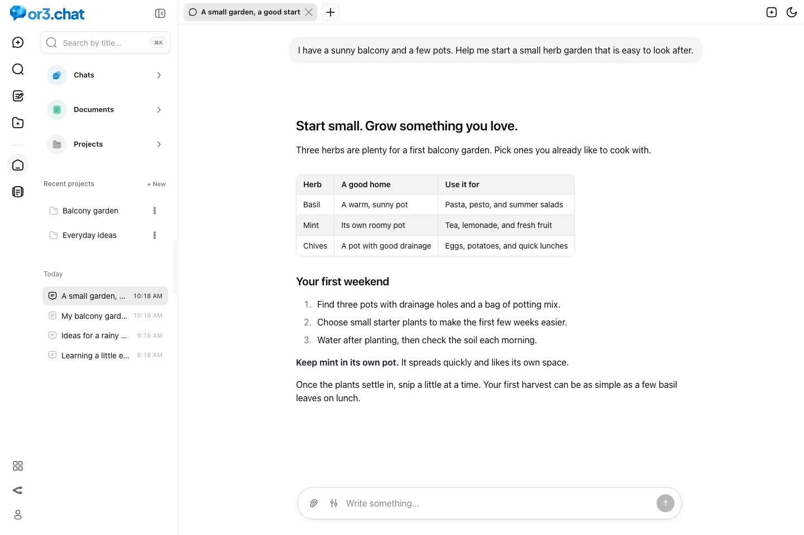
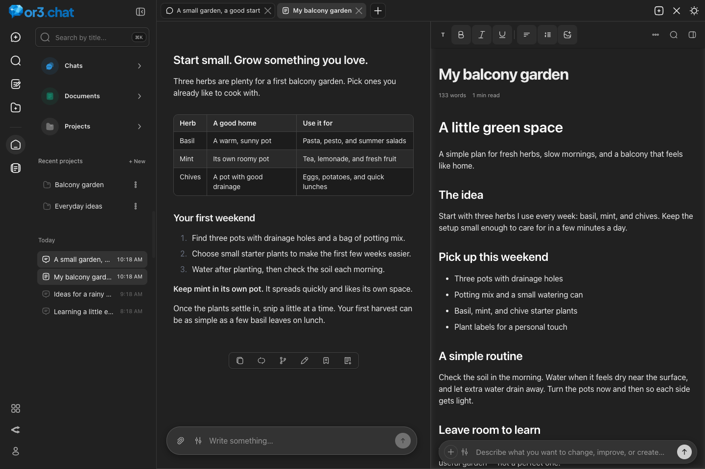

<p align="center">
  
</p>

<h1 align="center">OR3.chat</h1>

<p align="center">
  <strong>Your models. Your workspace. Your way.</strong><br/>
  An open-source AI workspace for chats, documents, and projects.
</p>

<p align="center">
  <a href="https://or3.chat">Website</a> · <a href="https://or3.chat/documentation">Docs</a> · <a href="docs/start-here.md">Setup guide</a> · <a href="https://github.com/Saluana/or3-chat/issues">Report an issue</a>
</p>



OR3 brings models from OpenRouter into one workspace. Ask questions, work on a
project, and turn ideas into documents without jumping between apps. Choose a
clean layout, a retro look, or something more colorful.

Your browser saves your work locally. Use the browser-only app for personal
work, or host OR3 Cloud to add accounts, shared workspaces, and sync across
devices. OR3 is free software; model providers may charge for AI use.

[Get started](#get-started) · [Features](#what-you-can-do) · [Your data](#your-data-and-privacy) · [Customize](#make-it-yours) · [Contribute](#contribute)

## What you can do

- **Chat with different models.** Connect OpenRouter, pick a model, and switch
  when you need a different approach. Responses appear as they arrive.
- **Keep useful context together.** Give a project a brief, add files and notes
  to its Knowledge library, and manage saved project memories.
- **Write alongside your chats.** Open documents in the rich text editor, save
  useful answers, and keep chats and documents side by side.
- **Explore another direction.** Branch a conversation or retry a response
  without losing the original thread.
- **Bring your files.** Attach images and documents, browse saved files, and
  restore deleted items from Trash. Model support varies by file type.
- **Find your work.** Press **Cmd+K** or **Ctrl+K** to search saved work and run
  commands. Use tabs and split panes to keep it in view.
- **Make it feel like home.** Choose Blank, Retro, or Cyberpunk, switch between
  light and dark mode, and adjust colors, fonts, and backgrounds.



*Screenshots show the current app with sample content, captured in October 2026.*

## Get started

### Use OR3 in your browser

Visit [or3.chat](https://or3.chat) and follow the link to the chat app. On an
instance that requires an account, sign in first.

1. Choose **Connect with OpenRouter**, or paste your key under **Use an existing
   API key**. A Cloud host may provide model access for you.
2. Open **Settings → Model catalog** and choose a model.
3. Type a message and send it.

See [Send your first message](public/_documentation/start/first-chat.md) for a
walkthrough. OpenRouter access and an OR3 Cloud account are separate.

### Host your own Cloud

The supported installer needs **Node.js 24.22.1+ (24.x)**, **Docker**, and **Docker Compose
v2**. Run it from an empty directory.

For a private instance on your computer:

```bash
npx @or3/cloud init --local
```

For a public server, point your domain at the server and follow the
[DNS and firewall steps](docs/installation.md#public-vps-with-caddy), then run:

```bash
npx @or3/cloud init --public --domain chat.example.com
```

The installer sets up sign-in, a SQLite database, and file storage. Public mode
also sets up HTTPS through Caddy. You do not need separate database or storage
accounts. Save the generated credentials in a password manager, then remove
the credentials file as instructed.

Use the [installation guide](docs/installation.md) for backups and recovery,
and [Updating OR3](docs/cloud-updates.md) for updates.

### Run from source

Use this path to change the app or build custom extensions. You need **Git**,
**Node.js 24.22.1+ on the 24.x line**, and the **Bun version pinned in [package.json](package.json)**.

```bash
git clone https://github.com/Saluana/or3-chat.git
cd or3-chat
bun install
bun run dev:offline
```

Open the URL printed in your terminal. This starts local-first development
with Cloud features off. No environment file or OR3 account is required.
Connect OpenRouter in the app when you want an AI response.

To build a browser-only site:

```bash
bun run generate:static
bun run preview:static
```

The static files are in `.output/public/`. Serve that folder through a web
server or static host. For Cloud development and custom providers, follow
[Develop from source](public/_documentation/start/development-setup.md).

## Browser-only or Cloud?

Both offer chats, documents, projects, search, and built-in themes.

| | Browser-only | Cloud |
| --- | --- | --- |
| Where work is saved | This browser | This browser, plus the configured server sync and storage |
| OR3 sign-in | Not required | Managed by your host |
| Sync across devices | No | Yes, when enabled |
| Shared workspaces | No | Yes, with access controls |
| Server to manage | No app server; just static hosting | Your own server or an existing host |
| Admin controls | No | Accounts, access, and instance settings |

Saved local work stays available offline. **AI responses need a network
connection.** Cloud sync resumes when you reconnect. Optional Cloud features,
such as server-provided model access and background generation, depend on the
host's setup.

## Your data and privacy

Chats, documents, and files are saved in your browser's local database. Clearing
site data can remove them. A different browser profile or site address has its
own local workspace.

When you ask a model a question, the request and its included context go to the
configured model service. Requests may pass through your OR3 host. Your personal
OpenRouter key is stored in the browser and excluded from workspace sync; it is
sent with requests that use it.

Export your work from **Dashboard → Workspace Backup** before moving instances
or clearing browser storage. Cloud sync shares changes; a backup gives you a
recovery point. See [Back up and restore](public/_documentation/database/backup.md)
for details, and keep downloaded backups private.

## Make it yours

**Themes:** Start with the built-in appearance controls, or
[build a theme](public/_documentation/themes/first-theme.md). Themes can change
colors, fonts, icons, backgrounds, and controls. Installing a new theme requires
an administrator and a rebuild.

**Plugins:** Add tools, forms, saved data, and workspace apps through the
[plugin SDK](public/_documentation/plugins/overview.md). Start with
[Build your first plugin](public/_documentation/plugins/first-plugin.md), or
explore the [example plugins](official-plugins/README.md).

Installable plugins need a Cloud server with sign-in and package loading enabled.
Portable plugins currently run in Chrome and Edge. Static builds can include
source extensions, but do not run the installable package system. Managed Cloud
keeps bundled extensions and hides custom upload and install controls; use an
editable source deployment for those workflows.

## Learn more

| I want to… | Guide |
| --- | --- |
| Choose a setup path | [Start here](docs/start-here.md) |
| Organize a project | [Projects, Knowledge, and Memory](public/_documentation/start/projects.md) |
| Change the look | [Customize your appearance](public/_documentation/themes/customize.md) |
| Install or manage plugins | [Plugin guide](public/_documentation/plugins/install-and-manage.md) |
| Configure a source deployment | [Configuration reference](public/_documentation/cloud/config-reference.md) |
| Find the code for a feature | [Source contributor map](public/_documentation/start/source-map.md) |

Browse the [full docs](https://or3.chat/documentation) or read them
[in this repository](public/_documentation/).

## Contribute

Bug reports, documentation fixes, themes, and code contributions are welcome.
Open an [issue](https://github.com/Saluana/or3-chat/issues) or a pull request.

For code changes, follow [AGENTS.md](AGENTS.md), keep the change focused, and run
the checks that match it. Start with `bun run test:changed` and
`bun run type-check`. The [development guide](public/_documentation/start/development-setup.md)
explains the test lanes and project structure.

## License

OR3.chat is licensed under [GPL-3.0](LICENSE).
