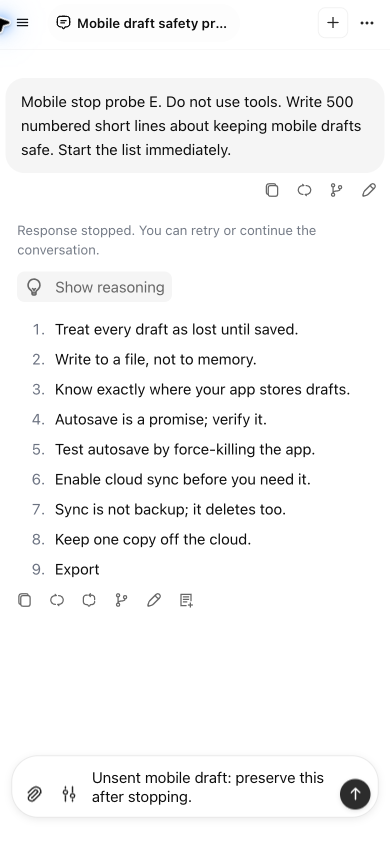

# Chrome mobile and real AI evaluation

October 24, 2026. The requested Chrome round is complete. Installed **Google
Chrome 155** was used through its extension connection; Brave was not used.
`or3-cloud` was checked and upstream fetched before testing: four local commits
ahead and none behind. The production artifact contains `55d47ec7`, including the
theme loading repair already proposed in [PR #306](https://github.com/Saluana/or3-chat/pull/306).

**No new production change was justified by these selected checks.** Real
generation, Markdown/code rendering, typing during generation, stopping, partial
history persistence and draft persistence worked. This round adds evidence and
remaining evaluation details; it does not claim to fix or qualify every area.
No theme, CSS, template, schema, dependency or appearance change was made.

## Method

- Supported production preview at `http://127.0.0.1:3156/chat`, without the
  scripted journey transport. Cloud auth, sync, storage and background execution
  are disabled. The existing Chrome profile and its local workspace remain.
- Blank/light, 390 × 844 CSS pixels, DPR 1, five emulated touch points, 4× CPU.
  CDP network settings: 150 ms latency, 200,000 bytes/s download and 93,750
  bytes/s upload. These apply to browser traffic; server-to-OpenRouter traffic
  is not throttled by the browser.
- Three HTTP-cache-disabled empty-chat loads, then a cache-enabled priming load
  and three cache-enabled loads. Service workers are bypassed for both sets.
  Browser/Dexie data were not cleared. New synthetic test conversations add a
  small amount of local history during the round.
- Performance observers record buffered paint/LCP, input events and long tasks.
  The app-ready diagnostic observes the existing app-init flag and mounted
  editor. Instrumentation is installed after reload, so ready observations can
  be upper bounds, particularly on warm loads. This is not an INP measurement.
- The exact [observer](chrome-mobile/observer.js),
  [capture expression](chrome-mobile/capture-expression.js), JSON receipts and
  screenshots are retained. Run `bun run
  audit-evidence/performance-20261024/chrome-mobile/summarize.ts` to regenerate
  [the summary](chrome-mobile/summary.json) from receipts. This is a manual
  Chrome evaluation, not an additional CI test suite.

The profile differs from the earlier Brave Slow 4G/DPR 3 experiment. These
numbers must not be used as a browser comparison or a new before/after gain.

## Startup results

| Setting | FCP samples (ms) | LCP samples (ms) | Median FCP | Median LCP |
| --- | --- | --- | --- | --- |
| Cache disabled | 1,580 / 1,556 / 1,620 | 8,364 / 8,332 / 8,632 | 1.580 s | 8.364 s |
| Cache enabled | 580 / 592 / 588 | 1,296 / 1,256 / 1,320 | 0.588 s | 1.296 s |

Cold app-ready observations are 7.486 / 7.467 / 7.770 seconds. Warm observations
are 1.429 / 1.375 / 1.455 seconds, subject to the instrumentation limitation
above. The Blank background image is the final largest paint in all six loads.
Warm caching helps substantially, while HTTP-cache-cold startup remains slow under
the selected profile. No new startup optimization was applied in this round.

## Real OpenRouter calls

The user completed OpenRouter authorization in a fresh Chrome tab. Five
foreground calls used the selected **DeepSeek V4.1 Flash 1017** with Low
reasoning. The catalog and [OpenRouter model page](https://openrouter.ai/deepseek/deepseek-v4.1-flash-1017)
list $0.15 per million input tokens and $0.60 per million output tokens. Two
automatic title generations also completed, with safe server timings of 361
and 525 ms; the observed title request uses DeepSeek V4.1 Flash's nitro variant.
No further paid calls were made after the stopped-response check.

| Probe | First visible answer | UI settled | Result |
| --- | --- | --- | --- |
| A: three short numbered lines | 2.690 s | 3.028 s | Completed; answer and usage receipt survive reload. |
| B: heading, table and JavaScript | 4.823 s | 5.459 s | Completed; table and highlighted six-line code render. |
| C: 300-item output | Timing excluded | Timing excluded | Completed before manual Stop; typing during generation worked. |
| D: 500 repeated lines | Timing excluded | Timing excluded | Completed before manual Stop. |
| E: isolated partial-output Stop | 8.076 s | 8.602 s | Stopped; 299 answer characters, stopped status, Continue control and unsent draft survive reload. |

Timing starts at the captured Send click. First visible answer is rendered text,
not a provider first-token metric: reasoning can arrive first. Probe A's HTTP
stream request begins 972 ms after the click; its first body bytes arrive 1.356 s
after the request, and visible answer text follows those bytes by 362 ms. That
last interval includes reasoning, buffering and rendering; it is not isolated
render cost. The payload selects `deepseek/deepseek-v4.1-flash-1017`, streaming,
Low reasoning, 18 tool schemas and a 65,536-token allowance. Prompts request
short replies except for the deliberate stopping/long-output probes.

Visible receipts report A: 4,371 prompt / 84 completion / 42 reasoning tokens;
B: 4,466 / 616 / 487; D: 6,765 / 3,878 / 378, including 4,608 cached prompt
tokens. Reasoning counts are part of completion counts, not extra totals. The
display rounds their tiny costs to `$0`; this does not establish zero billing.
Exact total OpenRouter billing was not read back. A $0.10/one-day authorization
was prepared, but the user completed a fresh-tab flow, whose saved limit was not
independently verified. No key, authorization header or full request payload is
included in the receipts.

The node-count observer is unsuitable for timing C/D once virtualization removes
older message rows. Those raw diagnostics remain, but are excluded from latency
conclusions. Probe E starts in a new chat with no older assistant nodes and also
uses an independent DOM wait before Stop. B's CDP event buffer was truncated;
its HTTP timing is unavailable. A's response body could not be retrieved through
CDP, so token figures come from the app's visible receipt. Its `ERR_ABORTED`
network-close event does not indicate a failed result: the shared SSE parser
cancels its reader during cleanup, and the completed answer/receipt persisted.

## Cleanup and artifact status

Chrome is restored to normal CPU/network speed, normal HTTP caching and service
worker behavior, with viewport/touch emulation removed. A final reload removes
the injected observers. [Cleanup proof](chrome-mobile/cleanup.json) records the
normal 1,512 × 716 viewport, DPR 2, zero touch points and absent instrumentation.
The authorization layout problem was confined to the testing setup; the user
completed authentication in a fresh tab. No authentication blocker remains.

The preview remains running on port 3156 for review. Chrome is left on **Mobile
draft safety practices**, showing the stopped result and retained draft. The
other synthetic conversation is **Mobile performance probe A**. The pre-existing
**Chrome performance verification** chat is preserved. No workspace data or
credentials were deleted. This report is review evidence, not a deployment.

The embedded phone proof was recaptured through a CDP viewport clip after a
separate reload at normal CPU/network speed. The connector's other emulated
screenshots scale a wider browser canvas and are diagnostic frames; they are
not pixel-comparison evidence. The clip changes no page content or styling,
and phone emulation was cleared again afterward.

## Still needs evaluation

1. **Cold startup:** the large initial module graph and late Blank artwork still
   dominate first-visit loading. Investigate resource scheduling with matched
   before/after builds; avoid unconditional image preloads that penalize populated
   chats or other themes. Existing complete-JavaScript/precache budget failures
   from the previous round remain open.
2. **Admission and rendering cost:** A has roughly 972 ms before the HTTP stream
   request. Separate context preparation, tool schemas, tokenizer work, first-use
   renderer imports, reasoning and rendering with a dedicated trace. This round
   does not resolve the earlier roughly 33 ms streaming-frame p95 at 4× CPU.
3. **Long-output measurement:** replace the node-count timing assumption with
   request/row identity before drawing benchmark conclusions across virtualized
   history. C/D demonstrate completion, not a reliable latency comparison or
   sustained heap/frame-rate qualification.
4. **Recovery and providers:** actual network loss during a paid stream, provider
   429/5xx, paid retry/Continue, auth expiry, background execution, sync and account
   switching are not qualified by these successful local foreground calls.
5. **Devices, scale and delivery:** physical Android/iOS, Safari/WebKit, long
   sessions, large-workspace heap use, PWA update/offline/quota behavior, font build
   reproducibility and deployed HTML compression remain open in the broader
   [stability inventory](../performance-20261023/STABILITY-STATUS.md).

No production or test-suite source changed, so existing unit/typecheck/build
lanes were not repeated. Verification for this round consists of the actual
Chrome journeys above, receipt/summary validation, secret-pattern review and
final diff checks. The prior PR's code validation retains its original scope.
