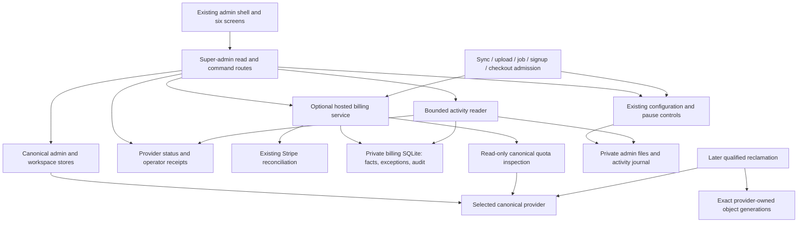

# Design

## Overview

Add a thin support interface over the existing canonical stores, hosted billing service, storage accounting, configuration manager and operations adapters. Build six screens using the [saved visual references](requirements.md#assumptions), correcting their example data and semantics. Implement stages A–C without enabling physical cleanup or changing the commercial offer; qualify D and E independently.

The key simplification is one source of truth per domain: canonical stores own identity/membership; Stripe reconciliation owns payment facts; explicit support records own exceptions; provider accounting owns usage; the existing configuration/controller paths own settings. Pages combine projections of these facts. They do not make authorization decisions.

## Architecture



| Component | Responsibility | Requirements |
|---|---|---|
| C1 Admin screens | Render operational state and explicit commands in the existing shell | R1, R3, R6, R9–R13 |
| C2 Customer inspection | Read canonical users, memberships and bounded operational metadata | R2–R4 |
| C3 Billing support | Read payment facts; reconcile and resolve reviews; persist support exceptions | R4, R5, R7, R9 |
| C4 Storage accounting | Explain admission totals and policy limits; preview quota changes | R4, R6, R7 |
| C5 Admission controls | Enforce effective entitlements and narrow operational pauses | R4, R7, R8, R11 |
| C6 Configuration view | Project effective settings, sources, pending changes and supported application paths | R10, R11 |
| C7 Health/recovery view | Present provider observations and trustworthy backup/recovery receipts | R4, R9, R12 |
| C8 Administrative activity | Persist domain-local audit and combine bounded historical reads | R5, R7–R9, R13 |
| C9 Provider reclamation | Coordinate eligibility, physical deletion and accounting release | R6, R14 |
| C10 Offer configuration | Preserve historical subscription/trial promises during later offer changes | R15 |
| C11 Qualification | Own failure cases, repeatable evidence, documentation and release checks | R1–R16 |

### Existing seams to extend

- [Admin shell](../../app/layouts/admin.vue), [admin data composable](../../app/composables/admin/useAdminData.ts), [owned admin extensions](../../app/composables/admin/useAdminPlugins.ts). Add Customers and Storage; retain `/admin/system` for Health & recovery and add `/admin/activity`. Use existing `/admin/advanced` rather than a second configuration route. Keep Hosted billing registered by its optional module.
- [Admin route guards](../../server/admin/api.ts), [principal resolution](../../server/admin/context.ts), [mutation guards](../../server/admin/guard.ts). Inspection uses `superAdminOnly: true, superAdminCookieOnly: true` so session resolution cannot provision unrelated workspaces. Actions carry explicit target IDs, not the active chat workspace.
- [Admin store types](../../server/admin/stores/types.ts), [canonical identity types](../../server/auth/store/types.ts), [existing search route](../../server/api/admin/search-users.get.ts) and [SQLite admin store](../../../or3-provider-sqlite/src/runtime/server/admin/stores/sqlite-store.ts). Current `getUser()` resolves an external identity, not an internal ID; do not call `getOrCreateUser()` to work around that gap.
- [Billing store](../../packages/hosted-billing/runtime/server/store.ts), [service](../../packages/hosted-billing/runtime/server/service.ts), [trial claims](../../packages/hosted-billing/runtime/server/trial.ts), [quota](../../packages/hosted-billing/runtime/server/quota.ts), [admin route](../../packages/hosted-billing/runtime/server/routes/admin.ts), [registration](../../packages/hosted-billing/runtime/admin.client.ts). Trial hardening was committed as `827da946` during planning; recheck the baseline before implementing.
- [Cloud policy](../../server/cloud/access.ts), [hosted route classification](../../packages/hosted-billing/runtime/server/access.ts), [hosted middleware](../../packages/hosted-billing/runtime/server/middleware.ts). Preserve current policy cleanup handles, client deadline handling and admitted-work exceptions.
- [Provider adapters](../../server/admin/providers/types.ts), [system status](../../server/api/admin/system/status.get.ts), [provider action route](../../server/api/admin/system/provider-action.post.ts), [FS usage](../../../or3-provider-fs/src/runtime/server/storage/fs-storage-usage.ts), [S3 usage](../../../or3-provider-s3/src/runtime/server/storage/s3-storage-usage.ts).
- [Configuration classification](../../shared/admin/configuration.ts), [metadata](../../server/admin/config/config-metadata.ts), [manager](../../server/admin/config/config-manager.ts), [revisioned site settings](../../server/admin/config/site-settings.ts), [restart configuration](../../shared/server/restarts/configuration.ts), [operator client](../../server/admin/update/operator-client.ts).
- [Dormant generation contract](../../server/storage/gateway/generation-lifecycle.ts), [SQLite generation coordinator](../../../or3-provider-sqlite/src/runtime/server/storage/sqlite-generation-upload-coordinator.ts), [retained accounting migration](../../../or3-provider-sqlite/src/runtime/server/db/migrations/026_retained_storage_usage.ts). The existence of these types is not evidence cleanup can be enabled.

## Components and Interfaces

### C1: Screens and interactions

Use Nuxt UI tables, tabs, cards, forms and the existing confirm dialog. Extract shared status/reason rendering only once used in two screens. No dashboard component framework, alternate design system or new client state store.

| Screen | Initial contents | Follow-on contents |
|---|---|---|
| Customers | Bounded search/list; account link; payment vs access | Server-wide state filters and storage summaries |
| Account | Identity, owned/member workspaces, access reasons, payment, explicit refresh/review | Detailed storage, grants, trial exception, pause controls, sync observations and history |
| Storage | Account allowance + charged/reserved bytes; deleted-retained notice | Quota impact preview, per-workspace inspection, upload policy, explicit physical scan, later qualified cleanup |
| Hosted billing | Keep current allowance form; review and reconciliation tabs | Integration health/outcomes; later accepted-offer settings |
| Overview | Attention list and supported counts | Provider checks, background recovery and backup coverage |
| Advanced settings | Effective/source/pending/application columns | Resource grouping and links to supported editors |

Billing tabs can link to the core account page; the core page fetches billing only when the build advertises that module. Keep module routes/components out of ordinary/static bundles using the existing Nuxt module boundary. Do not introduce a general-purpose billing extension bus for one module.

Action dialogs show target ID, current state, requested change, expiry/reason and expected effect. After a successful command, reload that account/section. A 409 preserves form input but requires reviewing fresh state. A timeout presents an operation ID and checks its result before offering retry. Avoid optimistic access/financial success messages.

Planned HTTP surface (reuse an existing endpoint where it already owns the operation):

| Surface | Owner and behavior |
|---|---|
| `GET /api/admin/customers`, `GET /api/admin/customers/:id` | C2 canonical list/inspection; super-admin-cookie-only; no provisioning |
| `GET /api/admin/hosted-billing/accounts/:id` | Optional C3 payment/access/support projection; no Stripe calls |
| `POST /api/admin/hosted-billing/accounts/:id/refresh` | C3 targeted reconciliation with operation ID |
| `POST /api/admin/hosted-billing/accounts/:id/review` | C3 explicit review decision with review revision, operation ID and reason |
| `POST /api/admin/hosted-billing/accounts/:id/support` | C3 bounded discriminated support command, never arbitrary field patching |
| Existing `/api/admin/hosted-billing` plus quota preview route | C4 global allowance settings and impact; account/workspace changes use their owning commands |
| `GET /api/admin/storage` and existing provider-action route | C4 logical summary and explicit provider inspection; physical work never hidden behind GET |
| `GET/POST /api/admin/system/pauses` | C5 revisioned concrete pause controls |
| Existing system/config/status endpoints; `GET /api/admin/activity` | C6–C8 effective configuration, checks/receipts and bounded history |

Register optional billing routes through the existing module, extending its current `/api/admin/hosted-billing` namespace. All POSTs validate host/origin/intent, authenticated actor, body limits and applicable rate limits. Add read-by-operation-ID within the owning namespace for commands that can outlive a response. Do not add endpoints for direct Stripe subscription/refund edits or arbitrary provider actions.

### C2: Canonical inspection and bounded listing

Add optional read methods to the existing `WorkspaceAccessStore`, with capabilities implemented first by SQLite: bounded `listCustomers`, `getCustomerById`, `getCustomerWorkspaces` (including deleted owned workspaces), and batched lookup by internal IDs. These read canonical tables through the provider. Existing search behavior can remain for its existing callers; no new identity table or provisioning call.

For All/search, page canonical users then enrich at most 50 IDs. For hosted paid/trial/review filters, page matching billing IDs and resolve canonical metadata in a batch; return an opaque continuation and do not claim a page-local count is a global total. Filter-out/missing canonical IDs must not become invented customers; counts disclose their population/coverage. Never load all users to filter in JavaScript. Non-SQLite providers get existing search where supported and explicit unavailable detail capabilities until they implement these reads.

Sync diagnostics initially label existing device cursor timestamps as server contact only. Add a small provider-owned observation record for last successful completed sync request and recent classified failure, keyed by canonical user/workspace, when the existing data cannot prove it. Record safe operation/error codes, not payloads. A failed observation write must not turn an already committed sync into a client-visible failure; report incomplete diagnostics. Instrument the actual authenticated gateway completion boundary, including successful no-op requests, and make that meaning visible. Keep only the latest success/failure per user/workspace initially rather than adding a telemetry event stream.

### C3/C5: Read-only entitlement and support commands

Extract a pure evaluation function from the existing status calculation. `BillingStore.findAccount(userId)` performs only SELECT and returns null for an absent row. `inspectAccount()` never invokes `account()`, `claimTrial()`, `exclusive()` or Stripe. User-facing trial claims continue in their existing authenticated boundary, with no eligibility changes.

Illustrative internal contracts (adapt names to established types; they are not a public SDK):

```ts
type AccessSource = 'paid' | 'renewal_grace' | 'trial' | 'support_trial' | 'grant' | 'none';
type AccessBlock = 'review_required' | 'account_paused' | 'entitlement_expired' | 'cloud_not_started';
type Inspection<T> =
  | { status: 'available'; value: T; observedAt: number }
  | { status: 'unavailable' | 'error'; code: string };
interface AccessExplanation {
  allowed: boolean;
  source: AccessSource;
  expiresAt: number | null;
  blockers: AccessBlock[];
  storageLimitBytes: number;
}
type SupportCommand =
  | { kind: 'grant'; expiresAt: number; storageBytes: number }
  | { kind: 'revoke_grant' }
  | { kind: 'extend_trial'; expiresAt: number }
  | { kind: 'storage_bonus'; bytes: number; expiresAt: number | null }
  | { kind: 'pause_account'; expiresAt: number | null }
  | { kind: 'resume_account' };
interface CommandEnvelope<T> {
  operationId: string;
  expectedRevision: number;
  reason: string;
  command: T;
}
```

Evaluation order:

1. Record payment/subscription facts independently, including grace and cancellation. Never represent a grant as a paid invoice.
2. Find an underlying entitlement: valid paid period/grace, otherwise eligible original/extended trial, otherwise unexpired grant. Original trial/eligibility records remain unchanged. Trial extension only applies when no existing paid subscription would make the action inappropriate.
3. Apply review hold and account hosted pause as blockers, even if an entitlement exists. An extension or ordinary grant never clears a hold. Show all blockers, not just the first.
4. Allowed storage uses the paid allowance, trial allowance, or explicit grant allowance for the selected source, plus an unexpired bonus. A grant is fallback access, not a way to raise an active paid/trial allowance; use the bonus for that. Show nominal allowance separately from current admission permission so a review does not disguise existing storage.
5. Per-operation policy additionally checks provider availability, membership, owner/uploader state and independent pauses/caps. Use a shared reason-producing check at the existing enforcement boundary; a preview is never an authorization token.

All account commands reuse `BillingStore.exclusive()`. Recheck lease ownership, revision and time immediately before committing. Database transactions remain short; never hold a SQLite transaction across a Stripe request. Increment one account support revision for payment/support/review changes relevant to admin decisions. Use the existing client/session access deadline and stream rechecks; adding a grant must not let streams outlive revocation checks.

Update the existing `BillingStatus` consumer contract together with evaluation: customer BillingPanel/banner, `useBilling`, session `cloudAccess`, job capability hooks, sync scheduling and quota admission must all recognize support access and its deadline. Add an explicit grant presentation state/source instead of labeling it paid or leaving `allowed: true` paired with an expired UI. A support trial still exposes the original deadline and extension separately. The `paid` capability remains derived from confirmed paid state only; a grant can supply hosted access but never invent that capability.

Review resolution is two steps in one account workflow: refresh the current Stripe facts, then confirm the exact open review set/revision with a reason. Resolve under the account lease; revalidate if the snapshot changed. A newly discovered risk/conflicting subscription requires a new review, not silently resolving the just-created hold. Record each risk source identity once, including old redeliveries after webhook dedup retention expires. Legacy `review_required=1` becomes a visible unknown-reason review during migration. Retain the existing boolean only as the enforcement projection updated transactionally with review records.

### C4: Storage and constraint explanation

Extend the existing account quota query rather than writing a second formula. Read totals and workspace contributions from the same canonical SQLite read transaction/snapshot:

`chargedBytes = retainedBytes + SUM(max(0, largest unresolved intent bytes - retained bytes for the same workspace/hash))`.

Use both active and expired unresolved intents, matching current admission. Do not double-count identical intents or bytes already retained. Distinguish retained active, deleted-retained and unclassified where canonical metadata can support the split; unavailable subcategories must not change the authoritative total. Keep logically charged reservations separate from physically measured objects.

Return which constraint prevents a proposed upload and all other evaluated constraints. Example: owner has 18 GB available but selected workspace is at its 10 GB cap. A diagnostic with no proposed file can explain current capacity but cannot assert that every MIME/size combination is admissible. Uploaded client MIME is not evidence of actual content; preserve provider verification.

Preserve existing retry/queue classifications such as `storage_quota_exceeded`; add a typed constraint detail rather than accidentally changing how clients defer an upload. Never substitute a device-download-cache limit for a server Cloud upload or account quota.

Quota previews are bounded SQL aggregate queries with paginated affected accounts. Bind the preview to proposed values and policy revision; recheck the target account for local changes. Usage can change between preview and save, so display the measurement time and explain that the final admission always checks live usage. Do not freeze uploads merely to keep an advisory count exact.

Physical inspection uses existing provider `storage.usage` actions with explicit workspace/provider scope and existing pagination/budgets. Store a last completed summary only if needed to display an expensive physical observation on later visits; never label a partial scan deployment-wide. If the provider cannot resume/complete a deployment-wide inspection within its existing API, show unavailable or a link to provider metrics rather than inventing a global bucket scanner. No physical scan during page load.

### C5: Pause enforcement

Store deployment-wide controls in a small private revisioned file using the locking/atomic rename pattern already used for site settings. Store account-specific controls with support state in billing for hosted builds. Keep the fields concrete: uploads, background admission, registrations and checkout; account scope additionally supports uploads/background and an all-hosted pause. No rule-expression language.

Check deployment/account upload pause before presigning; check jobs before durable admission; check registration at canonical signup/invite acceptance where a new account would be created; check purchases before creating or returning an open checkout session. Existing checkout sessions can still be completed at Stripe, and previously issued upload URLs can still work until expiry. Continue processing their authentic webhooks/commits. Do not disable download, portal, password recovery, existing-account sign-in or generation abort/completion routes. Existing registration mode still applies after a pause expires.

Expiry is evaluated per request; no timer service. A corrupt/unreadable policy file fails new applicable admissions with an unavailable error, not an implicit resume. Reads/exports and recovery remain usable. Simple request-scoped reads come first; optimize only if admission measurements show a problem.

Represent each pause as `null` when inactive or `{ startedAt, expiresAt: number | null, actionId }` when active; a null expiry means indefinite, not disabled. The audit record owns the reason and actor. At the storage boundary use explicit enabled fields plus nullable expiry where needed so permanent and inactive states cannot be confused.

### C6: Configuration and resource controls

Extend the current metadata/projection, not the raw `.env` writer. Supply resolved effective values from actual runtime/build/site-setting owners, their source and any pending controller revision. Distinguish settings applied on the next server request from public settings visible after page refresh. Infrastructure remains read-only unless the existing controller has a qualified writer.

Use two separate fields: `application` (immediate/refresh/restart/rebuild/migration/unavailable) and `editable` with a reason. Enforced BYOK is not “unavailable”; it is effective and locked by hosted policy. A database-provider change needs migration, not merely restart. Provider capabilities/build inclusion are facts, not runtime toggles.

Group existing resource settings and link to their owning forms: AI credentials, background concurrency/timeouts/admission, endpoint rate groups, workspace model limits, features, plugin controls and registration. Do not add replacement settings with subtly different semantics. Each newly editable setting needs a verified consumer and rollback/application behavior before its UI is enabled.

### C7: Health and backup evidence

Extend adapter status with optional structured check information: result, checkedAt, check kind/scope and safe diagnostic code. Existing enabled/configured fields remain separate. Cheap checks can run on explicit refresh with timeouts; unavailable providers produce section errors, not blanket page failure. Overview aggregates local billing/accounting queries and these observations; it never globally reconciles Stripe.

Read existing background recovery state and the managed operator's public status/receipts. The web application must not receive a Docker socket, arbitrary filesystem paths or a shell tool to gather missing evidence. Add only a read-only receipt projection to the existing operator protocol when necessary. Source installations without an operator report unknown and point to the documented manual verification path.

Backup rows require evidence for each component and capture time. Billing coverage includes trial decisions/hash key, customer mappings, support state, reviews and audit. Credential key escrow and off-host copies need their own evidence; “backed up on this host” is not “independently stored.” If evidence cannot be verified, label it operator-reported or unknown. Recovery-test time is not inferred from app health. No automatic restore action is added by this plan.

### C8: Activity and billing outcomes

Billing commands write their audit record in the same SQLite transaction as state. Non-billing admin actions use a small append-only private JSONL journal under the existing admin data directory with the existing interprocess lock pattern: durable intent before mutation, durable outcome after. A crash between them remains “incomplete”; do not claim cross-store atomicity. Include stable operation IDs and consult the authoritative owner/revision on retry. Do not replay non-idempotent operations blindly.

The activity reader merges bounded pages from the billing audit, core journal and existing operator audit/receipts. Use per-source cursors and stable ordering by timestamp/source/id. Start with bounded file scans; only introduce segmented files/checkpoint indexes if the qualification fixture exceeds the request budget. History never claims completeness before its recorded start. Mutations fail before state change if mandatory audit intent cannot be written; post-change receipt failure is explicitly incomplete and recoverable.

Keep billing processing outcomes separate from the successful webhook dedup table. Validate signatures before recording an event identity. Persist classified failures, last success and attempt counts; sanitize error data and retain no raw payload. Use a bounded retention window (initially 30 days, capped pruning per write/read maintenance) for diagnostics, while unresolved reviews and administrative decisions remain retained. Do not implement a bespoke webhook retry queue; Stripe retries and targeted refresh remain the recovery paths.

### C9: Reclamation (stage D only)

First qualify SQLite + filesystem; then independently qualify SQLite + S3. Extend the existing generation contract/coordinator and provider adapters. Current retained-storage triggers never decrement on deletion; accounting release needs an explicit provider migration and independently verified completion, not a dashboard UPDATE.

1. Dry run produces bounded candidate IDs, exact generations, scope, retention cutoff, estimated reclaim and blocked reasons; no deletion capability is enabled yet.
2. Under canonical coordination, claim an immutable generation after proving no references, no unsafe tombstone/GC interaction, no live upload/publication and sufficient retention. Unknown or oversized reference inspection blocks.
3. Record a durable irreversible generation barrier before physical deletion. A worker lease must never reopen that generation to delayed writers. Old mutable hash paths and unqualified legacy objects remain excluded.
4. Delete only the provider-owned exact generation; filesystem paths cannot be supplied by the caller. S3 needs exact immutable key/version semantics and must address versioning/multipart remnants; deleting a current pointer alone is insufficient.
5. Verify removal and then complete idempotent accounting release in canonical storage. An active/expired intent is not released merely because its timestamp elapsed; reconcile it to proven absent or retained exact bytes.
6. Restart can resume claimed work without double-decrementing. Admission, file restore and ownership-transfer paths must respect the barrier. Recreated identical content uses a new generation with fresh accounting.

Only after crash/race/restore qualification may the provider advertise cleanup. Add bounded opt-in periodic retained-file cleanup using existing scheduling/operations infrastructure after the manual primitive works. Keep expired-account metadata/data purge disabled pending an explicit retention policy and separately authorized deletion workflow. A settings form must not promise that purge exists.

### C10: Offers (stage E, before price changes)

Seed a single offer from the current fixed offer. Separate the price used for new checkout from accepted existing prices. Resolve a subscription's offer from its actual item price; use that same accepted price when validating paid invoice coverage. Continue current account/customer ownership checks and bounded invoice-history behavior.

Store the matched offer on the billing account after successful reconciliation. Existing customers remain on accepted historical offers; retired-for-new-purchase does not mean rejected-for-reconciliation. Freeze trial duration on claim, never recompute existing deadlines. Trial eligibility fingerprints/decisions survive offer changes. Conflicting matches become reviews.

Default paid allowance edits apply to a clearly named cohort/offer with impact preview; a new offer does not silently rewrite existing offer allowances. No coupons, seats, metered billing, migration wizard or bulk Stripe subscription changes are needed. Keep the installed Stripe client/API contract and existing Checkout/portal flow; dependency upgrades are separate work under the user's narrow scope.

## Data Models

Use additive, versioned migrations in each owning database; back up before applying. Do not run an old application writer concurrently against a schema whose semantics changed. Match each store's existing timestamp units explicitly; billing milliseconds and provider lifecycle seconds must not be mixed.

| Owner | Minimal change | Reason / query |
|---|---|---|
| Canonical provider | Optional bounded customer reads over existing users/workspaces/memberships; no copied identity | Directory and account lookup; inspect query plans before adding indexes |
| Billing account | Admin state revision; last reconciliation time/outcome; later matched offer ID | Stale-command protection and health; indexed user ID already exists |
| `billing_support` (new) | One row/user: revision, grant expiry/bytes, trial extension deadline, storage bonus/expiry, account pause/expiry and upload/job pause expiries | Concrete override state; reasons/actors in linked audit, no generic policy engine |
| `billing_reviews` (new) | Review ID, user ID, kind, unique source identity, opened/resolved time, decision and resolving action ID | Review queue and late-event dedup; index open state/time and user/time |
| `billing_admin_actions` (new) | Unique operation ID, user target, actor, kind, reason, time, redacted before/after, outcome | Atomic audit/idempotency; target/time and time indexes for account/global pages |
| `billing_processing_outcomes` (new) | Event or refresh-operation ID, optional user, kind, attempts, last attempt, success/failure, safe error code | Recent failures, retry visibility; timestamp/result indexes after query-plan check |
| Canonical sync observation (if needed) | User/workspace key, last completed success time/type, latest failure time/code | Durable last-observed diagnostics, not a full telemetry log |
| Private admin directory | Revisioned pause settings; append-only activity journal | Reuse existing persistence/locks without adding a second database to non-billing deployments |
| Provider generation tables | Extend existing generation completion/accounting state and migration guards | Only D; crash-safe deletion/accounting ownership |
| `billing_offers` (new, only E) | Offer ID/version, unique Stripe price ID, amount/currency/interval, storage bytes, trial days, current/grandfathered/retired state | Recognize historical prices; one current checkout offer enforced transactionally |

Audit values use explicit field allowlists, not arbitrary object serialization. Store support expiry and mutation reason in a way that allows every effective override to link back to its originating action. No trial fingerprint values, IPs, secrets or Stripe raw objects enter support DTOs.

## Error Handling

Reuse H3 errors and existing client error rendering; do not introduce a Result framework throughout the app. Typed sections distinguish unavailable from failed. Command responses have stable codes plus safe messages and operation IDs.

| Failure | Behavior |
|---|---|
| Unauthorized/cross-scope request | Existing 401/403/host gate; no customer details before authorization |
| Malformed ID, amount, reason, date or pagination | 400; validate safe integers and finite times before writes |
| Missing canonical account | 404; no billing or identity provisioning |
| Unsupported provider capability | Section unavailable; action disabled and server rejects it |
| Revision/review conflict | 409 with refresh guidance; no mutation or silent merge |
| Account lease busy/lost | Existing 503 + Retry-After; no stale commit |
| Stripe timeout/failure | Safe recorded failure; preserve conservative hold and last confirmed facts; no success marker |
| Invalid/missing accounting | 503 for admission; unknown for inspector, never zero/unlimited |
| Audit/storage disk full | Abort atomic commands; non-atomic interrupted operations retain durable intent and are shown incomplete |
| Cleanup partial failure | Keep claim and charge; resume exact operation after checking authoritative state |
| Expired signed URL/checkout or stale browser form | Re-evaluate current policy; preserve existing bounded completion rules and idempotency |

## Testing Strategy

C11 follows [R16](requirements.md#r16-repeatable-verification-and-staged-delivery). Write the failing behavior/contract coverage before the implementation slice. Prefer extending canonical E2E fixtures and producing a repeatable receipt, not creating a second test harness. No source-string assertions or tests that just mirror a DTO. Focused integration tests are justified for races/crashes that a browser cannot control reliably; enumerate those failures before writing code.

| Primary owner/boundary | Scenarios | Requirements |
|---|---|---|
| Existing admin-auth E2E + customer UI | Super-admin versus workspace-admin; no trial/account/workspace provisioning on GET; no content leakage; direct-route denial; keyboard/mobile/theme captures | R1–R3 |
| Existing hosted-billing E2E | Paid/review/expired/denied-trial/never-started accounts; grants and expiry; paid facts unchanged; shared-owner cap; Free Local/download/export/abort preserved | R4–R8 |
| Billing store/service integration | Two admins, lease loss, webhook/review race, duplicate command/event, failure before/after commit, stale revisions, denied trial preservation | R5, R7, R9, R13 |
| Existing quota integration + SQLite stress | Concurrent uploads across owner workspaces; active and expired reservations; dedup; smaller workspace cap; bonus expiry; impact preview | R4, R6–R8 |
| Existing Stripe sandbox runner | Real reconciled paid invoice, renewal grace, refund/dispute hold, review resolution, replay and older accepted price when E lands | R5, R9, R15 |
| Admin/config/provider tests and E2E | Resolved-default/source accuracy, enforced BYOK, unsupported writes, pause admission, partial/stale health, backup coverage unknown versus verified | R8, R10–R12 |
| Activity boundary | Atomic billing audit; journal crash leaves incomplete; bounded multi-source filtering; secret redaction | R13 |
| Installed FS/S3 lifecycle harnesses | Dry run unchanged bytes; references/active uploads block; crash at claim/delete/complete; delayed publisher; exact version delete; once-only release; backup restore and repeated cleanup | R14 |

Verification commands available today:

```sh
bun run test:e2e:admin-auth
bun run test:e2e:hosted-billing
bun run test:hosted-billing
bun run test:e2e:hosted-billing:sqlite-stress
bun run type-check:hosted-billing
bun run type-check
# Disposable Stripe sandbox only; inspect runner inputs first, never live keys.
bun run test:e2e:hosted-billing:stripe
# Provider/lifecycle stages only.
bun run test:e2e:file-backup:cloud
bun run test:e2e:file-backup:s3
```

Run targeted files while implementing; one relevant-suite/typecheck pass per coherent stage. Run `bun run test:full`, build and the affected installed-provider checks for final cross-cutting/security/schema qualification, not after every edit. Static/non-billing build exclusion must be exercised whenever module imports/routes change. Before any release use [releasing.md](../../docs/releasing.md), including the required fixed profile and exact published dependencies.

Retain each stage's command/environment manifest, redacted assertion receipt, screenshots for the six pages/states, and browser trace on failure under the existing `output/` evidence conventions. Suggested diagnostic load fixture: 10,000 canonical accounts and 20,000 workspaces; 50-row local read endpoints should stay within a 1-second server-side budget on the recorded reference host. Count provider/Stripe calls to prove page loads do no physical scans or automatic Stripe calls. If the budget fails, collect query plans before choosing an index/summary cache. This is a qualification target, not an invented production SLA.

## Design Decisions

1. **Ship support before advanced operations.** A ends with a useful read-only inspector plus audited refresh/review. B adds account corrections/storage/pauses. C completes the six-screen operational experience. D/E cannot silently delay or weaken A–C.
2. **Reuse stores and optional capability reads.** A parallel customer database would drift from membership/ownership. Direct canonical SQLite reading remains limited to the already-supported quota path; broader customer reads belong to the canonical provider.
3. **Pure access calculation, explicit commands.** Removing inspection side effects and sharing evaluation reduces drift. Avoid a configurable policy graph or general support workflow engine.
4. **Separate facts from exceptions.** A concrete support row plus audit is smaller and safer than pretending to edit payment/trial history. Access pause never deletes data.
5. **Audit at the owner, merge at read time.** A central distributed transaction/outbox service is unnecessary. Billing is atomic locally; other owners expose explicit incomplete states for crash recovery.
6. **Use data already available before collecting more.** One sync summary per account/workspace, bounded outcome records and real backup receipts are sufficient. No full telemetry warehouse, periodic Stripe sweep or dashboard bucket crawler.
7. **Preserve provider safety boundaries.** Reclamation is coordinated provider work, not a reset button. Legacy objects remain retained until separately qualified; automation comes after safe manual operation.
8. **No incidental dependency upgrade or pricing/tax migration.** Continue existing Stripe Checkout, webhooks and portal. Confirm external API contracts against current official docs when implementing an API change; no new payment product is needed for support tools.

## Risks & Mitigations

1. **Moving source baseline:** trial claims/accounting advanced to `827da946` during planning. Record the implementation SHA and diff first; carry forward stronger eligibility/reservation rules and never restore the old assumptions from images.
2. **Incorrect entitlement or concurrent review release:** use the same evaluator as enforcement, account lease, revisioned open-review set, atomic audit, and race/replay evidence before enabling actions.
3. **Storage loss or undercharging:** no counter reset, no expiry-only release; maintain exact-generation barriers and independently verify deletion with crash/retry tests for each provider pair.
4. **Misleading health/configuration:** missing observations remain unknown; resolve actual configuration sources and require component-specific backup evidence, including billing and credential recovery coverage.
5. **Scope growth and optional-build coupling:** stage the work, keep existing routes and admin primitives, avoid a new role/registry/service, and qualify non-billing/static builds and published provider versions before each affected release.
