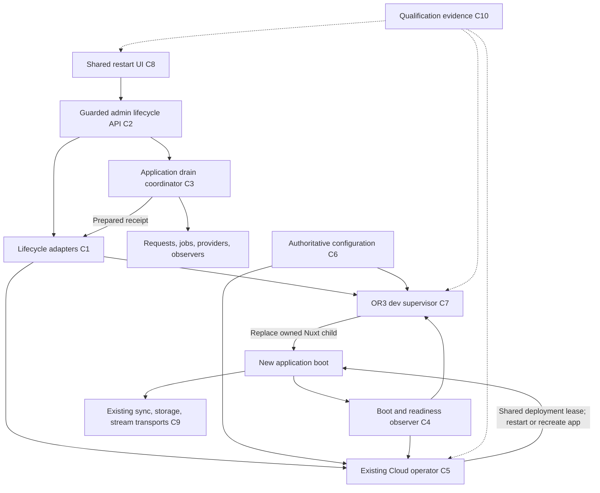

# Design

## Overview

Replace the dashboard's delayed exit with a supervised lifecycle operation. The application prepares active work; a controller that survives the application owns process replacement and verifies the new boot. Managed deployments reuse the existing Cloud operator and deployment lease. Development extends OR3's existing launcher into a persistent supervisor. The default is to wait for active execution, cancel before termination if it cannot finish, and preserve local client work throughout the outage.

Implement ordinary restart first. Add activation of explicitly supported saved settings through the same operation. Retire the in-process rebuild endpoint; managed code updates continue through the existing update system. No new deployment service, database, general command runner, or public restart daemon is needed.

The October 17 audit found these concrete gaps:

| Evidence | Consequence | Planned correction |
| --- | --- | --- |
| [server-control.ts](../../server/admin/system/server-control.ts) writes `restart.requested` in the working directory and exits after 250 ms. No consumer was found in this tree. | Pending writes and cleanup can be interrupted; the read-only managed app directory can reject the request before exit. | Remove the marker and route-owned exit; delegate to a surviving controller. |
| [shutdown/controller.ts](../../server/utils/shutdown/controller.ts) awaits a job count before enforcing its deadline and does not wait for nonzero jobs. | Shutdown can hang during lookup or discard active execution. | Bound all participants and distinguish preparation from final drain. |
| [graceful-shutdown.ts](../../server/plugins/graceful-shutdown.ts) and installed Nitro both own signal/exit behavior. | Independent timers and cleanup paths can race. | Qualify one signal/exit owner with Nitro resource closure. |
| [server-control.ts](../../server/admin/system/server-control.ts) builds in the serving directory using a shell command; installed Nitro prepares builds by deleting output. | Serving assets can disappear during rebuild; concurrent requests have no operation lock. | Make the old rebuild action non-executing and link to supported deployment flows. |
| [useServerRestart.ts](../../app/composables/admin/useServerRestart.ts) reports initiation only; the dev route refuses. | No distinction between accepted, stopped, restarted, or failed. | Shared operation tracking with a dev adapter. |
| [dev.ts](../../scripts/cli/dev.ts) and Nuxt descendants inherit file-loaded environment values. | Relaunching only a Nitro worker or Nuxt host can retain stale settings. | Preserve the outer launcher and reconstruct the environment before relaunching its owned Nuxt child. |
| Managed Compose uses a read-only app container and host-side `env_file`; [runtime-entrypoint.mjs](../../scripts/docker/runtime-entrypoint.mjs) translates only selected settings. | Writing app-local `.env` or restarting an existing container does not reliably activate dashboard settings. | Write through the authoritative controller and recreate only the app when environment activation is required. |
| Background jobs outlive HTTP responses; file transfers currently count retryable failures toward their limit. | Response counts alone do not protect execution, and maintenance can exhaust healthy transfers. | Register execution participants; defer announced maintenance in existing transports. |

The audit's 12 focused tests passed despite these gaps. Isolated probes reproduced them; they are diagnostic evidence, not a claim of live restart qualification.

## Architecture



| Component | Single responsibility | Requirements | Existing owner / intended location |
| --- | --- | --- | --- |
| C1 Lifecycle adapters | Select a supported controller through a typed server registry. | R1, R2, R5, R7, R10 | `server/admin/system/`; register through SSR-only Nitro wiring. |
| C2 Admin lifecycle API | Authorize and validate browser requests. | R1, R2, R8, R10 | Existing `server/api/admin/system/` routes and `server/admin/api.ts`. |
| C3 Drain coordinator | Control application admission and completion before termination. | R3, R4 | Existing `server/utils/shutdown/`, graceful-shutdown plugin, background lifecycle and scheduler. |
| C4 Boot observer | Prove that a new boot is ready with the intended settings. | R3, R5, R6, R11 | Existing health utilities plus a small readiness route and server-only startup registration. |
| C5 Managed controller | Execute one durable, fenced managed restart. | R2, R5, R6, R11 | Existing operator asset/client and `packages/or3-cloud/src/{commands,deployment,runtime}/`. |
| C6 Configuration activation | Persist and classify authoritative settings revisions. | R1, R6, R7, R10 | Existing admin config manager/env-file writer, managed configuration, runtime entrypoint. |
| C7 Dev supervisor | Replace only the launcher-owned Nuxt child using fresh launch configuration. | R1, R2, R6, R7, R11 | `scripts/cli/dev.ts` and `shared/dev/`; no browser bundle imports. |
| C8 Restart UI | Present and reconcile one operation across admin screens. | R1, R6, R8, R10 | Existing `useServerRestart`, Operations, Registration, Themes, operations card. |
| C9 Client continuity | Defer maintenance and resume existing local work. | R9 | Existing sync outbox, storage transfer queue, foreground/background stream tracking. |
| C10 Qualification evidence | Demonstrate safety and measure latency across real process boundaries. | R11, R12 | Existing test harness conventions, operator process fixtures, docs and this plan. |

## Components and Interfaces

### C1/C2: typed control boundary

Keep `POST /api/admin/system/restart` as the mutation entry point. Add guarded capabilities and operation-status reads in the same namespace. The request contains a client-generated UUID and a revision, never a process ID, path, executable, signal, or shell command. Use the existing H3 error envelope with typed `data.code`; return HTTP 202 only after the controller has persisted acceptance. All responses use `Cache-Control: no-store`.

```ts
type RestartTarget =
    | { kind: 'current'; activeRevision: string }
    | { kind: 'saved'; savedRevision: string };

type RestartRequest = {
    requestId: string;
    target: RestartTarget;
    policy: 'wait'; // Initial shipped policy; no generic force switch.
};

type RestartCapability =
    | { mode: 'unsupported'; reason: string }
    | {
          mode: 'managed' | 'development';
          protocol: 1;
          restart: boolean;
          applySaved: boolean;
          rebuild: false;
          unavailableCode?: string;
      };

type ControlResult<T> =
    | { ok: true; value: T }
    | { ok: false; code: string; retryAfterMs?: number };

interface RestartController {
    capabilities(): Promise<ControlResult<RestartCapability>>;
    submit(request: RestartRequest): Promise<ControlResult<RestartOperation>>;
    status(requestId: string): Promise<ControlResult<RestartOperation | null>>;
    prepared(receipt: PreparedReceipt): Promise<ControlResult<RestartOperation>>;
    cancelBeforeStop(requestId: string): Promise<ControlResult<RestartOperation>>;
}
```

These are interface sketches; use the repository's runtime schema conventions at every HTTP/socket/disk boundary. Stable codes are an enum, not arbitrary upstream error text. Validate payload size, UUID shape, enum values, revisions, identity, and legal phase transitions. Bound all socket requests. Dedicated mutation rate limiting starts at six new operations per minute per deployment; authenticated replays of an existing ID return its receipt without acquiring a new lease. Retention capacity is a separate admission limit.

Use `requireAdminApiContext` with deployment-super-admin authorization and mutation checks. A workspace admin does not acquire process control. Preserve SSR, allowed-host, same-origin and intent enforcement; never expose the private controller directly to browsers. Capability flags combine existing admin opt-in flags with actual controller support. Missing/old controllers fail closed.

The lifecycle adapter registry follows existing server registry patterns and owns no independent global scheduler. Static builds do not instantiate adapters or import filesystem/socket/process packages through client/shared contracts. Retain the legacy rebuild route only to return `build_required`/`unsupported`; remove shell execution and stop presenting the raw command setting as an available action.

### C3: preparation, final drain, resource closure

The accepted controller operation starts an application-owned preparation task that does not depend on the request socket remaining open. If the acceptance response is lost, the application reconciles the same ID before preparing. The controller does not terminate anything until it receives a valid prepared receipt bound to the original boot and target revision. An accepted operation that never prepares expires safely without process replacement.

Register lifecycle participants through the existing shutdown controller, with an idempotent disposer for Nitro reloads:

```ts
interface DrainContext {
    requestId: string;
    signal: AbortSignal;
    remainingMs(): number; // Monotonic, established before any lookup.
}

interface ShutdownParticipant {
    id: string;
    stopAdmission(): void;
    snapshot(context: DrainContext): Promise<{
        active: number;
        blocking: number;
        reason?: string;
    }>;
    settle(context: DrainContext): Promise<void>;
    resumeAdmission(): void;
    close(context: DrainContext): Promise<void>;
}
```

Preparation stops new background claims, workflow starts, and generation starts. Existing jobs keep lease heartbeats and can finish. Short sync/storage operations remain available until the final drain barrier; admitted uploads and their required completion requests must be able to commit. Control/status, job abort, and required tool-result callbacks have explicit admission classifications. Match parsed pathnames, not raw URL strings. Unknown long-lived work blocks readiness to restart rather than being guessed safe.

Track admitted asynchronous work until persistence settles, independently of `res.close`; a disconnected client does not imply that its transaction ended. Passive SSE viewers close with recoverable EOF/maintenance signaling and release viewer bookkeeping; they are not active generation tasks. During the final barrier, reject new mutation work with 503 and bounded `Retry-After`, finish registered work/flushes, then send the prepared receipt. Read-only health and operation-status access remain available as needed.

Before process replacement, the controller revalidates its lease, original boot, prepared receipt, current saved revision and target identity. A failed preparation restores admission only after cancellation is acknowledged or controller state proves that no stop was authorized. An ambiguous stop boundary stays non-admitting until reconciled.

Integrate OR3's lifecycle with Nitro's HTTP drain and `close` hooks. The first implementation gate must prove, using actual installed-runtime processes, exactly which layer owns signals, final exit, HTTP connection closure and hard deadlines. Prefer Nitro's documented close lifecycle; remove the competing OR3 exit path. Do not merge two timers and assume cleanup ordering. OS termination uses a bounded final-drain path, not the five-minute interactive wait. No HTTP helper calls `process.exit()`.

Default budgets, configurable only through validated operator/source settings:

| Stage | Budget / behavior |
| --- | --- |
| Accept controller request | <= 2 s on healthy fixture; slow/unreachable is reconciled by ID. |
| Individual status/provider probe | <= 3 s, capped further by remaining phase budget. |
| Wait for active execution | 5 min; cancel before stop if work remains. |
| Final application drain | 15 s maximum; finish immediately when work settles. |
| Supervisor cleanup / container stop | At least 20 s / existing 25 s grace, with explicit nesting verified. |
| New-boot verification | 180 s managed; 120 s development; no repeated restart on expiry. |
| Browser automatic observation | 9 min; then retain ID, show uncertainty and reduce status polling. |

### C3: background execution policy

Ship `wait` as the initial policy. Stop the scheduler in `server/plugins/25.background-jobs.ts` from claiming new work before taking an execution snapshot. Track execution promises and buffer flushes in the existing background lifecycle; do not rely on provider counts alone. Already owned jobs keep their leases until settled. Apply the same contract to workflow/plugin execution; inactive parked records are distinct from an executing tool, and their persisted result/receipt guarantees must be known before classifying them as safe.

Do not add an enabled “force restart” shortcut. A later explicitly exposed recoverable-interruption policy requires a provider capability and conformance tests: quiesce execution, persist fenced checkpoints/tool receipts, stop renewal, then conditionally release the exact owned lease. The old worker must be unable to write after handoff. Shutdown cancellation must be distinguishable from a user abort. Existing providers without this capability continue using wait/refuse. R4's conditional handoff criteria remain mandatory before any such capability is advertised.

Memory jobs disappear on exit and therefore block a dashboard restart until finished. Durable jobs may recover after unexpected crashes using existing fencing and receipts, but a model request may be repeated and partial output reset. An uncertain external tool outcome remains `ERR_TOOL_OUTCOME_UNKNOWN`; restarting must not change that into automatic replay. The UI explains blockers without exposing job prompts or other users' content.

### C4: boot identity and readiness

Generate an opaque boot ID once per actual application boot, not per health request or HMR module evaluation. Register that boot with the private controller. Keep existing `/api/health` liveness compatibility; add a bounded readiness route that returns 503 during preparation/drain or failed provider readiness. Public readiness reveals only a coarse status. Guard detailed operation/configuration identity through the admin API and private controller channel.

Success requires a new boot ID, the intended target identity and effective supported settings, plus successful bounded provider readiness. The operator additionally checks the actual application image/container/deployment identity. An old server, another process on the port, a copied expected-revision variable, or a shallow HTTP 200 cannot satisfy verification. Compare an allowlisted effective-settings manifest privately against the controller's expectation; do not publish secret hashes or environment contents.

### C5: reuse the managed operator

Extend `packages/or3-cloud/assets/dashboard-operator.mjs` and `server/admin/update/operator-client.ts` with a separate versioned `/lifecycle/v1` namespace. Existing `/status`, `/check`, `/start`, and `/v2/*` response shapes stay unchanged because current clients validate exact schemas. Capability discovery treats a missing namespace as unsupported. The application keeps its existing narrow socket mount and gets no Docker socket or deployment-directory access.

Use the existing `withDeploymentLease` and deployment identity checks for both CLI and dashboard entry points. Extend the actual `restartCommand` implementation rather than issuing unrelated Compose commands from the API. Make a qualified exact-version lifecycle runner available locally when installing/updating the operator so ordinary restart needs no registry download or latest-version resolution. Installation/package changes follow existing release workflows; this plan does not introduce publishing commands.

Under the lease, check both existing deployment recovery state and the new lifecycle journal. Every competing managed mutation entry point must honor unresolved lifecycle state, including CLI commands; otherwise a released lock could permit a restore/update while restart remains uncertain. Record intent before each stop/recreate boundary. On operator recovery, inspect journal plus actual container/boot identity and either continue observation, cancel a definitely unexecuted request, or retain `needs_attention`. Never blindly execute the recorded command twice.

For unchanged configuration, restart only the identified app service using its existing image and volumes. For supported environment activation, validate then recreate only that service with the exact same image digest and data identity, with pulling/building/dependency recreation disabled. Container identity may change; deployment and data identity may not. Verify these properties in the Compose fixture before enabling capability. Do not run backups or data restoration as part of routine restart. Startup failure keeps the operator, logs and data available for the existing recovery guide.

### C6: authoritative configuration

Reuse the existing config validation and env-file preservation logic. Add location-aware private atomic replacement and optimistic revision checks under the authoritative controller's lock. Re-read and compare content before commit to detect external edits; document that editors must not concurrently rewrite the managed configuration. Use a private same-directory temporary file, validate it, sync as appropriate, rename atomically, and preserve restrictive permissions/unrelated entries. No secrets appear in revisions or public diffs.

Classify each dashboard-editable field explicitly: runtime-readable, restart-required, build-required, or unsupported for dashboard activation. The initial verified allowlist includes registration policy and only other server settings with confirmed runtime mappings. Credentials, provider modules, database paths, ports/origin, and deployment identity remain unsupported here. A no-op save returns the current revision. Persist the saved revision separately from the attested active revision.

In managed mode, persist to the host-side authoritative deployment configuration through the operator; do not write `/app/.env`. Extend the existing runtime-entrypoint mapping for supported flags/settings and test alias precedence and deletions. In development, the supervisor owns the source environment file and revision. In both modes, stale confirmations are rejected, and effective settings overridden by the shell/Compose/runtime configuration are reported as mismatches rather than success. Do not rely on a revision copied into environment variables as evidence that the application used those values.

### C7: persistent development supervisor

Retain current `bun run dev`, `dev:ssr`, and offline launch behavior, port preflight, native runtime choice, terminal logs and provider preparation. After initial setup, the wrapper remains alive, owns one Nuxt CLI child/process tree, and exposes a private per-instance Unix socket in an OS-private directory. Authenticate the controller handshake with a short-lived instance token available only to its child, validate peer/instance identity, restrict file permissions, and never expose an unauthenticated TCP restart endpoint. Persist bounded operation receipts outside `.nuxt` in private ignored local state; a launcher that loses child ownership reports uncertainty instead of killing by port/PID reuse.

For restart: retain the selected port/origin/arguments, wait for application preparation, stop the owned child, await its entire owned process tree and sockets, then start one replacement child using reconstructed environment. Never use kill-by-port or the interactive fallback-to-another-port path during restart. Ctrl+C shuts down the supervisor and child once; failed replacement remains diagnosable in the terminal and operation receipt, without an infinite respawn loop.

Environment provenance is an explicit delivery gate. Both `dotenv/config` and Bun's parent invocation can populate `process.env` before the launcher records it. Equality with a file value cannot distinguish a real exported override. The intended solution is explicit file loading with a clean inherited environment: qualify project-level Bun `env = false`, then give affected source/build/test entry points explicit equivalent loading while preserving standard commands. Avoid a second unconditional dotenv load in provider preparation. Validate default/mode/local file precedence, expansion, deleted keys, aliases, and shell/CLI overrides. Do not ship this change until other entry points retain their behavior. If the minimum supported Bun cannot support that contract, resolve the launch mechanism in the first gate; merely adding `--no-env-file` to an inner child cannot repair an already polluted parent environment.

The manifest pins Bun 1.3.14 while the audit shell provided 1.3.6; qualification must record and use the supported version. The official [Bun environment documentation](https://bun.sh/docs/runtime/environment-variables) documents the auto-load opt-out; installed behavior and the entry-point regression fixture decide compatibility.

Keep existing caches and prepared provider artifacts. Do not rerun install/provider build/Convex deployment on ordinary restart. Detect changes invalidating those prerequisites and return setup/build-required before stopping. Coalesce an environment watcher and dashboard request for the same revision; the launcher is the sole owner of environment-triggered full relaunch. Normal source HMR remains Nuxt-owned. Qualify two successive restarts, actual HMR afterward, and the optional HTTPS/WebSocket listener without stale ports or duplicate watchers.

### C8/C9: shared progress and transport continuity

Extend the existing restart composable with shared reactive operation state and pending identity persistence containing no secrets. Synchronize tabs using the existing cross-tab mechanism where available. On mount/reload, observe the stored request ID and the controller's active/recent operation. Lost POST responses trigger status reconciliation or an explicit retry with the same ID, never a new automatic restart request. Reauthentication preserves the ID. Polling uses bounded requests and jitter; a disconnected browser cannot infer operation failure.

Use Nuxt UI components and existing variants for one progress/status presentation across Operations, Registration and Themes. Show “Waiting for active work”, “Restarting”, “Reconnecting”, “Verifying”, and a verified result or actionable reason. Disable conflicting mutations, show saved versus active settings, refresh relevant server data after success, and preserve route, workspace, drafts and local files. Use a refresh action only where a genuinely build-bound client change requires it; don't reload the page merely to hide incomplete state.

During preparation/final drain, return 503 with `Retry-After` and a typed maintenance code where appropriate. Preserve the sync outbox's existing transient deferral behavior. Extend the storage transfer queue to defer announced maintenance without consuming permanent-failure attempts, retain local bytes and resume normal validation afterward. Respect presigned URL expiry by obtaining a new authorized URL for the same pending transfer, not creating duplicate file references. Background tracking resumes from existing job IDs/offsets and originating workspace. Foreground generation interrupted unexpectedly remains recoverable with its partial response; never resubmit paid generation automatically. Distinguish maintenance from genuine 401/403/validation failures.

## Data Models

No new application database table is required. Lifecycle receipts belong to the controller, not Dexie or the canonical workspace store. Client persistence holds only operation identity and presentation state in the existing preference mechanism; server data remains authoritative.

```ts
type OperationPhase =
    | 'accepted' | 'preparing' | 'draining' | 'restarting' | 'verifying'
    | 'succeeded' | 'cancelled' | 'failed' | 'needs_attention';

type RestartOperation = {
    schemaVersion: 1;
    requestId: string;
    payloadFingerprint: string;
    controllerInstance: string;
    deploymentId: string;
    mode: 'managed' | 'development';
    target: RestartTarget;
    phase: OperationPhase;
    originalBootId: string;
    observedBootId?: string;
    createdAt: string;
    updatedAt: string;
    phaseStartedAt: string;
    executionIntent?: { kind: 'restart' | 'recreate'; recordedAt: string };
    reasonCode?: string;
};

type PreparedReceipt = {
    requestId: string;
    originalBootId: string;
    targetRevision: string;
    controllerInstance: string;
};
```

Implement legal transitions as validated discriminated states: `succeeded` requires observed new boot and verification evidence; `restarting` requires durable execution intent; `needs_attention` preserves unresolved evidence. Payload fingerprinting covers only the validated nonsecret request. Wall timestamps are for audit/recovery; in-process budgets use monotonic time. After a controller reboot, reconcile before deriving a new bounded verification period.

Managed storage uses a separately versioned lifecycle journal/receipt file beside existing operator state. Do not silently add new operation kinds to existing managed-state schema versions. Serialize updates with the existing lease plus the operator's local admission lock. Development uses its own private, ignored instance-scoped store. Default retention is 256 terminal receipts with a guaranteed 24-hour replay window; expired terminal receipts can be pruned before admission. Active and unresolved records are never evicted. If storage cannot meet the replay guarantee, refuse new work with a typed capacity reason. Logs reuse the operator's bounded rotation policy; development gets equivalent bounds.

The query patterns are lookup by request ID, find the single active/unresolved operation, and bounded recent history. A small validated file store is sufficient; no indexing service is needed. Configuration revisions are opaque identifiers with private expected-effective manifests for supported nonsecret fields. Keep saved and observed-active revisions distinct.

## Error Handling

| Failure | Response / recovery |
| --- | --- |
| Unauthenticated / non-super-admin / invalid host or intent | Existing 401/403 path; no controller call and no diagnostic leakage. |
| Unsupported launcher, missing namespace, disabled permission | Typed unavailable capability and 409/501 mutation response; no drain. |
| Malformed request / different payload with same ID | 400 / 409; original receipt remains unchanged. |
| Busy lease, incomplete update/restore, stale revision | 409 with redacted reason; no termination or implicit queue. |
| Rate limit / retention capacity | 429 or typed capacity refusal with bounded retry guidance; no old receipt evicted early. |
| Controller response lost | Preserve ID, inspect receipt; no success claim and no new-ID POST. |
| Provider lookup hangs or work exceeds preparation window | Bounded cancellation before stop; restore admission after cancellation is established. |
| Invalidated dev provider/build prerequisites | Setup/build-required before stopping; do not silently reinstall or deploy. |
| Process stops but replacement fails | Controller records `failed` or `needs_attention`, preserves data/logs and selected origin; no respawn loop. |
| Controller crashes around stop/recreate | Reconcile journal against actual boot/container identity; uncertain work remains fenced from other mutations. |
| New boot has wrong effective config or image | Verification failure; saved/current difference remains visible; no implicit data rollback. |
| Auth expires while observing | Preserve operation ID, sign in, resume read-only observation. |
| UI observation window expires | Show unknown/needs-attention with status check; don't change controller truth. |

Once process replacement begins, cancellation is unavailable. Recovery instructions use [the canonical Cloud guide](../../docs/cloud-updates.md) and terminal diagnostics; they do not invent a release command or offer an unrestricted shell action in the dashboard.

## Testing Strategy

Before changing each boundary, enumerate its credible failures and add the smallest production-backed regression that fails under the current implementation. Follow the test-audit skill; prefer the real process/E2E harness over mocks of exit or source-string assertions. Do not create a second suite for an existing canonical owner.

| Layer | Coverage and evidence | Requirements |
| --- | --- | --- |
| Focused existing suites | Deadline before hanging lookup; signal idempotency; genuine work completion; protocol validation; permission/CSRF; replay and revision conflicts; shared UI reconciliation. Extend existing shutdown, admin, operator and config suites. | R1–R4, R6, R8, R10 |
| Process integration | Start disposable application/supervisor processes; verify actual shutdown hooks, flush completion, new PID/boot, owner-only tree cleanup and exit budgets. Test controller kill at both sides of execution-intent persistence. | R2–R5, R7, R11 |
| Environment gate | Run the standard entry points with file changes/deletions and genuine inherited overrides, including equal-valued overrides; verify build/static/test modes retain original loading behavior. | R6, R7, R12 |
| Dashboard E2E | Real authenticated click, duplicate tabs, disconnect/reload, two dev restarts, HMR/HTTPS, saved registration change, controller outage and failed startup. Do not intercept restart into fake success. | R1, R2, R5–R8 |
| Continuity E2E | Seed deterministic data, pending sync, upload/commit, active model stream and durable tool receipt; restart during each boundary and compare counts/checksums/side effects afterward. Memory jobs wait/cancel; unqualified handoff is refused. Switch workspace during recovery. | R3, R4, R9 |
| Managed fixture | Actual read-only app container, persistent volume, socket operator and existing grace period; same image digest on restart/recreate, no pull/build/restore, unchanged legacy operator schemas. | R5, R6, R10, R12 |
| Performance | At least 20 managed + 10 dev warm idle runs. Probe readiness/boot at a fixed interval; report measurement resolution, outage p50/p95/max, preparation and all phase timings, hardware/runtime/image identities. | R11 |

Add a named `test:e2e:server-restarts` harness using existing harness utilities, isolated fixture configuration, deterministic local model/tool endpoints and private disposable data. It must own only its processes/containers and clean them on success and failure. Separate functional, managed, failure-injection and performance modes so normal checks do not run stress or paid-network suites. The command does not exist yet; its creation belongs to implementation.

Artifacts go under ignored `test-results/server-restarts/<run-id>/`: redacted results JSON, fixture/runtime/build identity, phase timings, trace/screenshots, record/blob checksums, tool side-effect receipts and cleanup results. Exclude credentials, environment dumps, prompts, live user data and unredacted traces. A failing cleanup fails the harness.

Use narrow affected `bun run test <files>`, `bun run test:scripts <files>`, and package process tests during implementation; use named E2E commands for qualification. Full cross-cutting/static/SSR and relevant compatibility gates are final qualification work, not a repeated inner loop. Rebuild affected provider packages before consuming their `dist/`; conditional handoff remains unavailable until the relevant provider passes conformance.

## Design Decisions

1. **A surviving supervisor owns replacement.** Self-exit cannot prove replacement succeeded and currently skips shutdown. Reuse the Cloud operator and source wrapper instead of creating another always-on service.
2. **Wait by default; no advertised force mode initially.** Existing leases/checkpoints do not prove all memory, workflow and tool work can be interrupted safely. Qualification can add a narrow handoff capability later without weakening wait/refuse behavior.
3. **Restart is distinct from activate-settings and build.** Docker [Compose restart does not reload changed environment configuration](https://docs.docker.com/reference/cli/docker/compose/restart/). A same-image app recreation handles supported managed settings; live source builds are removed from this path.
4. **Relaunch the whole owned Nuxt CLI child.** Nuxt has a hard-restart hook, confirmed in installed CLI 3.37.0 and the [Nuxt hook contract](https://github.com/nuxt/nuxt/blob/main/packages/schema/src/types/hooks.ts), but inherited/prewarmed environments can remain stale. The outer wrapper supplies a fresh environment and survives failure; Nuxt remains responsible for ordinary HMR.
5. **Explicit environment provenance is a gate, not a heuristic.** Project-level Bun auto-load opt-out plus explicit entry-point loading is the chosen direction. Guessing whether an inherited value came from `.env` can override intentional shell settings. This affects more than the restart helper and must be validated before implementation proceeds to config activation.
6. **Additive operator protocol and separate journal.** Existing exact response schemas and managed state compatibility make in-place widening risky. The lifecycle namespace is small and uses existing lease/recovery infrastructure.
7. **Readiness and effective-state proof determine success.** A toast, shallow health response, or copied config revision is insufficient. New boot identity plus verified effective state provides an observable completion condition.
8. **Performance comes from removing unnecessary work.** No install/build/pull/backup on restart; retain caches; finish draining promptly. Measure phase costs before adding caches or shortening safety budgets.

## Risks & Mitigations

| Risk | Mitigation / stop condition |
| --- | --- |
| Nuxt/Nitro runtime differences create duplicate signal owners or orphan children. | First qualify real installed-runtime shutdown and dev-tree ownership; keep capability disabled until closure, two restarts and HTTPS/HMR tests pass. |
| Bun/env provenance work changes build/test semantics beyond development. | Gate on explicit-loader fixtures for every affected entry point and the pinned Bun version. Do not infer provenance or ship a broad opt-out without preserved behavior. |
| Background/tool/plugin execution cannot be classified safely. | Default wait/cancel; register actual owners, qualify provider-specific recovery, and keep interruption unavailable for unknown participants. |
| A controller crash or competing CLI mutation crosses the process-replacement boundary. | Durable intent plus shared lease and unresolved-journal gates in all mutation entry points; failure injection must prove no blind second execution. |
| Managed configuration activation or recreation drifts image/data identity. | Start with a small nonsecret settings allowlist, verify authoritative mappings and effective settings, assert image/volume identity in the real Compose fixture, and preserve data on failure. |

## Durable-provider drain follow-up

SQLite uses disjoint covering-index counts for streaming jobs and terminal rows
with pending admission/history. Convex uses transactionally consistent indexed
existence checks, reading at most one document per status/history bucket and
returning a lower bound of one on the first blocker. This avoids the transaction
byte limit for large pending snapshots; zero is exact. Parked tools,
workflows and expired leases remain blockers. Neither implementation swallows
lookup failures. The existing controller cancels preparation on uncertainty;
no force/interruption capability or new scheduler is introduced.

Convex backend verification remains awaited before requests are accepted. Nitro
server transforms target ES2022, supported by Node 24/Bun, because its default
ES2019 transform rejects that existing top-level await. Client targets and
static provider gates are unchanged. Memory accounting also retains terminal
admission-pending records until their history phase settles.

Preparation pauses new claims and cleanup, while the tracked retry scan keeps
delivering pending canonical history. Final drain pauses all scans. Cancelling
preparation releases a stalled accounting lookup immediately; its late result
cannot advance a later operation or authorize replacement.

Convex history and cleanup scans use the SDK's native value-size accounting and
stop each indexed bucket after 2 MiB or its existing row cap. The next scan
continues from remaining pending rows. Four cleanup buckets plus one-document
overshoot per bucket stay below the transaction read limit; small rows retain
the original throughput. The provider SDK floor is 1.31.7, where that helper was
introduced; the host already pins a newer version.
