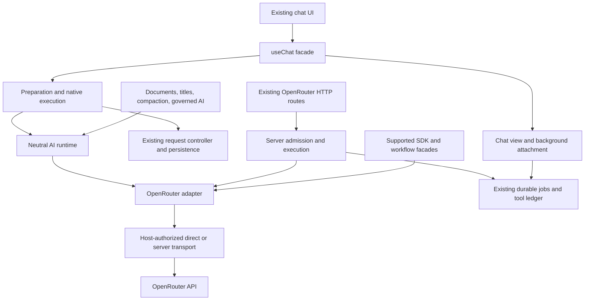

# Design

## Overview

Create a small internal AI operation boundary with one concrete OpenRouter implementation. Keep `useChat` as the public Vue facade, extract its orchestration into focused owners, and preserve the existing request controller, persistence helpers, transcripts, tool ledger, and background job machinery. Migrate callers incrementally through a single implementation; preserve explicitly supported OpenRouter-shaped APIs with delegating facades.

The first delivery is complete when OpenRouter runs through these boundaries with repeatable compatibility evidence. There is no second production router, new settings experience, data migration, SDK replacement, or new deployment surface. Concurrent edits observed during planning already translate the saved `online` choice into a provider search tool; capture and qualify that settled change as the baseline before extraction.

### Research and current ownership

Source paths below are relative to the repository. Line references describe the researched working tree and will move during implementation.

| Evidence | Observation and implication |
| --- | --- |
| E1 — [useAi.ts](../../app/composables/chat/useAi.ts), 4,616 lines | `executeSendMessage` begins at 1947; `runPreparedNative` at 3118; background attachment/reconciliation occupy much of 1078–1838. Request preparation, writes, view state, background recovery, workflow handoff, and execution coexist. Extract by ownership, not arbitrary line ranges. |
| E2 — [requestController.ts](../../app/utils/chat/useAi-internal/requestController.ts) and [chat lifecycle](../../public/_documentation/architecture/chat-lifecycle.md) | The application already has request ownership, terminal finalization, and persisted/streaming states. Keep these; do not build another state machine. |
| E3 — [openrouterStream.ts](../../app/utils/chat/openrouterStream.ts) | Combines provider-body construction, context preparation, direct/proxy HTTP, retry, job admission, polling, cancellation, and browser tool handoff. Provider protocol and host jobs need different owners. |
| E4 — [model-variants.ts](../../shared/openrouter/model-variants.ts), [useChatModelSelection.ts](../../app/composables/chat/useChatModelSelection.ts), [useModelStore.ts](../../app/composables/chat/useModelStore.ts), [server context admission](../../server/utils/chat/context-admission.ts) | Suffix decoding and metadata selection occur in multiple client/server paths. Share router-owned resolution without silently changing selection precedence. |
| E5 — [useAi.ts](../../app/composables/chat/useAi.ts), approximately 2238–2370 | Reasoning is computed before `ai.chat.model:filter:select`, while context/tool metadata is resolved afterward. Missing `supported_parameters` currently allows tools. Both require characterization before consolidation. |
| E6 — [OpenRouter credentials](../../server/secrets/openrouter.ts) and [useUserApiKey.ts](../../app/core/auth/useUserApiKey.ts) | Personal/instance precedence, account vault scope, key format, and Cloud non-disclosure are concrete compatibility contracts. Generalization must not move credentials into model/request objects. |
| E7 — [SSE parser](../../shared/openrouter/parseOpenRouterSSE.ts), [request builder](../../app/core/auth/openrouter-build.ts), [transcript](../../app/utils/chat/transcript.ts) | OR3 already normalizes events and stores canonical tool/message relationships. These are foundations, not reasons to replace the stream renderer or DB. |
| E8 — [plugin invocation](../../server/utils/plugins/ai/plugin-invocation.ts), [plugin provider](../../server/utils/plugins/ai/openrouter-client.ts) | Governed plugin completions already depend on `PluginAiProvider`. Preserve the budget/permission governor and adapt its provider to the shared inference service. |
| E9 — [workflow gateway](../../../or3-plugin-workflows/src/core/modelGateway.ts) | The installed workflow engine already has `ModelGateway`; its host boundary still exposes an OpenRouter client. Keep that package contract. Do not introduce a competing workflow gateway or require a package release in this phase. |
| E10 — [memory classification](../../shared/projects/memory-classification.ts) | Calls `client.alpha.decisions.create`, not chat completions; has an origin gate, deadline, response validation, and unclassified-fact fallback. Inventory and retain this operation explicitly. |
| E11 — [production chat journeys](../../tests/e2e/production-chat-journey.spec.ts), [chat tools](../../tests/e2e/chat-tools.spec.ts), [Cloud tools](../../tests/e2e/chat-tools-cloud.spec.ts), [connection](../../tests/e2e/openrouter-connection.spec.ts) | Existing real-browser and authenticated server fixtures already retain receipts/screenshots. Extend these owners before creating a new test suite. |
| E12 — [SDK compatibility](../../shared/openrouter/sdk-v1-compat.ts), package.json and bun.lock | Catalog/OAuth and some nonstreaming operations use SDK 1.2.145; chat streaming deliberately uses raw fetch/SSE. Keep the installed SDK and both necessary protocol paths under the adapter. |
| E13 — [request options](../../shared/openrouter/request.ts) and concurrent transport edits | `prepareOpenRouterWebSearch` now removes trailing `:online` and adds `openrouter:web_search` at direct/server/background dispatch. This arrived during planning and is not this plan's implementation. Qualify the final transformation and its admission/usage interaction before extraction. |

### Upstream research, checked 2026-11-02

- OpenRouter distinguishes real catalog variants from request-time routing modifiers. Catalog identity must be preserved when looking up limits and prices; recognized routing modifiers need separate metadata resolution. [Model variant contract](https://openrouter.ai/docs/guides/routing/model-variants/overview).
- `:online` is deprecated in favor of a model-controlled search server tool. These have different execution semantics. Preserve the settled implementation baseline, including the concurrent search migration; do not assume suffix dispatch and tool dispatch are interchangeable. [Online documentation](https://openrouter.ai/docs/guides/routing/model-variants/online), [search server tool](https://openrouter.ai/docs/guides/features/server-tools/web-search).
- Current Nitro and Floor documentation includes priority/flex endpoint eligibility in addition to sorting. Do not replace suffixes with simple `provider.sort` fields and assume equivalent behavior. [Nitro](https://openrouter.ai/docs/guides/routing/model-variants/nitro), [Floor](https://openrouter.ai/docs/guides/routing/model-variants/floor).
- Vercel's AI SDK offers provider registries and a language-model specification. These are credible alternatives for new applications, but adopting them here would also change event, request, retry, and usage behavior. This phase borrows the boundary concept without adding that dependency. [Provider management](https://ai-sdk.dev/docs/ai-sdk-core/provider-management), [custom provider specification](https://ai-sdk.dev/providers/community-providers/custom-providers).
- Vercel's catalog uses fields such as `context_window`, capability tags, and different pricing/reasoning metadata. This confirms why URL substitution alone is insufficient; no Vercel implementation is included. [Gateway catalog](https://vercel.com/docs/ai-gateway/sdks-and-apis/rest-api).

These sources define upstream semantics, not proof of current OR3 behavior. Current behavior must be captured independently. No live inference was run in planning.

## Architecture



### Components and ownership

| Component | Responsibility and proposed placement | Requirements |
| --- | --- | --- |
| C1 — Chat facade/view | `useAi.ts` retains the `useChat` API; a focused owner under the existing `useAi-internal/` directory owns reactive presentation, history subscriptions, and view lifetime. | R1, R5, R10 |
| C2 — Turn preparation | Extract `preparation.ts` in `useAi-internal/` for captured selections, model resolution, prompt/history/media preparation and pre-write hook/admission sequencing. Reuse `messageBuild.ts`, context and project helpers. | R1, R3, R4, R10 |
| C3 — Native turn execution | Extract `send.ts`/`nativeExecution.ts` for durable acceptance and dispatch coordination, and `recovery.ts` for existing native checkpoints. Reuse `requestController.ts`, `foregroundStream.ts`, `retry.ts`, `continue.ts`, and persisters. | R1, R4, R5, R6, R7, R10 |
| C4 — Background attachment | Extract `backgroundAttachment.ts` for attaching an existing tracker to the current view and reconciliation. Existing `backgroundJobs.ts`, persistence and notifications retain durable tracking ownership. | R1, R5, R6, R10 |
| C5 — AI runtime | Small `shared/ai/` contracts plus client composition under `app/core/ai/` and server composition under `server/utils/ai/`. Own operation dispatch through the configured adapter, not chat state or tools. | R2, R6, R9, R10 |
| C6 — OpenRouter adapter | Extend the existing `shared/openrouter/` owner with adapter/selection entry points. Own SDK use, metadata normalization, provider options, request encoding, response parsing, and OpenRouter-specific policies. Reuse current files first. | R2, R3, R4, R6, R9 |
| C7 — Model catalog/selection | Keep `useModelStore` and its current cache ownership; expose normalized descriptors/resolved selections and project legacy catalog shapes at supported boundaries. No second cache or parallel store. | R2, R3, R4, R11 |
| C8 — Host transport/access | Existing credentials, authorization, server routes, origin checks, and bounded HTTP helpers; client/server factories capture authorized IO separately. Extract host job HTTP helpers from `openrouterStream.ts`. | R2, R5, R6, R8, R11 |
| C9 — Integration facades | Existing OpenRouter imports, hooks, routes, trusted provider access, `PluginAiProvider`, and workflow host ports delegate to the new owner where possible and retain narrow documented SDK compatibility surfaces. | R1, R7, R8, R9, R11 |
| C10 — Qualification/docs | Existing test harnesses plus a compatibility receipt and updated public/source documentation. | R1–R12 |

New folders are limited to the shared neutral contract and environment composition roots. Extraction files are justified by the measured responsibilities in E1/E3; do not create a class/service for every helper or wrap stable DB functions. File names can be adjusted to existing conventions, but responsibilities and acceptance conditions cannot be omitted.

### Dependency rules

1. Shared AI contracts import no Vue, Nuxt runtime, Dexie, server credentials, or vendor SDK runtime/types. Promote existing reusable message/event types rather than cloning their definitions.
2. The OpenRouter adapter cannot own UI refs, workspace DB lookup, tool execution, durable job admission, or plugin authorization. It receives prepared data and authorized operation-scoped IO.
3. Core chat/document/title code cannot build OpenRouter URLs, parse SDK objects, append suffixes, or inspect `sk-or-` keys.
4. Runtime factories select the single installed adapter explicitly. A small static composition table is enough; no global mutable registry, plugin registration system, public router setting, or service locator.
5. Compatibility facades may retain OpenRouter names and signatures. They delegate to one implementation and are listed in the import inventory. Actual authentication and explicitly SDK-shaped APIs remain legitimately OpenRouter-specific.
6. Keep server SDK/secret initialization out of static browser bundles. Preserve dynamic loading of heavy document, history, workflow, and rendering code.

## Components and Interfaces

### Neutral contracts

These are design-level TypeScript shapes, not a request to add unused interfaces. Final names reuse existing definitions where possible. Promote `ORStreamEvent`'s current union to a neutral definition with an old-name re-export; preserve event order and payload shape. Similarly extract the vendor-independent parts of current message/model types, keeping old imports as aliases/projections where necessary.

```ts
type CapabilityState = 'supported' | 'unsupported' | 'unknown';

interface ModelRef {
    routerId: string;        // API router, not the model creator
    modelId: string;         // opaque catalog/native identity
}

type ReasoningChoice =
    | { kind: 'default' }    // omission, not an instruction to disable
    | { kind: 'disabled' }
    | { kind: 'enabled' }
    | { kind: 'effort'; value: string }
    | { kind: 'budget'; tokens: number };

interface ModelSelection {
    model: ModelRef;
    routingOption?: string; // opaque adapter-declared option ID
    searchOption?: string;  // separate from routing and OR3 tools
    reasoning: ReasoningChoice;
}

interface ResolvedSelection {
    selection: ModelSelection;
    requestModelId: string; // exact ID that must reach the selected router
    catalogModelId: string; // metadata identity; not interchangeable above
    metadata: ModelDescriptor;
}

interface ModelDescriptor {
    ref: ModelRef;
    name: string;
    canonicalSlug?: string;
    context: { inputAndOutput?: number; maxOutput?: number };
    capabilities: {
        tools: CapabilityState;
        inputModalities?: readonly string[];
        outputModalities?: readonly string[];
    };
    // Retain existing pricing units and optionality; unknown is not free.
    pricing?: ModelPricing;
    options: ModelOptionDescriptors;
}
```

`ModelPricing` retains the current per-token prompt/completion amounts and existing other billing units, with unknown values absent. `ModelOptionDescriptors` contains only controls already needed: supported routing/search options, effort values, optional reasoning budget bounds, enabled/disabled support, existing defaults, and allowed combinations. Do not create a generic form schema. OpenRouter's compatibility presenter continues to produce the current single variant menu and thinking control.

A resolver returns the project's result style, for example `{ ok: true, value } | { ok: false, error: AppError }`, with the existing public failure mapping. No new exception/error framework is required.

```ts
interface AiRuntime {
    listModels(options?: CatalogOptions): Promise<CatalogSnapshot>;
    resolveSelection(input: ModelSelection): Promise<SelectionResult>;
    prepare(request: AiRequest, context: PreparationContext): Promise<PreparedInference>;
    stream(prepared: PreparedInference, context: OperationContext): AsyncIterable<AiEvent>;
    complete(prepared: PreparedInference, context: OperationContext): Promise<AiCompletion>;
}
```

`AiRequest` uses the existing message/content/tool semantic types, plus the resolved selection and existing output allowance. It has no credential, URL, workspace DB handle, or background-job controls. `PreparationContext` passes the captured context policy and cancellation; the host preparation owner retains project validation and the existing explicit lossy-review procedure. `OperationContext` carries the abort signal and captured ownership guard, not a mutable view lookup.

`PreparedInference` is internal and immutable from consumers' perspective. It binds the resolved selection to the final provider body that passed admission. Its encoded body is adapter-owned, is never accepted from a client as trusted, and is not persisted as a new schema. Do not introduce a brand/capability-token framework. Reuse detached request snapshots and existing versioned recovery structures.

### Adapter and transport split

The concrete adapter supplies catalog conversion, selection validation, preparation/encoding, opening an HTTP response, decoding stream/completion data, and provider-error normalization. `AiRuntime.stream/complete` compose these operations. Opening and decoding are separate because the existing server route must continue forwarding raw OpenRouter SSE while the background worker consumes normalized events.

- The static/local factory closes over the existing permitted personal credential and configured base URL. Cloud browser composition uses the existing host routes; it cannot construct server credentials.
- The server factory closes over `resolveOpenRouterCredential` and the route/job's existing authorization. No secret enters `ModelSelection`, `AiRequest`, hooks, durable jobs, or diagnostics through the new interface.
- A host-authorized IO function rechecks the captured origin before every dispatch, including SDK retries. The adapter chooses its fixed/configured endpoint; users cannot submit arbitrary endpoint URLs.
- The existing `/api/openrouter/stream` facade keeps its body envelope, HTTP error statuses, `X-OR3-Stream-Route` marker, and raw SSE response. The browser's selected OpenRouter adapter decodes it as today. Do not add a new SSE protocol or transcode it merely to make the route name generic.
- The server calls the same provider preparation/opening owner as other execution paths, but re-resolves trusted catalog/context facts. Background workers use the same decoder as foreground. Provider-response streams have exactly one consumer.
- Host job admission/status/polling/abort/browser-tool APIs move to a focused host job transport, not into the router adapter. Existing exports from `openrouterStream.ts` can delegate during compatibility cutover.
- Keep existing retry/deadline behavior per operation. Do not apply the chat retry wrapper to titles, plugin completions, or Decisions just because they share the runtime.
- Affordable-reply retries, attribution headers, Anthropic caching, SDK pagination, and provider-specific error interpretation remain in the OpenRouter implementation. The caller still owns no-retry-after-output and job/tool idempotency semantics.

### Model variants and online behavior

There are four independent concepts: opaque model identity, router endpoint selection, router-provided search, and model reasoning. They must not become one universal enum called `variant`.

| Current input/control | Compatibility behavior in this phase | New internal owner |
| --- | --- | --- |
| Plain model with variant Off | Preserve selection semantics: `appendModelVariant(id, 'off')` leaves an already suffixed selection unchanged. A trailing Online hint is still translated at dispatch by the separate search encoder; Off is not strip-all. | OpenRouter legacy selection decoder |
| `modelVariant: online/nitro/floor` | Keep the saved values and one-of menu. Current concurrent source presents Web search for `online`, strips its hint at dispatch and adds the provider search tool; Nitro/Floor retain suffixes. Qualify that final request. | OpenRouter encoder and option presenter |
| `online: true`, no explicit variant | Preserve legacy conversion to the saved `online` option and its qualified search encoding. An explicit `modelVariant` wins. | Legacy input facade |
| `:free` or another genuine catalog identity | Retain its metadata, pricing and capacity identity; never retry as the paid base. | OpenRouter catalog resolver |
| Existing trailing `:thinking` hint | Preserve OR3's existing conversion into reasoning configuration for legacy `useChat` inputs. This is not a universal instruction to strip a catalog ID. | Explicit legacy decoder |
| Reasoning off/default/effort/budget | Preserve omitted versus explicit fields and today's selected-effort restoration. Do not send `effort: none` simply because the old path omitted reasoning. | OpenRouter reasoning policy |
| Unknown suffix or an opaque ID in a different adapter | Preserve the identity and let that adapter resolve or reject it. | Selected adapter only |
| Future router without search/routing options | Return no matching controls and reject an explicit unsupported option. Do not append OpenRouter suffixes or invent an OR3 search fallback. | Adapter capabilities and request validation |

The renderer keeps today's labels and structure. It receives the same effective OpenRouter options through a small presenter. This phase does not enable combined search+Nitro, Exacto, or other new controls, even where upstream supports them. Existing manually supplied IDs are characterized; unrecognized combinations are not silently normalized or newly advertised.

Legacy `:thinking` and a genuine catalog entry with the same suffix can be ambiguous. Keep existing public string-input behavior, introduce explicit catalog/request identities internally, and record the collision as a baseline case. Any change to a working legacy input's interpretation must be a separate defect/behavior decision. Do not use one blanket colon parser across routers.

Capability facts remain tri-state. The OpenRouter adapter explicitly retains current policy for absent tool metadata and current reasoning heuristics; a future adapter receives no such implicit default. A parameter name is evidence about a capability, not authorization to execute a tool. Plugin/instance policy and current origin permission remain separate gates.

Catalog caching stays in existing services/stores. The neutral descriptor is derived at the catalog boundary; compatibility projections are views of that same snapshot. No second refresh loop/cache is added. Preserve fetched timestamps, stale provenance, exact-ID-before-alias policy where currently established, and current forced-refresh coordination.

Search injection must occur once per final request, including follow-up tool rounds, Retry, Continue, affordability retries and background resume. Already-present provider search tools must not be duplicated. Preserve model-controlled search and its separation from OR3 local tools. The search transform must be represented in full-body context admission and measurement/fingerprint inputs. If the concurrent migration transforms the body only after those steps, reproduce and resolve the discrepancy separately before freezing a passing baseline; do not merely move the late transform unchanged into the new abstraction and call it correct.

### Turn ownership and extraction

Keep the current sequence observable through existing hooks and DB boundaries:

1. Admit one operation using `requestController`; capture origin, selected inputs, cancellation and hook-chain ownership.
2. Prepare prompts, projected canonical history, files/project context, model choice and context limits. Preserve the timing of outgoing, model-select, input, and prepare filters.
3. Persist the accepted user turn; publish the existing durable acceptance that clears the matching composer draft. Then create the assistant generation under the same current ownership rules.
4. Preserve post-persistence `ai.chat.send:action:before`, legacy `before_send`, and delegated commit/acknowledgement timing. These hooks are not moved ahead of persistence as a cleanup.
5. Revalidate the final body and ownership, retain native recovery checkpoints, choose the existing eligible foreground/background/workflow path, and dispatch once.
6. Stream/project through existing accumulators and tool execution. Finalize through the current request/tracker/canonical authority before completion effects.

The preparation owner may share pure resolution/hydration functions with Retry/Continue, but their revision claims and history rules remain distinct. Do not force all operations into an oversized mode-switch function.

| Extracted owner | State it owns | State it must not duplicate |
| --- | --- | --- |
| View/history | Current pane/thread projection, subscriptions, tail display and disposal | Durable request result or server job status |
| Preparation | Detached request inputs and preparation outcome | UI loading booleans or DB authority |
| Native execution | Coordination of one already-owned turn | Another request lifecycle or tool ledger |
| Recovery | Existing checkpoint validation/cleanup and safe re-entry | A new persisted recovery schema |
| Background attachment | View subscriptions to a tracker and reattachment coordination | Tracker polling, durable receipts, terminal persistence |

Pass small ports such as `publishAccepted`, `projectTerminal`, and `attachTracker` only where the extracted owner needs them. Preserve callbacks/getters that intentionally observe fresh view state; never replace them with stale destructured values. Keep `originDb`, account/workspace generation, request IDs, and ownership checks request-scoped. `useAi.ts` should become a composition facade, roughly hundreds rather than thousands of lines; no arbitrary LOC threshold substitutes for ownership review.

### Other consumers and compatibility inventory

| Consumer | Cutover approach and preserved distinction |
| --- | --- |
| Foreground, Retry, Continue, native recovery | Shared selection/preparation/inference; existing lifecycle and persistence owners |
| Server stream, durable job/tool loops, delegation preparation/model search | Same adapter, server-owned metadata/auth; retain idempotency and browser handoff |
| Document AI and EditorAutocomplete | Shared inference with existing cancellation, origin checks, request mode and deadlines; no new durable chat behavior |
| HelpChat and compaction | Shared inference without changing system prompts, selected history, JSON validation or compaction confirmation |
| Client/server titles and admin title-model validation | Shared completion/catalog operations; preserve 48-token bound, timeout, explicit reasoning policy and title validation |
| Plugin governed completion | Preserve `PluginAiProvider`, price validation, bounded body, output ceiling, spend ledger and grants; implement its provider through shared inference |
| Trusted `ai.provider()` and workflow server host ports | Retain the explicit OpenRouter client contract and retry guards. Adapter-owned client construction is an intentional escape hatch; never label it portable/router-neutral |
| Installed workflow `ModelGateway` | Reuse the package-owned gateway and existing host ports. Exercise installed-plugin qualification; no vendored package rewrite |
| Project memory classification | Keep a small concrete optional classifier operation selected at composition; move SDK Decisions details into the OpenRouter owner. No generic capabilities bus and no chat-completion substitution |
| OAuth, manual key UI, connection-provider descriptor | Stay explicitly OpenRouter-specific in this phase, with unchanged storage and API contracts |

### Findings requiring reproduction, not assumed bugs

1. **Reasoning/model mismatch:** a model-select filter can change the requested model after reasoning was computed (E5). Reproduce with models having incompatible effort controls. If confirmed, fix resolution ordering in a separate change with before/after evidence and preserved hook timing.
2. **Identity normalization drift:** picker, send, recovery, Continue and server admission use related but nonidentical suffix/alias lookups (E4). Exercise prefixed aliases, catalog variants, stale favorites, legacy thinking and explicit routing combinations before centralizing.
3. **Unknown capability policy:** absence of `supported_parameters` currently enables tools in native send. This may be intentional legacy behavior; record it explicitly. Do not globally flip unknown to false during extraction.
4. **Lifecycle coupling:** attachment and execution state are represented in several booleans/refs around a stronger existing request owner. Verify races before removing any field; some distinguish detached UI from a running durable job.
5. **Final-body drift from concurrent search work:** the observed helper is invoked at HTTP serialization, while admission/measurement can inspect the earlier body. Compare both bodies, repeated tool rounds and stored usage/recovery inputs; a mismatch needs a focused reproducer before claiming an admission bug.

These are source-based risks, not confirmed production defects. Error suppression in teardown/projection is not automatically bad code: distinguish optional UI effects from durable failures before changing it.

## Data Models

No new tables, indexes, DB versions, credential scopes, durable queues, or provider-package schemas.

Preserve existing `model` strings on messages/jobs/checkpoints, `chat-model:<thread>` values, project defaults, favorites, draft fields, global last selection, `defaultModelVariant`, model cache keys/provenance, and account credential identifiers. `ModelRef.routerId = 'openrouter'` is an internal interpretation of existing records during this phase, not a bulk writeback. Do not persist speculative connection IDs before multiple connections exist.

Legacy `OpenRouterModel` shapes remain available to supported SDK/hook consumers as a projection or alias of the same catalog. Transient normalization must not erase fields a documented consumer already receives. Unknown extension fields must be retained at that compatibility boundary where current behavior retains them; do not spread them into the neutral trusted request indiscriminately.

Preserve existing recovery/configuration/history fingerprint algorithms and canonical serialization inputs, including measured-usage prefix/configuration hashes and background admission identity. New neutral wrappers must not leak into those inputs or silently invalidate saved attempts. Compare old-record recovery and candidate-written-record rollback explicitly.

The old and new application must read each other's records written in this phase. Background worker leases, checkpoint versions, tool receipts and wire envelopes remain unchanged. Mixed old/new clients are covered by compatibility fixtures, rather than introducing a dual runtime or migration flag.

## Error Handling

Keep the existing `shared/errors`, `ChatContextAdmissionError`, `SendResult`, and RPC error mapping. Use result values for expected selection/capability failures; catch adapter exceptions at current runtime boundaries and normalize them without exposing raw upstream bodies. Preserve diagnostics metadata and secret scrubbing.

| Failure | Required behavior |
| --- | --- |
| Invalid/unsupported option | Explicit preparation error before paid dispatch; no suffix guessing or feature dropping |
| Missing capacity vs catalog outage | Preserve current distinct metadata/context failure and provider-outage classification |
| Missing/revoked credentials or permissions | Preserve current authorization error; never fall back to weaker access |
| Pre-output retryable HTTP/transport error | Existing bounded retry policy, operation-specific deadlines and cancellation |
| Midstream failure | Preserve accepted partial output and current terminal/recovery behavior; no automatic replay |
| 402 affordability response | OpenRouter's existing conditional single retry only; never a generic router policy |
| Lost background admission response | Same admission ID and bounded recovery; unknown stays unknown when recovery cannot prove the outcome |
| Tool/result persistence uncertainty | Preserve receipts and refusal to repeat consequential work |
| DB failure during acceptance/finalization | Visible failure/recovery, no fabricated success; distinguish transaction AbortError from user cancellation |
| Workspace/project change | Stop or detach according to current ownership; never redirect a write to the new workspace |
| Optional memory classifier failure | Existing unclassified-fact result, with unchanged validation/deadline behavior |

## Testing Strategy

### Baseline and test authoring gate

Before implementation, record source commit plus the relevant dirty diff identity, dependency lock identity, runtime profile, fixture versions and current failures. Use a disposable captured checkout for destructive/restart scenarios and for clean final builds; do not modify the user's working tree to create the baseline. Include relevant user changes only after identifying the intended source snapshot. Do not copy local credentials or personal databases.

Enumerate failure modes first. For each new/changed test state the observable invariant, credible regression, existing coverage gap, and strongest owner boundary. Author necessary coverage before implementation. Prefer extending existing E2E cases. Keep meaningful existing unit/integration tests; add a focused isolated protocol test only for a distinct wire/ordering failure not effectively exercised by E2E. No copied implementation, source-string inventories, private helper assertions, or test-only production switches.

### Compatibility matrix

| Primary owner | Required scenarios | Requirements |
| --- | --- | --- |
| Production chat journeys | Send, busy admission, edit/Retry, Continue, Stop before headers/midstream, reload, pane/workspace changes, drafts, attachments/generated images, reasoning, context refusal/lossy review/compaction, project context and defaults | R1, R3–R6, R10–R12 |
| Connection/browser + server credential tests | OAuth/manual key, reconnect/disconnect, personal/instance/required/override policy, account switch, no browser secret disclosure, stale credential responses | R6, R8, R11 |
| Chat tools browser/Cloud | Client/server/hybrid loop, tool errors/limits, cancellation, permission revocation, lost admission, duplicate handoff, reload/restart, delegation, durable terminal recovery | R4–R7, R10–R12 |
| Model/variant boundary cases | Off/Web search/Nitro/Floor, saved `online` precedence and final tool injection, free IDs, thinking hints, omitted/explicit reasoning, effort restoration, alias conflicts, model-changing filters, cache provenance, unsupported/unknown capabilities | R2–R4, R11 |
| Secondary consumer owners | Documents/autocomplete, HelpChat, titles, compaction, classifier Decisions, governed completion, installed workflows | R7, R9 |
| Protocol/integration owners | Fragmented SSE, malformed/truncated stream, reasoning/images/tool deltas/usage, iterator cleanup, timeout/retry, marked/unmarked 404/405, 402, body limits, upstream abort | R2, R4–R8 |
| Neutral adapter conformance | Non-OpenRouter wire fixture, opaque colon-bearing IDs, unavailable options, normalized events; exercise the same runtime constructor used in production | R2, R3 |
| Builds and performance | Static/server dependency boundaries; browser streaming responsiveness and loading budgets on the same host/profile | R2, R8, R10–R12 |

Receipts compare **outbound requests, observed event order, side-effect counts, saved rows, and UI results**, not LLM prose. Keep prompt/message strings exact where behavior depends on bytes. Normalize nondeterministic IDs/timestamps explicitly while retaining their relationships; do not normalize away model IDs, suffixes, flags, hook ordering, tool counts, usage, errors or terminal states. Never issue duplicate live requests to compare old/new pipelines.

Use synthetic credentials and scripted upstream HTTP for automated qualification. A manual live OpenRouter smoke can supplement protocol confidence if separately authorized, but is not a substitute for deterministic regression proof and must not be reported as performed when skipped.

### Commands and profiles

Run relevant subsets after coherent changes, not the full matrix after each edit. Final cross-cutting qualification includes:

```sh
bun run test:chat-tools
bun run test:integration
bun run test:plugin-compatibility
bun run test:e2e:journeys
bun run test:e2e:chat-tools
OR3_CHAT_TOOLS_JOB_PROVIDER=sqlite bun run test:e2e:chat-tools:cloud
PW_PORT=3127 bun run test:e2e:context
bun run test:full
bun run type-check
bun run build
bun run generate:static
bun run performance:browser:check
bun run check:docs
bun run check:docs:examples
bun run check:repomix-paths
```

Existing connection, model-selection, transport, credentials, document, classifier, and installed-workflow suites must also be selected by the inventory; `test:full` is not a substitute for an E2E scenario excluded by its harness. Confirm the actual named harness and assert required scenarios executed rather than skipped. Extend a canonical harness only when a required case has no supported runner.

Build/type-check commands run in an isolated credential-free checkout with the repository's supported wrappers and a fixed Basic Auth + SQLite + filesystem profile where server features are required. Derive disposable settings from the existing Cloud harness/release configuration, rather than inheriting local `.env` values. The current type-check wrapper forces SSR auth on, so setting `SSR_AUTH_ENABLED=false` is not a static type-check. `bun run generate:static` is the separate static build proof. Clean static generation must not import server-only credentials/SDKs. Build/profile preparation is recorded before commands run.

The Cloud tool harness defaults to an in-memory job provider: the explicit SQLite run is required for persistence coverage. Separate restart/delegation fixtures require their existing harness profiles. Vault integration tests are added when credential composition changes, using disposable fixtures and existing `test:e2e:source-secrets` support; no production vault is involved.

Use the current performance budgets and compare candidate/base on the same host for unexplained failures. Capture request counts and stream/render behavior from the same deterministic fixture; do not add caching or batching based on a guessed performance problem. No CI timeout increases or blanket retries to hide a repeatable failure.

## Design Decisions

1. **OpenRouter-only first.** Select one production adapter at composition. Prove neutrality with a nonshipping fixture, not a speculative second integration. Multiple connections/storage naming are deferred.
2. **Separate protocol from execution.** A router sends/decodes inference; OR3 owns tools, projects, auth, job durability and UI state. This avoids transplanting the current god file into an adapter.
3. **Preserve the qualified wire behavior.** Internally separate features while retaining Nitro/Floor suffix semantics and the settled concurrent Online/search translation. No additional search migration or semantic switch belongs in the structural refactor.
4. **Retain public facades and stored shapes.** Compatibility is explicitly required. Re-exports and projections are acceptable; dual implementations and broad fallback machinery are not.
5. **Use existing request and provider abstractions.** Extend `requestController`, `PluginAiProvider`, and the package-owned workflow gateway; do not unify them into a generalized agent framework.
6. **Keep native and package SDK paths honest.** A trusted raw OpenRouter client API remains OpenRouter-specific. Preserve it and label it accurately rather than returning a fake SDK with partial methods.
7. **Avoid a simultaneous SDK migration.** AI SDK adoption would expand the regression surface beyond modularity. Revisit only after the boundary is qualified and a concrete integration benefits.
8. **Extract in small reversible batches.** Introduce contracts, qualify the concrete adapter, then move execution owners and cut over callers. No runtime A/B path, dual paid dispatch, release tag, or migration flag is needed.
9. **Separate defect fixes.** Reproduce source risks first, fix confirmed touched-path defects with their own evidence/change, then refresh the baseline. Unrelated defects become explicitly scoped follow-up work.

## Risks & Mitigations

1. **Lifecycle regression through extraction:** moving closures can alter ownership or hook timing. Keep current request/persistence authorities, compare durable acceptance and terminal receipts, and qualify one extraction at a time.
2. **Model identity/capability regression:** generic suffix stripping or unknown-capability defaults can select wrong limits, prices or options. Keep identity opaque, adapter-specific decoding and explicit OpenRouter compatibility cases.
3. **Hidden inference bypasses:** documents, Decisions and installed workflows can be missed by a composer-only refactor. Maintain the concrete consumer/import inventory and require a disposition and test owner for every path.
4. **Credential/billing regression:** shared factories can accidentally widen browser access or bypass plugin budgets. Keep the existing resolver/governor authoritative and test real authorization boundaries with disposable credentials.
5. **False confidence from baseline drift or skipped tests:** the checkout is dirty and some E2E profiles are conditional. Record exact source/profile identity, preserve user work, assert scenario execution, and compare against the same captured baseline.
