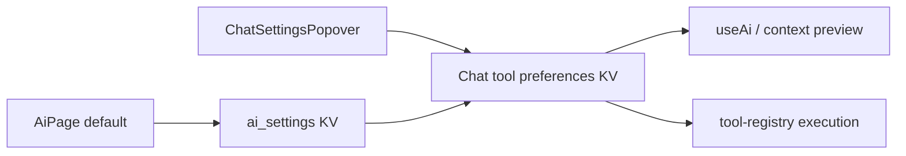

# Design

## Overview
Keep registered tools and their existing global preferences intact. Add a chat-specific master gate and selection backed by existing workspace KV helpers.

## Architecture

- **AI defaults** (R2): useAiSettings and AiPage store a boolean defaultToolsEnabled, false by default.
- **Chat preferences** (R1, R3): a small storage helper and reactive composable read/write one preference per chat or draft owner.
- **Chat controls** (R1, R3): popover changes chat preferences while preserving category switches.
- **Request/execution gates** (R1, R3): request preparation, retry, context preview and execution use the originating chat preferences. Native tool commit transactions include KV so authorization can re-read preferences atomically before writing.

## Components and Interfaces
```ts
interface ChatToolPreferences {
    enabled: boolean;
    tools: Record<string, boolean>; // Missing tool names are selected.
}
```
Use guarded KV writes, captured DB handles, workspace generations and revision checks, following chat model preferences. Keep the master switch separate from individual selections.

## Data Models
Reuse `ai_settings.defaultToolsEnabled`, `chat-tools:<threadId>` and `chat-tools-draft:<ownerId>` KV rows. No database migration, provider schema change or new index is needed. Draft preferences transfer to the new chat at admission.

## Error Handling
Invalid saved preferences fail closed. Failed saves show an inline retryable message and leave durable state unchanged. Writes retain their originating workspace and reject stale revisions. Request configuration is rechecked before admission; execution rechecks tool selection before invoking handlers.

## Testing Strategy
Use the existing chat-tools browser fixture for R1–R3, including captured provider requests and a screenshot/receipt artifact. Run the existing registry/popover/settings suites and one application typecheck. No performance/load work is needed.

## Design Decisions
- Separate the master switch from selected tools so suspension never overwrites the selection.
- Use KV like chat model overrides instead of changing synced thread/provider schemas.
- Chat preferences replace global selection for chat; registry globals continue serving other consumers.
- Preserve unloaded tool entries so temporarily absent plugins retain their selection.

## Risks & Mitigations
- Preview/send mismatch: route both through the same preference model.
- Navigation during save: capture workspace, scope and revision before awaiting.
- Tool calls after suspension: enforce selection at execution as well as advertisement.
- Existing test fixtures assume tools on: explicitly opt tool-execution fixtures into the new default.
