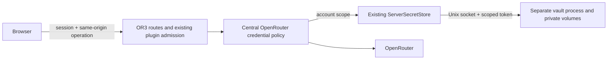

# Design

## Overview
Extend the existing provider and OpenRouter paths. Estimated complexity is high integration effort (roughly 3–5 engineer days): credential policy is small; browser account races, plugin lifecycle and deployment recovery are the substantial parts. No vault protocol change or new permission model is intended.

## Architecture

- Existing ServerSecretStore and managed Compose lifecycle: R1.
- Account credential routes and central resolver: R2.
- useUserApiKey and existing OAuth/UI callers: R3.
- Existing plugin capability admission, budgets and activation authorization: R4.
- Canonical regression suites, real process harness and receipt: R5.

## Components and Interfaces
One server resolver returns `{ apiKey, source: 'personal' | 'server' }` only to server callers. It authenticates and authorizes Cloud use, ignores browser credential headers in Cloud, and applies existing requireUserKey/allowUserOverride configuration. Resolve a personal key only when policy needs it. A provider outage must not become an instance-key fallback. Account credential operations use bounded bodies, no-store, same-origin intent, an expected-account header checked against the authenticated session, and per-user rate limits. Status returns booleans only.

OAuth uses a server-owned PKCE transaction bound to the signed-in account and a private HttpOnly cookie; exchange happens at a fixed upstream endpoint and stores the result before redirecting to the existing callback UI. No client-visible key or session key field.

Cloud ai.provider explicitly returns unsupported. Implement ai.complete through existing activation/grant/governed inference machinery. Local trusted SDK behavior remains. Isolated network access retains containment restrictions; secrets methods retain existing owner scopes.

## Data Models
No application table. Existing vault scope: `{namespace, ownerUserId: session.user.id, workspaceId: '@account', consumerId: '@or3.openrouter'}` and fixed name `api-key`. Plugin consumer identifiers cannot use `@`. Existing revision/tombstone semantics provide compare-and-set import and cross-device deletion markers. No credentials enter sync or workspace exports.

## Error Handling
Missing user credentials: actionable authentication error, never server billing in required-BYOK mode. Selected provider missing/outage/expired service token: sanitized 503, no fallback. Revision races: 409 and explicit retry. Lost import response: fetch status before removing local copy. Account/workspace changes invalidate outstanding browser work. Partial vault initialization or missing key: preserve custody and refuse startup; never auto-repair by generating replacement keys.

## Testing Strategy
Write regression cases before production edits, following test-audit. Central billing matrix and route tests own credential selection/leak protection; browser tests own migration/account races. Existing plugin capability and secret-route suites own activation/grant isolation. Real CLI/socket tests own vault persistence, outage/restart, backup/restore and UID isolation. Compose lifecycle smoke must use only disposable deployments, with a repeatable receipt. No paid OpenRouter calls or live credentials.

## Design Decisions
- Account scope avoids duplicate credentials per workspace while every operation still authorizes its active workspace.
- A tombstone prevents a disconnected account from silently importing stale copies on another device.
- Provider selection does not itself provision a service. Managed deployment must create private volumes, service identity, socket group and app-owned token/configuration; key/database/operator mounts never reach the app.
- Reuse the published 0.1.1 client/protocol and existing vault CLI. If source changes become necessary, coordinate a separate PR without consuming an npm version.
- Backups must include an encrypted vault artifact and its checksum; master-key recovery custody is separate from app backups. App rollback preserves live vault state rather than replaying old upstream credentials. Explicit disaster recovery uses fresh-key restore and new service tokens.
- Stateless/independent multi-host deployments cannot use this Unix vault automatically. Explicit disable allows server-managed-only operation, never browser BYOK.

## Risks & Mitigations
1. Incorrect billing: one resolver plus negative BYOK tests across routes/plugins.
2. Credential disclosure: server-only exchange/resolution, no redirects, no client provider SDK in Cloud; scan synthetic canaries.
3. Account races: capture canonical owner through async operations; do not migrate unowned keys.
4. Custody/recovery regressions: fail on partial initialization, preserve volumes and source, exercise real CLI recovery.
5. Qualification gap: document pinned Bun profile's existing advisory/independent-review/host requirements without claiming production readiness.
