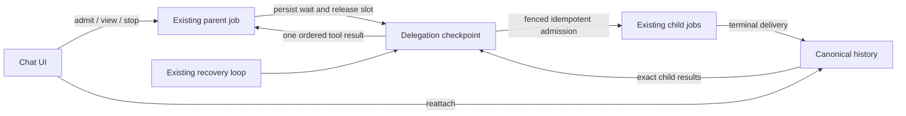

# Design

## Overview

Implement durable delegation as a checkpointed wait inside the existing background job system. Persist the parent/child relationship before launching children, let normal workers execute them, and resume the parent from an authoritative aggregate result. Use one coordinator, one job store, the current canonical sync adapter and current reconciliation loop. No separate queue service or general workflow engine is needed.

This review checked the browser runner, tool loop, job lifecycle, history adapter and installed SQLite provider. Initially qualify SQLite jobs + SQLite sync; additional providers must implement and pass the same contract before advertising support. Browser closure can be transparent. A crash during an upstream operation can leave an unknown outcome and cannot safely promise automatic completion.

## Architecture



| Component | Responsibility | Requirements |
| --- | --- | --- |
| Eligibility + child preparation | Freeze an authorized, server-executable request | R1, R4.AC1, R4.AC4 |
| Delegation coordinator | Admit/reconcile children and settle one parent tool call | R2, R3 |
| Job provider + history adapter | Fenced persistence, canonical delivery and retention | R1.AC2, R1.AC4, R2, R3.AC6, R4.AC6 |
| Activity/tracker UI | Project outcomes, navigate and recover viewers | R1.AC2–AC3, R2.AC2, R2.AC4–AC6, R4.AC2–AC3 |

Source anchors: `server/utils/background-jobs/{types,capabilities,lifecycle,stream-handler,history}.ts`, `server/plugins/25.background-jobs.ts`, `server/utils/chat/{tool-registry,canonical-history-context,project-policy}.ts`, `app/utils/chat/{delegation-tool,delegated-chat-runtime}.ts`, `app/utils/chat/useAi-internal/backgroundJobs.ts`, and `app/components/chat/{DelegatedChatRunner,DelegationActivity}.vue`. Provider changes belong in provider source/packages, never patches to `node_modules`.

## Components and Interfaces

### 1. Eligibility and preparation

| Request/deployment | Version 1 behavior |
| --- | --- |
| Authenticated SSR, qualified persistent SQLite jobs/sync, new project-free text chats, server-executable tools/preparation | Durable delegation |
| Static/local-only, memory jobs, older/unqualified provider | Existing foreground path, visibly requires the browser |
| Project, continuation via `threadId`, browser-only tool or preparation dependency | Foreground limitation visible before execution; durable invocation returns unsupported before child launch |
| Existing interrupted browser receipt | Inspect saved child; never automatically replay |

Add an explicit versioned persistent-delegation capability. `supportsDurableBackgroundJobs()` currently checks method presence and also accepts memory. Check the complete capability set on admission and recovery, including canonical reads and shutdown accounting. Expose capability through the existing runtime discovery path so tool definitions, model instructions and UI agree. Do not add a mode selector or silently remove requested tools to achieve eligibility.

Extract shared server admission/preparation from `startBackgroundStream`. Ordinary and child admission use its policy checks, payload limits, context budgeting, encrypted credential envelope and history construction. Do not call the public HTTP route from a worker or fabricate a session. Derive identity from the persisted parent and current `AuthWorkspaceStore`/`can()` checks, never model arguments. Revalidate canonical project ownership before dispatch and result delivery.

At parent admission, capture bounded effective system/developer context and relevant settings as server-private delegation defaults. Child messages contain that context and the explicit task, not the parent's whole transcript. Reuse pure native preparation; reject required browser hook behavior that cannot be represented. Preserve model/variant/reasoning semantics. Bind child tools to the parent's admitted enabled definitions intersected with currently registered server handlers and permissions; exclude `delegate_chat`. Missing/changed required tools make the child unsupported, not permission to substitute tools.

Share catalog matching between browser and server; server reads the existing catalog service, not Vue stores. Search stays bounded (200-character query, at most 20 results), normalizes names such as “terra 6.1”, preserves variants and rejects ambiguity. Validate the batch envelope first; resolve each child's model/eligibility before admitting it. A bad child returns its own outcome while valid siblings can proceed.

### 2. Persisted wait and provider operations

Proposed shapes, not existing APIs. Store coordination facts; derive running/saving labels from authoritative child state.

```ts
type RetainedToolResult =
  | { kind: 'inline'; value: string }
  | { kind: 'artifact'; reference: string };

type ChildSettlement =
  | { kind: 'complete'; assistantMessageId: string; result: RetainedToolResult }
  | { kind: 'failed' | 'stopped' | 'unknown' | 'unavailable'; code: string };

type DelegationWait = {
  version: 1;
  revision: number;
  callId: string;
  argumentFingerprint: string;
  deadlineAt: number;
  nextCheckAt: number;
  children: Array<{
    kind: 'prepared';
    index: number;
    admissionId: string;
    threadId: string;
    userMessageId: string;
    assistantMessageId: string;
    request: PreparedDelegatedRequest;
    admissionFingerprint: string;
    admission: { body: JsonObject; history: ChatGenerationAdmissionEnvelope };
    jobId?: string;
    settlement?: ChildSettlement;
  } | {
    kind: 'rejected';
    index: number;
    settlement: { kind: 'unavailable'; code: string };
  }>;
};
```

A rejected input has no prepared request or fabricated chat link. `PreparedDelegatedRequest` is bounded shared-preparation output; `RetainedToolResult` uses existing result retention, not another unbounded response copy. The server-private wait retains the prepared body and canonical history inside its existing size limit. Completed results explicitly distinguish inline text from artifact references; an inline answer that resembles a reference remains ordinary text. The provider binds each recorded result or artifact to the child job's exact saved output and parent call identity. The enclosing job owns identity, encrypted credentials, cancellation and tool-loop state. Stable child admission/thread/message identities bind parent generation, call ID and index under user/workspace; never include worker attempt. The prepared checkpoint records a fingerprint of the complete immutable child admission, including history, prompts, settings, tool definitions and encrypted credential envelope. The provider verifies both that fingerprint and the stored body/history before admission, and requires the child's guarded dispatch policy. The coordinator must reconstruct the remaining admission fields deterministically from the parent and snapshot after recovery; a changed payload fails before initial admission as well as on retry. Fingerprints do not authorize execution.

Add a suspend/resume branch in `processToolQueue` before generic server-tool execution. Atomically checkpoint the complete pending tool queue, normalized transcript/ledger, accumulated content and wait, then release the parent's model slot. A generic long-running handler is unsuitable because of its timeout and interrupted-tool replay policy. Only one wait is active per parent; remaining tool calls preserve order.

The persistent provider needs three coordination operations under the new capability:

1. **Claim next due wait:** bounded indexed lookup with an expiring fence; includes outstanding cancellation cleanup even for terminal parents. Model claims exclude waits. Coordinator claims do not reset content or increment model request sequence.
2. **Admit/link child:** one job-store transaction checks parent fence, checkpoint identity, cancellation/deadline and global/user capacity, then creates/finds the child and saves its link. Duplicate lookup precedes capacity rejection. Reuse normal job-creation invariants. Canonical history admission remains a separate idempotent operation.
3. **Commit coordination step:** compare fence/revision; save settlements/next-check, preserve concurrent cancellation, or atomically append the aggregate result, checkpoint the ledger and make the parent runnable. Use this transition for initial parking too.

No transaction spans job and sync stores. A crash between job creation and canonical admission leaves `admission_pending`; existing history reconciliation completes that intent before dispatch. A child cannot run before canonical admission is ready.

### 3. Scheduling, cancellation and bounds

Extend the existing five-second reconciliation loop, bounded page size and idle backoff. Claim due waits, admit available children without waiting for model completion, reconcile results and yield. Index due waits by state/next-check time with stable ordering so blocked parents do not starve others. Persisted scans recover missed wakeups; no correctness dependency on in-memory callbacks.

Parked parents use the existing separate global/user parked-job budget, not model execution slots. Reserve that budget atomically on parking; if full, return capacity before creating children. Children use normal job limits. A one-slot deployment can run four children sequentially; two available slots permit actual overlap. Unadmitted children exist only inside their bounded parent checkpoint. Once settled, parent continuation competes for a normal slot without repeating the tool call.

Persist a non-sliding two-hour deadline from delegation creation. Reconciliation refreshes activity so normal idle cleanup does not prematurely expire a healthy wait, but never extends its deadline. Children retain configured request/job limits. At expiry, one fenced job-store transaction records `expiredAt`, stops admission, marks never-started work unavailable and requests cancellation of active children; retain cleanup intent. Only confirmed cancellation becomes stopped; uncertain upstream work stays unknown. Once these outcomes settle, the parent may resume to summarize them. Storage outages delay reconciliation, not justify invented outcomes. Generic checkpoint writes cannot add or change the expiry marker.

Stop persists intent first. The provider serializes cancellation against admission: either a child exists and is linked for cleanup, or admission is refused. Retry cancellation idempotently even after the parent is terminal. Child Stop affects only that child. Parent failure, deletion or lost execution authorization also ends scheduling and requests cleanup; completed children remain intact. Late child success cannot resume a stopped parent. Viewer disconnect and lost worker lease are not Stop. Recheck the lease/cancellation after asynchronous preparation and immediately before network dispatch; abort an active request on cancellation. An upstream request already accepted may still finish or incur cost, so cancellation is not a refund guarantee.

Shutdown accounting includes waits, cancellation cleanup and pending history. During preparation, reconciliation may finish bookkeeping/history/cancellation but may not admit children or dispatch new model work. A parked parent may therefore block drain; use existing cancel/drain controls rather than bypassing it.

### 4. Safe recovery and uncertain dispatch

Current recovery can reset content and invoke the model again; idempotent admission does not prevent that. Enable a conservative dispatch policy for eligible parents from their initial request and all their children:

- Before each upstream model request, persist a fenced sequence and `dispatch_started` marker. Send only after that write succeeds.
- Atomically replace the marker with the complete iteration checkpoint (including tool calls) or terminal snapshot after recording the corresponding result.
- An outstanding marker on recovery without a committed result becomes typed `ERR_MODEL_OUTCOME_UNKNOWN`: preserve evidence and never resend. A crash between marker and network send is conservatively unknown too.
- Safe checkpoints and unadmitted children recover normally. Preserve the existing tool ledger's refusal to repeat an uncheckpointed side effect.

Reuse serialized typed errors for uncertain local termination, not a global job-status enum expansion. Map uncertainty to unknown in the delegation projection. Viewer SSE/poll failures never write terminal snapshots. A provider timeout after possible dispatch is uncertain unless authoritative rejection/failure is known; provider idle cleanup must preserve this classification too, rather than replacing it with generic failure. Inspect transport wrappers and disable automatic replay under this policy.

Exactly-once upstream billing is not promised. After an unknown child settlement, block further `delegate_chat` calls for the remainder of that parent turn; the parent can still summarize saved results. A new user request is required to retry. This prevents the model from immediately repeating uncertain work under a new call ID, without building semantic deduplication machinery.

### 5. Settlement and client projection

Success requires the exact child's successful terminal snapshot and `historyPhase: committed`. Retain its bounded tool response using the existing artifact helper, then commit its settlement. `finalization_pending` displays “Saving result”; blocked, superseded or tombstoned history becomes unavailable with a reason, never replacement success or model failure. Temporary history errors retry within the wait deadline without replaying the model.

Once all children settle, atomically record one ordered aggregate tool result and bounded child metadata in the parent transcript/ledger, then resume. Preserve successful siblings. Tool settlement means outcomes are available, not that every child succeeded. Canonical parent finalization retains metadata for later devices after job rows expire. The same projection powers single and batch activities; current synthetic batch receipt IDs are not enumerated by the one-receipt UI.

Reuse status/stream authorization, transcript normalization, scoped trackers and NotificationService. During execution use server job projection; after retention use canonical metadata/history. Gate links/responses by originating account/workspace, invalidate in-flight views on switches, ignore stale attempts/revisions and deduplicate notifications by existing job/generation identity. Mobile opens an OR3 workspace tab, desktop retains panes. Legacy receipts are navigation hints: timestamps or partial text do not prove completion.

## Data Models

- Keep versioned waits and dispatch evidence in existing private job execution. Synced activity contains no credentials, prepared prompts or private execution body.
- Add only provider columns/indexes needed for due-wait discovery and parent/child retention/cancellation. Use existing job rows, not another canonical authority. Parent lookup permits cleanup without scanning response bodies.
- Exclude needed child evidence from five-minute terminal cleanup until the parent retains its settlement and finalizes canonical history, or cancels with cleanup/history settled. Unresolved history is a drain/retention blocker, not permission to delete evidence. Preserve bounded payloads and existing operational recovery for stuck records.
- Release holds once canonical metadata/results are durable and cleanup is complete. Reopening uses canonical history, not a permanently growing job table. Never resurrect deleted parent/child content.
- Check versions on every claim. Additive migrations do not make old workers safe: drain them before enabling new checkpoints and prohibit rollback to an unaware worker while such jobs remain. Matching provider artifacts need the documented release workflow; typings/stubs are not support.

## Error Handling

| Failure | Behavior |
| --- | --- |
| Mobile suspend, browser close, lost SSE | Reconnect viewer; server execution continues |
| Duplicate admission/settlement | Reuse identity/result; reject conflicting fingerprint |
| Crash before child creation / before canonical admission | Resume stored intent / reconcile existing child |
| Crash after dispatch marker before saved result | Unknown, no automatic resend |
| Child complete while parent disconnected/stopped | Retain result; resume only an authorized, unstopped parent |
| Full active/parked budget | Bounded admission deferral or explicit capacity result |
| History outage/conflict/deletion | Saving/unavailable; no overwritten history or invented model failure |
| Revoked access, changed project/tool policy, lost credential key | Refuse new work/delivery, retain evidence and perform permitted cleanup |
| Old provider/worker or unsupported call | Refuse before dispatch; no silent durable-to-foreground fallback |

## Testing Strategy

Extend canonical suites, not copies of production logic. Scripted upstream request IDs/counts and barriers prove OR3's dispatch behavior, not the provider's billing internals.

| Scenario | Required evidence | Requirements |
| --- | --- | --- |
| Hold two children at a barrier; second arrives before releasing first | Actual overlap, ordered results; dependent follow-up waits | R1.AC1, R3.AC1–AC2 |
| Close all app pages after admission, release barrier, reopen another context | Parent/children finish while closed; canonical links restore | R1.AC1–AC2, R2.AC1, R4.AC2–AC3 |
| Kill/restart at admission, safe tool checkpoint, terminal-before-settlement | Stable identities, saved outputs reused, one aggregate | R2.AC1, R2.AC3, R3.AC6 |
| Kill after dispatch marker, stale worker still alive, interrupted tool | No automatic repeat, fenced writes, unknown preserved | R2.AC2–AC3, R3.AC6 |
| One slot, full parked limit, mixed outcomes, deadline, Stop/admit race | Bounded progress/cancellation, preserved siblings | R2.AC4, R3.AC1, R3.AC3–AC6 |
| Pass job retention before parent settles; later prune jobs and reopen | No lost result; canonical metadata sufficient | R1.AC2, R2.AC5 |
| History outage, supersession, parent/child deletion | No invented success or resurrection | R2.AC6 |
| Revoke access, switch workspace, change policy, unsupported version | No unauthorized output/dispatch/fallback | R1.AC3–AC5, R4.AC3–AC4, R4.AC6 |
| Unknown/ambiguous models; mobile single/batch taps | Shared resolver and actual workspace-tab navigation | R4.AC1–AC2 |

`test:e2e:chat-tools:cloud` currently uses a memory job provider. Add a persistent SQLite profile with stable temporary databases/encryption key across restart, preserving the existing lane. `test:e2e:chat-delegation:live` currently disables SSR/background entirely; retain it and add an explicit isolated durable profile. Neither existing lane proves durability. Use deterministic fault tests, then one opt-in real-provider smoke for server delegation/browser closure; do not run paid fault-injection loops (R4.AC5).

## Design Decisions

- **SQLite first, explicit capability:** qualify one complete persistent implementation before broadening support; do not assert this already matches the VPS.
- **Checkpoint wait, not a long handler:** avoids browser ownership, handler timeout and consuming the last worker slot, while retaining one recovery loop.
- **Unknown after uncertain dispatch:** stronger idempotency cannot reconstruct an unrecorded external response; stop automatic replay rather than silently paying twice.
- **New children for durable v1:** avoids competing writers/context reconstruction for existing chats. Foreground continuation remains available with an explicit limitation.
- **Canonical history plus temporary job state:** survives retention without permanent duplicate storage or another authority store.

## Risks & Mitigations

1. **Provider package gap:** enable only after real provider-source work and qualified matching artifacts; no installed-file patching.
2. **Preparation/permission drift:** shared pure preparation, explicit eligibility and prompt/settings/tool parity tests.
3. **Hidden request replay:** inspect transport/recovery paths, count attempts in fault tests and preserve uncertainty throughout UI projection.
4. **Cleanup/cancellation races:** test concurrent cleanup, finalization and lease takeover; no premature evidence release or parent resume.
5. **Overstated coverage:** memory, open-page and viewport-only tests do not prove persistence or physical iOS behavior. Record exact artifacts/profile and device limitations.
