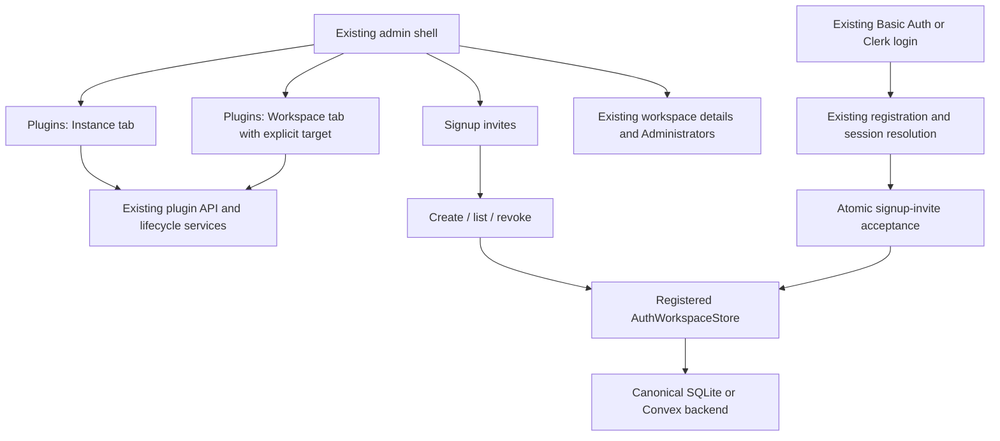

# Design

## Overview

Make three direct changes: remove the Plugins page's instance-level workspace prerequisite, add a signup-invite page, and add one atomic signup operation to each supported canonical provider. Reuse existing authentication and plugin execution paths.

The first draft added a general user directory, a second plugin-page API pair, a pending-credential protocol, default-initialization state tracking, repair screens, and a separate-host configuration feature. Those additions are removed. This plan keeps transactionality, authorization, and compatibility because they prevent duplicate accounts and unintended access.

## Architecture



These are responsibilities inside existing modules, not a requirement to add six new services/classes.

| Component | Responsibility | Requirements |
| --- | --- | --- |
| C1 Existing admin UI | Clearly separate instance and workspace controls | R1, R3, R4, R5, R11 |
| C2 Existing plugin API/lifecycle | Skip unnecessary workspace reads and target actual operations correctly | R2, R3, R4, R11 |
| C3 Invite handlers/helpers | Manage and distinguish signup invitations | R2, R5, R8, R10 |
| C4 Canonical auth store | Store invitations and commit private signup atomically | R6, R7, R10 |
| C5 Existing registration/session flow | Turn authenticated identity plus invitation into canonical access | R6, R7, R8, R11 |
| C6 Focused verification/docs | Prove the changed behavior and explain it | R1–R8, R10–R12 |

## Components and Interfaces

### C1: Keep the current admin structure

- Add `/admin/signup-invites` and a direct sidebar link to existing `/admin/admin-users` labeled Administrators.
- Keep `/admin/workspaces/:id` for members, roles, team invitations, and shared-resource guest access. Add a Manage plugins link.
- Keep `/admin/plugins` with Instance and Workspace tabs. Default super admins to Instance. Use `?scope=workspace&workspaceId=…` for workspace controls; display that target beside them. Restrict the existing selector to this tab and operation dialogs that actually need it.
- Keep existing plugin/rollout query parameters and extension registration behavior. Restricted workspace-admin principals enter their authorized workspace view; this does not grant ordinary owners new admin access.
- Use the query/route target as the authority for workspace requests, key/discard responses by that target, and never substitute the Chat active workspace after a request starts.

No new workspace route hierarchy, route-scope metadata framework, or user-directory API. Extract a Vue component only where it reduces duplication or makes the existing page manageable; do not prescribe a component hierarchy in advance.

### C2: Make the existing plugin API accept an optional workspace

Change `server/api/admin/plugins-page.get.ts` in place:

1. Authorize through `requireAdminApiContext` as today.
2. Load site inventory/policy for the super admin independently of workspace selection.
3. If an explicit workspace is supplied, validate it and load its enablement/grants/setup. For a restricted workspace-admin principal, resolve only its authorized workspace.
4. With no workspace, return an explicit null workspace-state section. Do not convert unknown workspace status into “inactive,” and do not silently use the super admin's Chat workspace.

Update the page and its internal response types together. Preserve the existing endpoint path; do not maintain three versions of the same aggregator. Existing catalog/default/rollout routes already have appropriate instance scope and can be reused.

| Action | Scope handling |
| --- | --- |
| Catalog approvals, package inventory, future defaults | No workspace prerequisite |
| Source install/remove | Instance operation; retain managed-image restrictions |
| V2 preparation, canary, setup, consent, enablement | Request an explicit target when the existing service needs one |
| Workspace data deletion | Explicit authorized workspace |
| Shared promotion | Existing canary and all-enabled-workspace checks |
| Shared rollback/uninstall | Existing global lifecycle with no invented initiating workspace |

For rollback, `package-promotion.ts` already skips local snapshot callbacks when `preflightWorkspaces` is supplied. Narrow its input type so that the global path no longer needs unused initiating-workspace callbacks; keep them required for the local migration path. Reuse the existing rollback review, fingerprint, digest and pointer checks. This does not require a new rollback coordinator.

For uninstall, use the existing server-derived workspace list and `PluginPackageLifecycleService.uninstallPackage`, preserving its package lock, expected digest, disable-before-removal behavior, and retained data. The confirmation must explicitly say it affects the instance. Do not introduce a separate uninstall review protocol merely to remove `resolveAdminWorkspaceTarget`. Zero-workspace instances must work.

Remove misleading initiating-workspace attribution from these two instance mutations. Update the affected typed hook payloads/consumers to allow an absent workspace for an instance event; do not invent an admin event taxonomy or rewrite unrelated hooks. Preserve every current permission, host/origin/intent guard, and post-commit failure boundary.

### C3: A small signup invite surface

Use existing token helpers, `server/auth/registration.ts`, existing admin API helpers, and three handlers under `server/api/admin/signup-invites/`:

| Route | Input/result |
| --- | --- |
| `POST .../create` | Email and expiry; returns public metadata and link/token once |
| `GET .../list` | Bounded page/cursor; returns lifecycle summaries without token/hash |
| `POST .../revoke` | Invite ID; changes only a pending invitation |

Retain the current 72-hour UI default and 30-day maximum. Reuse existing admin rate-limit infrastructure and no-store/origin/intent patterns. Creation is super-admin-only; record the authenticated username instead of fabricating `invitedByUserId` from a workspace owner.

Add one signed token variant using the same HMAC helper and secret:

```ts
type SignupInvitePayload = {
  purpose: 'signup';
  invite_id: string; // CSPRNG-generated 128-bit ID; also makes each token unique
  email: string;
  exp: number;
};

type VerifiedInvite =
  | { kind: 'workspace'; payload: InviteTokenPayload }
  | { kind: 'signup'; payload: SignupInvitePayload };
```

Legacy `{ workspaceId, email, exp }` tokens remain workspace invitations. Validate the new purpose and exact token framing/size; unknown purposes do not fall back to legacy parsing. A random ID makes a separate nonce and new signing-secret family unnecessary. Persist only the token hash.

Keep existing `/?invite=…`, cookie/body handoff and link-origin behavior. The same-origin admin UI assembles the link as it does today and displays the destination; the full token remains a fallback for separately hosted/custom deployments. No new public-origin environment variable is part of this change. Clipboard failure exposes manual copy; a lost create response exposes refresh and revoke/create, not a fake re-copy function.

### C4: Flat optional methods on the existing store

Add optional signup-specific methods to `AuthWorkspaceStore`, following its existing invite naming pattern. A provider advertises support by implementing the complete method set for its active driver. There is no nested V1 capability object, new registry, or separate recovery API.

```ts
interface SignupInviteOperations {
  createSignupInvite(input: {
    id: string; email: string; token_hash: string;
    expires_at: number; created_by_admin: string;
  }): Promise<{ id: string }>;
  listSignupInvites(input: { limit: number; cursor?: string }): Promise<{
    invites: SignupInviteSummary[]; next_cursor: string | null;
  }>;
  revokeSignupInvite(input: { id: string }): Promise<
    { ok: true } | { ok: false; reason: 'not_found' | 'already_used' }>;
  validateSignupInvite(input: {
    id: string; email: string; token_hash: string;
  }): Promise<SignupValidationResult>;
  acceptSignupInviteAndProvisionUser(input: {
    invite_id: string; token_hash: string; provider: string;
    provider_user_id: string; email: string; display_name?: string;
  }): Promise<
    | { ok: true; user_id: string; workspace_id: string;
        workspace_name: string; created: boolean }
    | { ok: false; reason: SignupFailureReason }
  >;
}
// Add these as optional members of AuthWorkspaceStore.
// Reuse current invite failure/status types, adding account_exists if needed.
```

The single acceptance transaction:

1. Read the invite; check hash, normalized email, pending state and expiry. An already accepted invite can replay only for its recorded provider identity, with `created: false` and no writes.
2. Resolve the provider mapping and canonical email. If the identity already has an unrelated canonical account, refuse new signup; do not link identities or create another private workspace.
3. Create the canonical user, provider mapping, ordinary workspace named My Workspace, sole owner membership, and active-workspace pointer.
4. Store the accepted user/workspace/provider result on the invitation and commit together.

An immediate SQLite transaction and a Convex internal mutation own this behavior. Convex keeps trusted-server/subject verification; never accept an arbitrary public caller's provider identity. Do not advertise support on D1 or another driver until equivalent atomicity is proven. Keep old workspace-invite methods and tables compatible.

The result's `created` flag is true only for the commit that created the workspace. Replay never resets a later active-workspace choice, adds memberships, restores a deleted workspace, or trusts the old owner role over current access policy. Concurrent identity creation must resolve through the transaction and existing provider-identity uniqueness, not an earlier host read.

### C5: Keep provider authentication and canonical admission separate

The existing Basic Auth register route validates the invite, writes its credential account/session, and core session resolution performs canonical provisioning. Its ordinary sign-in route verifies the password against the same stable account ID. Clerk already follows a comparable external-identity-first flow. Keep this arrangement.

Extend the shared validation/registration helpers to dispatch by invite kind. For signup invites, use the new atomic store method and its returned workspace. A new canonical user without a valid invite never receives OR3 workspace/data access simply because provider cookies exist. Gate production sync/storage/managed-key routes through their existing canonical authorization; test this boundary.

Recovery is ordinary sign-in:

- Failure before credential creation: retry the signup form.
- Credentials exist but canonical admission failed or the response was lost: sign in with that password, reopen the valid invitation if needed, then refresh the OR3 session.
- Invite expired/revoked before canonical commit: obtain a replacement invite and sign in using the already-created credential account. No account deletion or new password reservation is needed.
- Canonical commit succeeded: the mapping already exists, so normal sign-in works without consuming an invitation again.

Provide a visible Already registered? Sign in action in the invite registration UI, retaining the invitation during that transition. Do not expose an account-enumeration response just to select the UI. An account created before a lost response must not trap the user in a registration-only loop.

This intentionally allows a provider credential account to remain after interrupted or revoked onboarding; it has no newly granted canonical access. Do not describe the credential DB and canonical DB as one transaction. The earlier pending-account schema, activation/finalization handshake, cleanup worker, and recovery dashboard are unnecessary for this access model.

In `open` mode, explicitly provided signup tokens use the invite flow; ordinary registration remains unchanged. In `disabled` mode, deny new admission. Preserve bootstrap and existing-user login. Keep verified-email handling for Clerk and the internal/provider ID split.

Call `provisionWorkspaceDefaults` for a newly created signup workspace, using the existing post-commit repair behavior and hooks. This fixes the path where `getOrCreateDefaultWorkspace()` would now report an already-created workspace and skip defaults. Defaults remain best-effort, as in existing workspace creation: a process crash immediately after the canonical commit may leave them unapplied, and they can be corrected from workspace Plugins. Do not add durable initialization phases or retry defaults on every login. This limit does not affect membership privacy or canonical signup atomicity.

## Data Models

Add **one** canonical `signup_invites` table. Keeping it separate is simpler than rebuilding the old workspace invite table to remove required workspace/role foreign keys, and avoids changing legacy token meaning.

| Fields | Purpose |
| --- | --- |
| `id`, `email`, `token_hash` | Random ID, normalized intended email, unique hash |
| `status`, `expires_at`, `created_at` | Pending/accepted/revoked; expired is derived for overdue pending rows |
| `created_by_admin`, `revoked_at` | Admin attribution and revoke time |
| `accepted_at`, `accepted_user_id`, `accepted_workspace_id` | Atomic result, populated together |
| `accepted_provider`, `accepted_provider_user_id` | Bind replay to the authenticating subject |

Use new snake_case wire/persistence fields. Map Convex's existing timestamp/ID conventions in its adapter. Index primary ID, unique hash, `(created_at, id)` for bounded chronological pagination, and expiry/terminal time for bounded cleanup. Add no email/status-search indexes unless the implementation actually adds those queries.

Keep accepted/revoked/expired history for 90 days, with at most 100 deletions during a create/list maintenance call. No scheduled retention service. Accepted history is not required for ordinary login: its canonical mapping already exists. After cleanup, the old invitation cannot be redeemed again; missing user/workspace records are not recreated by replay.

No Basic Auth schema changes, canonical-user mirror, new Dexie table, default-initialization ledger, or plugin storage model is required.

## Error Handling

| Situation | Behavior |
| --- | --- |
| No super-admin authorization, wrong workspace, cross-origin request | Existing admin/can denial, no mutation |
| Invalid email/expiry or supplied signup workspace/role fields | Strict request validation failure |
| Missing new provider methods | Explicit unsupported response; retain legacy feature support |
| Invalid/revoked/expired/wrong-email signup | Generic public admission error; no new canonical rows |
| Concurrent accept/revoke | Transaction picks one outcome; same-identity accepted replay does not write |
| Credential account exists after interrupted signup | Offer sign-in and valid-invite retry; do not delete accounts across stores |
| Default plugin provisioning fails | Preserve account/workspace; use existing repair/settings UI |
| Global plugin operation changes during execution | Existing locks, digest checks and preflight behavior |
| Copy/create response lost | Manual copy if token is present, otherwise refresh and revoke/create |

## Testing Strategy

Record failure cases first and extend existing suites. Additional isolated tests must be written before the matching production change and own a risk browser E2E cannot reliably exercise.

- **Primary browser proof:** extend `tests/e2e/cloud-sign-in-gate.spec.ts` through `bun run test:e2e:sign-in-gate`. Use an admin-only browser to create a signup invite, then separate desktop/mobile recipient contexts. Verify sole ownership, reload, normal-session cross-user sync/storage denial, interrupted credential-first sign-in retry, and a legacy team invite. Exercise revoked/expired preflight and the race outcome separately.
- **Canonical transaction proof:** extend the SQLite registration suite and Convex's real-function/backend harness for concurrent acceptance/revocation, rollback, same-subject replay, different-subject denial and unchanged old records. Mocked adapters are not transaction proof.
- **Admin/plugin proof:** extend the existing admin-auth/plugin suites for an instance view with no workspace, target-specific controls, null workspace state, and global uninstall/rollback including zero-workspace instances. Reuse `test:e2e:admin-auth` and the relevant named plugin harness; do not run broad credential-writing browser suites.
- **Boundary checks:** focused token/session tests, affected-file Vitest or `bun run test:changed`, `bun run type-check`, relevant provider builds/host-contract checks, isolated static/SSR build checks, and `bun run check:docs`. The admin-auth harness disables sync; real provider/signup cases belong in the sign-in-gate profile.

Retain a short redacted result JSON with commands, host/provider revisions, synthetic workspace IDs, access outcomes, and desktop/mobile screenshots under `test-results/instance-workspace-admin/`. Disable raw traces for sensitive signup portions unless the retained artifacts are redacted; no passwords, invitation tokens or cookies in the evidence. No new evidence framework, general stress suite, or live paid-model call is needed. Qualify actual built provider artifacts because the app consumes `dist/`; unavailable Clerk/Convex proof remains an explicit incomplete item.

## Design Decisions

1. **Correct scope locally.** Tabs, existing routes, and an optional workspace on the current aggregator solve the UI/API coupling without a new scope framework or compatibility API layer.
2. **One new table and five flat methods.** Signup has different ownership semantics from team invites. An additive table avoids destructive legacy migration; methods follow the existing store pattern instead of creating a versioned subsystem.
3. **Canonical transaction is required; cross-store activation is not.** OR3 access already depends on canonical session resolution. Reusing sign-in gives a stable identity and recovery path without pending credential states. A retained provider account after failure is an explicit accepted tradeoff.
4. **Reuse existing post-commit defaults.** Exactly-once plugin default initialization and its repair UI are separate reliability work; signup only needs to invoke the existing helper correctly.
5. **Defer the user directory (R9).** It was inferred scope, not necessary for admin separation or invitations. Existing Administrators becomes directly accessible now.
6. **Keep provider parity, avoid driver speculation.** SQLite/Convex use the same contract. Unsupported drivers fail explicitly rather than adding unproven fallbacks or silently expanding support claims.

## Risks & Mitigations

- **Provider authentication mistaken for OR3 access:** keep canonical authorization as the boundary and prove data-route denial before admission; explain interrupted-signup sign-in clearly.
- **Partial or duplicate canonical signup:** one backend transaction, persisted accepted result, and real concurrency/rollback tests remain mandatory.
- **Global plugin operation still appears workspace-local:** label instance effects, remove only the unrelated target requirement, and retain actual workspace setup/consent/canary checks.
- **Old provider artifacts silently used:** rebuild providers and qualify the artifacts the host loads; do not patch `node_modules` as the implementation or substitute a non-atomic fallback.
