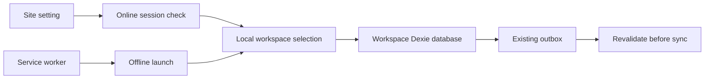

# Design

## Overview

Ship the app files needed for local work during installation. Resume a verified local workspace when disconnected and validate its owner again before sync.

## Architecture

## Components and Interfaces

- **Service worker (R1).** Update the Workbox rules in `nuxt.config.ts` to cover startup modules, bundled local features, workers, and required assets. Provide a neutral shell for offline navigation. A missing optional plugin must disable its own UI safely and allow startup to finish.
- **Local workspace selection (R2).** Extend the workspace bootstrap and route gate with a distinct device-local access state. Accept it only for an unavailable network. A verified denial or a signed-out result takes precedence. Honor read-only roles. Server and provider operations continue to require real credentials and authorization.
- **Workspace storage and sync (R3).** Open the existing Dexie database for the verified scope. Attach write capture before exposing editing. Reuse existing queues, account-scoped drafts, transfers, and idempotent pushes. Revalidate when the network returns, including when it returns during startup.
- **Site configuration (R4).** Resolve the proposed boolean alongside the other Cloud auth settings. Return the effective runtime value during online verification. Use the existing environment configuration path.

## Data Models

One device-local record identifies the last verified account, workspace, local editing permission, and effective offline policy. Store the minimum fields needed to scope local access. Omit credentials and provider session tokens. Invalidate the record on sign-out, verified loss of access, or account change. Fence outstanding writes so an older tab or a delayed response cannot restore a cleared record.

## Error Handling

- Missing or inconsistent local access metadata leads to the existing sign-in flow. Keep workspace data intact.
- A failed session check during reconnection leaves edits queued. A different verified account cannot upload those edits.
- A first installation interrupted before completion finishes on the next online visit. A prior installation remains usable during an update.

## Testing Strategy

- **R1.** Run a production build in mobile Chromium. Close all app pages, clear the ordinary HTTP cache, cut connectivity and launch from the manifest start URL. Exercise a previously unopened editor and an interrupted worker update.
- **R2/R4.** Test owner setting on and off, a fresh profile, sign-out, account and workspace changes across tabs, revoked membership, and a read-only user. Exercise Cloud and local-only builds.
- **R3.** Exercise local workflows through the UI, close and reopen offline, then reconnect to a disposable authenticated Cloud server. Check a second client and the server records for missing or duplicate writes. Include expired credentials and an upload pending at restart.
- Record installation size and requests against the existing production asset budget. Verify the installed Android home-screen flow with airplane mode and a device restart, and identify the actual browser and device used.

## Design Decisions

One environment setting provides owner control without adding interface text. An admin dashboard control could later edit that same setting. Keep the Cloud session separate from permission to work on local copies.

## Risks & Mitigations

- Account changes can mix data. Bind selection, pending writes and reconnect to the originating identity.
- A disconnected device cannot receive a revocation. Apply the owner's updated policy on the next verified connection.
- First-use imports can escape the install cache. Exercise previously unopened features with the network unavailable.
- Mobile browsers can evict site data. Test ordinary app closure and device restart distinctly from an explicit site-data reset.
