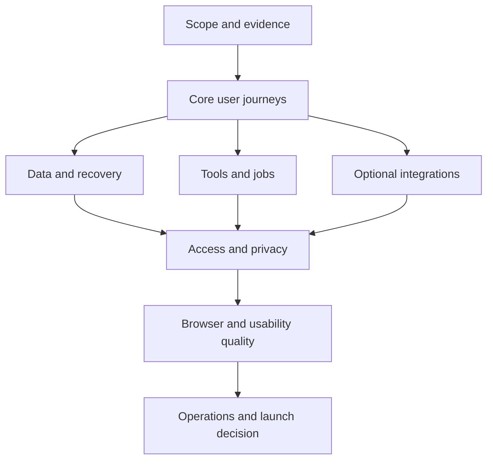

# Design

## Overview

Run [tasks.md](tasks.md) as a release qualification workbook. First freeze the scope and prepare disposable fixtures; then walk the app as a new user, test persistence and failure recovery, qualify optional features, and rehearse operations. Finish on the exact deployed candidate with a second person following the public instructions without coaching.

Each numbered checklist section is a work batch intended to take roughly one to four hours per configuration. Its subordinate cases are independently recorded checks. Split a batch by browser or provider if it exceeds that size. A repair or candidate change invalidates affected evidence and requires the affected journey to be repeated.

## Architecture



| Component | Responsibility | Requirements |
| --- | --- | --- |
| C1 Scope and evidence | Bind cases and results to the launch configuration | R1 |
| C2 Core user journeys | Exercise arrival, accounts, chat, navigation, documents, and projects | R2, R3, R4, R5, R6 |
| C3 Data and recovery | Verify files, backups, origin capture, and sync recovery | R7, R8 |
| C4 Tools and jobs | Verify execution authority, canonical status, and notifications | R9 |
| C5 Optional integrations | Qualify exact plugin packages and external services | R10 |
| C6 Access and privacy | Verify denied access, credential custody, and untrusted-content boundaries | R11 |
| C7 Browser and usability quality | Exercise supported devices, accessibility, and performance | R12 |
| C8 Operations and launch decision | Qualify administration, deployment, public guidance, and sign-off | R13, R14 |

## Components and Interfaces

Use a plain run record; no application code or new tracking service is needed. A local Markdown table, issue tracker, or spreadsheet may implement this structure:

```ts
type CaseOutcome =
  | 'not-run'
  | 'passed'
  | 'failed'
  | 'blocked'
  | 'not-applicable';

interface WalkthroughResult {
  caseId: string; // e.g. 6.4
  outcome: CaseOutcome;
  owner: string;
  recordedAt: string;
  candidate: string; // commit plus build/image digest as applicable
  configuration: string; // mode, provider versions, feature flags, plugins
  browserAndDevice: string;
  roleAndWorkspaceFixture: string;
  observed: string;
  evidence: string[]; // redacted trace, screenshot, command output, restore report
  defect?: string;
  notApplicableReason?: string;
}
```

Keep secrets, bearer tokens, invitation links, private conversations, and unredacted request headers out of evidence. Record model identifiers and request outcomes, not credentials. A checked case means an evidenced pass; mark an excluded case `N/A — reason` instead of checking it as passed. A batch completes only when each case passes or has an approved scope exclusion.

Use these configuration dimensions without running every possible Cartesian combination:

| Dimension | Required coverage |
| --- | --- |
| Product mode | Local/static if shipped; the exact public Cloud stack; each additional advertised stack |
| Account | Fresh visitor, owner, editor, viewer, removed member, separate account, deployment administrator |
| Data | Empty workspace, populated workspace, previous supported version, malformed input, limit boundaries |
| Device | Current supported desktop browsers; real iPhone Safari and Android Chrome if mobile is supported; record versions |
| Runtime | Online, offline, reconnecting, expired session, throttled dependency, server restart |
| Extensions | Disabled, enabled/ready, missing setup, denied capability, incompatible browser, interrupted update |

Run the complete core journey on the primary desktop browser and both supported mobile platforms. Use targeted repeats for alternate themes/browsers. Repeat authentication, sync, file recovery, and background jobs for each advertised backend combination. A Chromium harness does not qualify Safari, Firefox, mobile keyboards, or a real production deployment.

## Data Models

No product persistence changes. Qualification fixtures comprise two accounts, two workspaces with deliberately similar resource names, a second browser/device, role variants, a populated synthetic library, and a manifest of known original file hashes. Local backups, Cloud workspace archives, and operator backups are different artifacts and are restored separately.

## Error Handling

| Failure | Required response |
| --- | --- |
| Missing provider, plugin, browser support, or permission | Block the affected feature clearly; do not count the rest of its journey as passed |
| Failed local save | Retain the draft and show retry/recovery; never infer durability from a spinner disappearing |
| Interrupted transfer or backup | Preserve the source, report incomplete state, and exercise documented retry/restore |
| Lost job transport | Reconcile actual job state; do not infer cancellation, success, or permission to replay a side effect |
| Changed account/workspace/role | Revalidate scope; late completions must not populate a different user's view |
| Failed release gate | Stop promotion, link the defect, repair and repeat affected evidence against the final candidate |

## Testing Strategy

- **Unit and integration:** reuse the existing Bun/Vitest lanes in checklist section 2. They support R3–R11 and R13; they do not replace deployed user acceptance.
- **End to end:** use the named browser harnesses for repeatable scripted failures and artifacts. Run normal production journeys independently with fixture routes disabled. Covers R2–R10 and R12.
- **Manual:** inspect visible behavior, copy, focus, keyboard, touch, role boundaries, document quality, and real provider/model behavior. Covers every requirement, especially R2, R5, R6, R12, and R14.
- **Performance and load:** use repository budgets plus recorded launch traffic, concurrency, recovery, and cost targets. Qualify normal and degraded operation rather than averages alone. Covers R8, R9, R12, and R13.
- **Recovery:** compare metadata and original hashes after local restore, fresh-workspace Cloud restore, and isolated deployment recovery. Covers R7, R8, and R13.

The checklist includes authorized execution planning only. No test suite, live model request, fault injection, account mutation, or release action was performed while authoring it.

## Design Decisions

1. **Follow user journeys before subsystem failures.** A first-time user must reach a saved result before sophisticated recovery tests are meaningful.
2. **Use the exact release boundaries.** Build and package receipts, browser activation, successful feature execution, and deployed provider behavior are separate facts.
3. **Keep optional functionality conditional.** Workflows and External Agents belong to installed packages; portable plugins require their documented browser/runtime. Disabled features still need accurate navigation and retained-data behavior.
4. **Keep release authority in existing guides.** [Cloud updates](../../docs/cloud-updates.md), [Cloud release checklist](../../docs/cloud-release-checklist.md), and [releasing](../../docs/releasing.md) own promotion and rollback procedures. This plan adds product acceptance; it does not replace them.
5. **Resolve documentation differences at the shipped boundary.** In particular, reconcile first-chat draft-clearing copy with current native admission behavior, generic backup instructions with the separate Cloud archive flow, and provider-version prose with the actual published artifacts. Source code establishes behavior; public instructions must then describe it accurately.

## Risks & Mitigations

| Risk | Mitigation |
| --- | --- |
| Qualifying a moving or dirty checkout | Freeze a clean candidate before execution; retain hashes, config, and package versions |
| False confidence from mocks or sibling provider source | Require real deployed provider/package receipts and a small budgeted live-model journey |
| Recovery testing damages useful data | Use disposable fixtures and restore destinations; take a verified backup before any approved destructive rehearsal |
| Scope expands into unqualified features | Freeze the public feature matrix; make unqualified capabilities unavailable and describe limits accurately |
| A very large checklist becomes a checkbox exercise | Record observations and artifacts; prioritize data loss, access, core journeys, and rollback; have an independent tester repeat the final journey |
