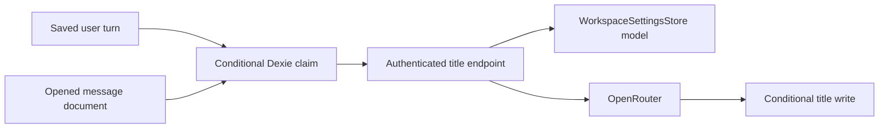

# Design
## Overview
Share backend inference and client atomic admission; retain separate chat/document triggers.
## Architecture

Components: shared/titles defines bounds, title cleanup and preparation (R1,R3); server title endpoint owns credentials and inference (R1,R4); app title runner owns admission and completion (R2); message action and useAi own triggers (R3); Dashboard component owns configuration (R4).
## Components and Interfaces
TitleRequest: type chat|document, content string. Backend accepts entity identity and local-mode model preference, never a Cloud key or Cloud model override.
## Data Models
Optional title_source on existing threads/posts: temporary, generating, generated, heading, manual, failed. No index or Dexie migration. Legacy rows do not opt in. Claims and final writes use existing outbox capture transactions.
## Error Handling
One attempt, no automatic retries. Timeout, reload or credentials failure leaves the fallback; no page-load work. Manual updates supersede generated results. Cloud requires can(workspace.write), same-origin mutation, matching workspace, rate limit and existing credentials.
## Testing Strategy
Real fake-indexeddb owner-boundary races, deferred inference for nonblocking behavior, route credential/permission tests, settings persistence and selected model transport tests (R1-R4).
## Design Decisions
Prefer one bounded attempt over recovery queues. Ambiguous short greetings wait for a later meaningful user turn; no response dependency. Heading extraction avoids inference entirely. Managed administrator setting uses existing private settings authority rather than client-writable KV.
## Risks & Mitigations
Reload loses pending inference: keep fallback and do not replay. Offline cross-device writes use existing LWW sync; same-browser tabs use atomic transactions. Static hosts cannot run inference: retain fallbacks. No paid live calls in automated checks.
