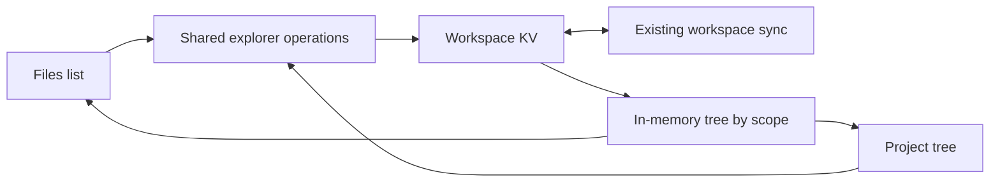

# Design

## Overview

Replace the explorer branch's organization store with small, namespaced workspace KV entries. The app reads the current scope's entries using the existing unique name index, then groups by parent in memory. File and chat metadata still comes from each surface's existing content reader.

## Architecture

## Components and Interfaces

| Component | Responsibility | Requirements |
| --- | --- | --- |
| Organization store in `app/db/explorer.ts` | Encode, read and update only the active scope's folder and placement entries. Reuse the existing workspace guard, KV write transactions and sync conflict handling. | R1, R2, R3 |
| Tree projection in `shared/explorer/tree.ts` | Resolve child lists, breadcrumbs, missing ancestors and cycles. Join placements only to content visible in the current scope. | R1, R2, R3 |
| Projects and Files views | Reuse the existing tree/list, shared interaction composables and virtualized rows. Pass the scope explicitly to the same commands for drag and menu actions. | R1, R2, R3 |
| App availability and transition | Use each surface's ordinary access checks. Bring existing preview organization across when present. Update the guides and docmap. | R2, R4 |

## Data Models

Use a reserved name prefix for Files and a separate prefix for each encoded project ID, terminated with a delimiter. A folder's key includes its stable ID. Its JSON string value holds the display name and parent ID. An item's key includes its kind and stable ID. Its JSON string value holds its parent ID. Root is the default, so a new workspace needs zero seed records. A move to root can write an explicit null parent. Stable keys let concurrent moves of the same item use ordinary KV conflict resolution. Moves of different items update independent keys.

For “Remove folder, keep contents”, mark the folder removed in its value and retain its parent ID. The tree's existing ancestor resolution promotes children for display, including late offline placements. A rename or reparent changes one folder row. Folder metadata never grants access to an item, creates membership, or owns a file blob.

## Error Handling

Reject self/descendant drops, duplicate local sibling names and stale destinations through the shared operations. Validate scoped values on read. A missing or unreadable placement leaves visible content at root. Concurrent cycles use the existing deterministic tree repair for display. Existing sync errors, pending writes and workspace permissions use the same paths as other workspace writes.

## Testing Strategy

Use the existing explorer browser journeys. Cover nested moves, cross-scope isolation, removal with an offline child, workspace switches and a read-only viewer. Run released and updated clients against the same disposable workspace with the provider versions from the released app. Include ordinary backup/restore and the production-scale navigation fixture. Keep traces and measured results. A storage microbenchmark alone cannot establish UI latency.

## Design Decisions

- Retain the project tree and the Files list with breadcrumbs. Share folder data, commands and interaction behavior wherever the two layouts differ.
- Enable the UI in the updated app wherever the underlying Projects or Files surface is available. Remove the explorer-specific checks for new organization writes. Preserve independent catalog, authentication and sync checks.
- Treat preview data as a separate upgrade case. Identify released versus preview formats first. For existing preview data, copy valid records by stable identity with repeatable writes that preserve newer KV edits. Rehearse any workspace that already synced preview posts, including a fresh pull and snapshot, before retiring its old handling.

## Risks & Mitigations

- **Hidden data after an upgrade.** Exercise both a normal released workspace and a populated preview workspace. Check paths, item IDs and content after reload.
- **Old clients stalling.** Prove an old client can push and pull ordinary edits after a new client creates a folder, on both providers.
- **Expensive renders.** Reuse the scoped read and virtualized views. Measure real clicks and folder expansion in a production build.
