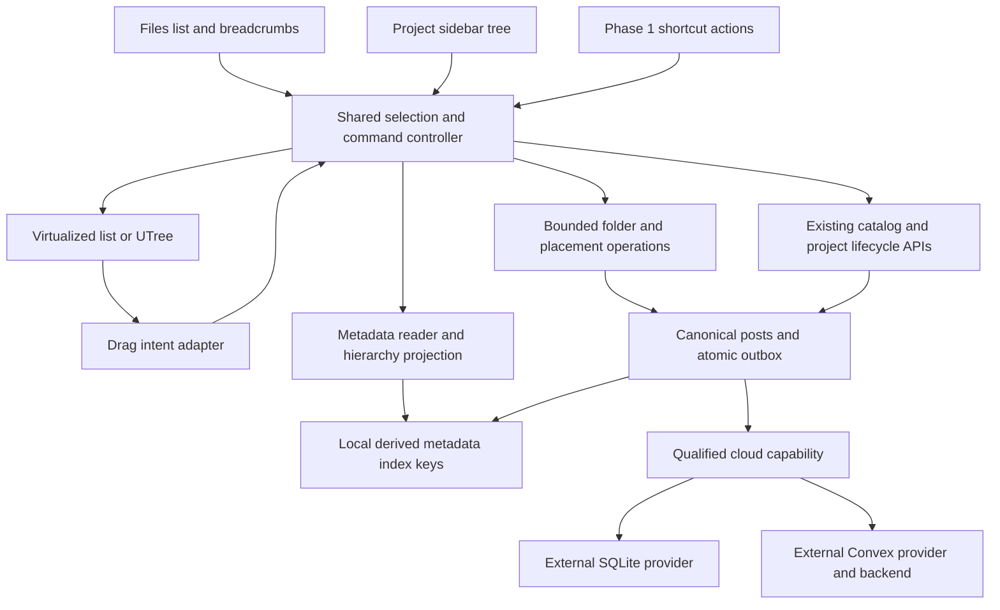

# Design

## Overview

Keep the scoped folder/placement model, but deliver the interaction in two phases. Phase 1 starts with a local/static Files list that has folders, breadcrumbs, explicit destinations, selection, and real moves; its interaction review precedes cloud work. Projects then reuse the same operations/controller with a compact `UTree`. Phase 2 adds Undo, Type sort, the optional Files navigator, and full shortcut trees.

Provider implementation is an external workstream: the authoring workspace contains sibling `../or3-provider-sqlite` and `../or3-provider-convex` clones relative to the host root; neither is part of this repository. Paths below identify inspected integration seams, not files guaranteed in every host checkout. Record provider SHAs and revalidate paths/contracts before editing them. Missing clones block cloud qualification only.

## Architecture



| Component | Responsibility / proposed owner | Requirements |
| --- | --- | --- |
| C1 Record contract | `shared/explorer/records.ts`: validate folder/placement payload and identity. | R1, R7, R8, R9 |
| C2 Organization operations | `app/db/explorer.ts`: scoped, revision-checked folder/placement writes with bounded admission. | R1, R5, R6, R7, R8, R9, R12 |
| C3 Hierarchy projection | `shared/explorer/tree.ts`: resolve effective parents, paths, cycles, and recovery reasons. | R1, R7, R8, R10 |
| C4 Interaction controller | `app/composables/explorer/useExplorer.ts`: selection, destinations, commands, local preferences. | R4, R5, R10, R11, R12 |
| C5 Explorer presentation | `ExplorerTree.vue`, `ExplorerMoveDialog.vue`, existing Files row shell: render the shared state. | R1, R3, R4, R5, R10, R11, R12 |
| C6 Drag adapter | `useExplorerDrag.ts`: pointer/external-file events become validated domain intents. | R3, R5, R11 |
| C7 Project integration | Active sidebar page/shortcuts: eligible project contents and existing membership actions. | R2, R4, R6, R7, R10 |
| C8 Files integration | `WorkspaceFilesPane.vue`: navigation, inspector, existing intake/content actions. | R3, R4, R6, R7, R10 |
| C9 Capability admission | Host and external provider boundaries: version/shape/access checks. | R8, R9, R13 |
| C10 Qualification | Existing browser/provider/docs infrastructure: traceable evidence per phase. | R1–R13 |
| C11 Metadata reader | `app/db/explorer-items.ts` plus existing derived-index hooks: key-only enumeration. | R10, R12 |
| C12 Bulk content executor | Thin composition in existing file/project owners: bounded item-level lifecycle actions. | R4, R6, R9, R12 |

No adapter registry or new service. Keep project/Files shell code in its current owner. Extract only the shared controller, read projection, and concrete operations that prevent duplication.

## Components and Interfaces

### C1: Typed records

Use Zod as existing internal project records do. Serialized fields are snake_case:

```ts
type ExplorerScope = { kind: 'files' } | { kind: 'project'; project_id: string };
type ExplorerItemRef =
    | { kind: 'chat'; item_id: string } // canonical family root
    | { kind: 'document'; item_id: string }
    | { kind: 'file'; item_id: string }; // catalog post ID

type ExplorerFolder = {
    version: 1; scope: ExplorerScope; parent_id: string | null; name: string;
};
type ExplorerPlacement = {
    version: 1; scope: ExplorerScope; parent_id: string | null; item: ExplorerItemRef;
};
type ExplorerRowRef = { kind: 'folder'; id: string }
    | { kind: 'item'; item: ExplorerItemRef };
type ExpectedRecord = Pick<Post, 'id' | 'clock' | 'hlc' | 'content' | 'title' | 'deleted'> | null;
type BulkOutcome = { item: ExplorerItemRef; status: 'done' | 'failed' | 'unattempted'; reason?: string };
```

Scope/item identity is immutable; Files disallows chats. Parent IDs reference folders in the same scope. Unknown-version rows remain intact and uneditable; known-version edits preserve unrecognized fields using the existing internal-record pattern. Local name comparison is `name.trim().normalize('NFC').toLowerCase()`; there is no locale-specific uniqueness database. Creation/rename/move compares against fresh siblings, including projected children of deleted folders. Concurrent duplicates remain separate and display a short stable ID suffix until the user renames/moves them. Creating a default `New folder` chooses the first free numeric suffix; submitting an explicitly entered duplicate refuses rather than silently changing it.

### C2: Operations, budget, and lifecycle

Provide concrete scoped read/create/rename/move/remove helpers. Pass captured `WorkspaceOperationScope`, typed identities, and observed revisions; never accept a replacement tree from the UI. Before write, resolve current membership, destination ancestry, duplicate sibling names, and changed canonical rows. Capture/write through `getWriteTxTableNames` with pending operations/tombstones included, recheck under the transaction, and notify after commit. Async policy hooks and ID hashing happen outside the transaction. Content rename/Trash/source removal remain in existing content owners.

**Admission is explicit, not chunked:**

- Maximum 100 changed canonical records for a new explorer command. A folder move changes its parent row only; its descendants need no rewritten paths. A content move changes its placement. Nonempty folder removal counts all direct child folders/placements, including hidden/trashed ones, plus its tombstone.
- A 600-item move refuses before mutation: `600 items selected. Move at most 100 at a time.` A folder with 2,000 direct records cannot be removed in one operation: show the count and instruct moving children in smaller selections until removal is within budget. Do not partially remove it.
- For sync-enabled scopes, before and within the write transaction, count queued operations with the same statuses/coalescing rules as `OutboxManager.getPendingCount`. Conservatively count proposed distinct `(tableName, pk)` writes. Refuse if projected queue size is at least 500, explaining that sync must catch up before another bulk change. Reuse/extract existing constants; this is explorer admission, not a new global hard queue cap. Existing unrelated writers may still reach the warning threshold.
- Keep the existing outbox's 100-op/2 MiB packing. A local atomic command is not guaranteed to arrive in one network batch; large content rows may require several pushes. Preserve individual oversize-row errors and do not increase wire limits.
- Local/static mode applies the record cap but not a nonexistent cloud queue limit. No new jobs, persisted mutation queue, retry daemon, or automatic chunking.

Remove folder promotes direct children and tombstones the folder atomically. The menu reads `Remove folder, keep contents`. For a nonempty folder, the dialog reads, for example, `12 items and 2 subfolders will move to Files / Research (including 3 items in Trash). No content will be deleted.` Show counts of typed direct entries, not recursively expanded descendants. Empty removal skips confirmation; Phase 1 does not promise undo. Counts/revisions are revalidated before commit.

Project deletion makes its entire organization scope ineligible through the canonical project tombstone. Do not add an O(n) eager metadata deletion cascade. Existing archive/retention rules retain those internal records; no new garbage-collection job is needed. Explicit detach retires only that item's placement through its existing owner; re-association starts at root. Restoring trashed content retains its saved placement and uses C3's effective parent.

### C3: Effective parent and recovery

Only existing catalog/membership/profile readers determine eligible content. Placements grant no membership/access. Unplaced items appear at root. Content title comes from its current canonical item, not a copied placement label. Chat-family branches stay grouped under the root and cannot be moved separately.

Build an iterative parent map from live and retained deleted folder records. Resolve a deleted parent by following its stored parent chain to the first live folder in the same scope. This makes late-arriving children of a removed folder appear beside locally promoted children. Preserve the original pointer; projection does not write a repair.

If an ancestor payload is missing/unreadable, collected by tombstone GC, or belongs to another scope, resolve to root. Detect cycles across live/deleted ancestry; deterministically ignore the parent edge of the lexicographically smallest folder ID in each cycle. Apply the same rule independent of record arrival order. A deliberate Move to… validates against the effective tree and persists a valid live parent.

Each recovered row carries a reason, original parent when known, and effective destination. Example messages: `Research was removed; shown in Files / Contracts`, `The original folder is no longer available; shown in Files`, or `Conflicting folder moves were received; shown at project Alpha root`. Offer `Move within Files…` or `Move within project Alpha…`. Do not merely say “needs attention.” If a deleted parent payload has already been purged, root fallback is an explicit limitation; do not extend retention indefinitely to preserve paths.

### C4–C5: Interaction contract

Both surfaces use the same typed selection IDs and commands. Project trees keep tree semantics; Files uses its list/grid semantics rather than nesting a complete tree inside each list row.

| Input or control | Phase 1 behavior |
| --- | --- |
| Plain click on content | Replace selection with that item and open its existing pane/preview. |
| Ctrl/Cmd click; Shift click | Toggle selection; select anchored ordered range. Neither opens content. |
| Tree folder label/disclosure | Plain label selects and toggles; disclosure only toggles. Modified label clicks only select. |
| Files folder row | Plain click selects/navigates; modified click or checkbox only selects. |
| Checkbox or touch Select mode | Toggle selection without navigation/activation. Toolbar shows selected count, Clear, Select all results, Move, and eligible bulk actions. |
| Drag selected row | Drag normalized current selection, removing descendants of selected ancestors. |
| Drag unselected row | Reset selection to that row and drag only it; suppress activation caused by the drag gesture. |
| Menu on selected row in multiselection | Counted bulk menu; no implicit single-item rename/plugin action. |
| Menu on unselected row | Select it alone and show its normal menu. |
| Enter | Activate focused content or toggle/navigate focused folder as appropriate. |
| Arrows, Home/End, Space | Standard tree/list focus and disclosure; Space toggles selection without opening. Shift+arrows extend the range. |
| F2 | Rename the single selected row; unavailable for multiple rows. Content rename uses its owner and shared-title explanation. |
| Delete/Backspace | Files content: Trash; project content: Remove from project; a single folder: Remove folder, keep contents. Mixed folder/content selection gives an explanation instead of choosing a destructive interpretation. Required confirmations still apply. |
| Cmd/Ctrl+A | Select the complete ordered current result set, including virtual rows. Display bounded-search result counts; never imply selection of undisplayed search matches. |
| Type-ahead | 700 ms buffered prefix match in the current ordered result set; focus/scroll without opening. Space remains selection; editable controls retain text input. |
| Escape | Cancel rename/drag/dialog first; otherwise clear selection. |
| Cmd/Ctrl+Z | No explorer binding in Phase 1. Phase 2 handles only an explorer-owned move/folder-rename receipt while explorer focus is outside inputs. |

Selection is reset on folder/filter/search/sort changes to avoid hidden selected items; it is pruned on live deletion/ineligibility and its anchor resets on result reorder. A plain activation still works when not in Select mode. Touch Select mode persists until Done; tapping a row in that mode changes selection only. Checkboxes remain available through keyboard and pointer as well.

Every dialog/toast/menu names its scope: `Move within Files`, `Move within project Alpha`, `Show in Files`, `Show in project Alpha`. Do not label two independent paths simply “Location.” The preview inspector shows Files location and the relevant associated project locations, with root written explicitly. From a project preview, Show in Files reveals the same content record; it does not relocate it. Trash labels its retained library placement `Files location` and the effective destination `Restores to`; project placement is never substituted. Replace the ambiguous “original location” label: folder renames, moves, or removal can change the retained path, and no historical path snapshot is promised. If retained ancestry is unavailable, show that explicitly with the effective root destination.

`ExplorerTree.vue` supplies stable keys, controlled state, virtualized flattened rows, and valid row `as`/slots so buttons/rename inputs are not nested inside buttons. Cap visual indentation at 48px; retain actual `aria-level`, full path in tooltips/details, and a subtle depth indicator beyond the cap. Full names/paths must be reachable on keyboard focus as well as pointer hover; touch uses the row's details/menu. Use current theme tokens/`v-theme`/overrides and reduced-motion settings.

Move dialog has a search field, ancestor-path result labels, scope root, and `New folder in [highlighted destination]`. Search narrows folder results without losing disabled-target explanations; creating a folder immediately selects it as destination but does not move content until the user confirms. New folder is a separate committed action: cancelling the move leaves that folder in place and never relocates the selected contents. The root destination always remains reachable. Do not introduce another search index for 500 already loaded folders.

Preferences use the existing `useLocalStorage` pattern in `useActiveSidebarPage.ts`, keyed by account/workspace/scope. Store explicit project view choice separately from automatic default; preserve Recently modified as the initial Files sort. Keep active folder/expansion/sort device-local, validate restored IDs, and fall back to memory if storage fails. Selection stays in memory. Dispose subscriptions/timers/drag registrations on scope changes.

### C6: Drag presentation and destinations

Keep the prior proposed framework-independent [Pragmatic drag-and-drop core](https://atlassian.design/components/pragmatic-drag-and-drop/core-package/) plus [auto-scroll](https://atlassian.design/components/pragmatic-drag-and-drop/optional-packages/auto-scroll), subject to a small browser interaction gate. [Nuxt UI's Sortable example](https://ui.nuxt.com/docs/components/tree#with-drag-and-drop) alone does not specify folder reparenting/empty destinations. Use one engine, no React packages or sibling reordering model; pin tested versions during implementation.

Run the initial gate on the actual Files list first, then verify UTree's virtual row lifetime before project integration. Demonstrate unselected-row drag, selection groups, empty/collapsed folders, invalid descendants/duplicate names, 600 ms hover expansion, auto-scroll, cancellation, and focus. Keep passing traces; revise the choice if the gate fails rather than maintaining alternatives.

Files breadcrumb segments are drop targets for their represented folder, including Files root; the project header is always a project-root target even when its tree fills the viewport. Folder rows are targets; content rows are not. Highlight text/icon/outline and announce the exact destination. Persistent headers/breadcrumbs must remain visible during autoscroll. Drag payload IDs/scope tokens are untrusted and resolved against fresh state on drop. Cancel hover timers on exit/unmount.

Files accepts ordinary external files through existing intake with the captured destination. Folder directories refuse explicitly. Project folders/header reject external files with supported alternatives; prevent default browser file navigation even for rejected drops. Internal cross-scope drags also refuse with a scope-specific explanation. Touch uses selection and Move to…; native touch dragging is not a delivery requirement.

### C7–C8: Surface integration and creation destinations

Project Home stays a sidebar page. Explorer is an alternative to Recent activity, not an unconditional replacement. Honor saved preference, otherwise use Recent activity until a live folder exists. Keep brief/Knowledge/Memory/Settings/new-content controls. Reuse canonical chat-family/membership/source/profile readers and existing content activation.

Top-level project New chat/New document/Add file always uses root. In-folder creation is available from the folder's `+`/menu, labeled with its path; capture that destination when invoked, never read current selection later. Preserve existing Knowledge/source behavior for newly created documents. Join placement to the existing transaction where supported; otherwise distinguish committed content from a failed placement and reveal its actual effective location. Do not offer a blind re-create retry.

Phase 1 shortcuts retain current navigation/open rows and receive Move to… through shared actions. Link “Open project Explorer” when deeper navigation is needed. Full nested shortcut trees are Phase 2. Delete the unreferenced `SidebarProjectTree.vue` in the relevant integration change after the quick import/reference check; remove stale comments, not unrelated sidebar code.

Files Phase 1 has breadcrumbs, a folders-in-list view, and existing preview. No navigator at any width. Below 1024px preview is a sheet/modal; at larger widths the existing list/preview split is permitted. Scope-labeled Upload/New folder controls name the current folder. Intake captures that destination, preserves existing catalog deduplication, and reports duplicate reuse with Show in Files. A deleted destination resolves through C3; loss of authorization prevents a new placement.

With any search/type/project filter, switch to flat content results with a Files path column and This folder / All Files toggle. This folder includes descendants and is the initial mode; root means all Files. Hide ordinary folder rows in this result view. Folder-name discovery belongs in Move dialog, not empty folder matches under Images. Project filtering still shows library paths; an optional Show in project action reveals its independent placement. Reveal clears incompatible filters, restores folder browsing, focuses the item, and opens as before. Project search uses project paths and Show in project [name].

### C11: Concrete Files read and rendering strategy

Replace cumulative 50-row Load more with **virtualization over a complete lightweight metadata result vector** for the qualification scale. Do not page full `Post` records and then try to sort their first page. Use the installed virtualizer behind `UTable`/existing `@tanstack/vue-virtual` runtime after verifying the host import; no additional virtualization library is needed. Render fewer than 150 rows including overscan, and scroll the focused identity into view before setting DOM focus.

Extend existing derived-index hooks with one sparse local `posts.explorer_item_key` array:

```ts
type ExplorerItemKey = [
    state: 'active' | 'trash', kind: 'document' | 'file',
    updated_at: number, title: string, id: string,
    original_hash: string, text_coverage: 'none' | 'prefix' | 'full',
    clock: number
];
```

Only eligible `doc`/`or3:file` rows receive a key, using the existing workspace-item visibility/parser rules. Tombstoned or unsupported-format items have no key; logical Trash has a trash key. Empty hash represents a document; do not put document content or its attachment arrays in the key. File catalog entries have one validated original hash. Values are normalized to legal IndexedDB key primitives. File metadata supplies MIME/size/availability through `file_meta.bulkGet` in bounded batches; those rows contain no blob values.

Add the index in the **next unused Dexie version** (30 was current at inspection). Backfill with a bounded cursor over eligible posts inside the upgrade, computing only the derived field. This one-time upgrade reads existing full row values; say so explicitly instead of promising zero body reads during migration. Do not parse bodies, modify canonical timestamps/clocks, download blobs, or enqueue canonical writes. Upgrade failure rolls back and offers retry without deleting the DB. Creating/updating hooks recompute the key for all local writes, remote apply, and restore, independent of sync-capture suppression. Strip the key from sync payloads and revision fingerprints alongside `document_reference_key`; rebuild from canonical fields after restore rather than trust imported keys. Verify old tabs close/reload correctly for the additive IndexedDB version change.

Read `posts.orderBy('explorer_item_key').eachKey(...)` or equivalent **index-key cursor**, following `listDocumentFileHashes`; `filter(...).toArray()` is not a metadata-only substitute. Decode all eligible metadata IDs at the tested 5,000-item scale, resolve file metadata, and join organization in memory. Root's unplaced set is eligible IDs whose effective placement is root (absent row, explicit null, or recovered parent); no scan of body values is required. Project document/file rows reuse this projection; chats keep existing lightweight family readers.

For unfiltered browsing choose direct child folders and contents, then sort each group by Recently modified descending or Name, with name/ID tie-breaks. Type sort is Phase 2. For type/project filters choose the entire eligible metadata result set under the selected scope toggle, omit folders, derive paths, and sort. For **explicit full-text search only**, reuse the existing debounced command-palette coordinator, whose document source does read/parse bodies. Apply folder/type/project eligibility before its result cap; label the capped result set (currently 200) so Select all results is honest. Do not silently downgrade existing full-text search to filename search.

The complete ordered result vector owns range selection, so Shift can include virtual rows not currently mounted. Select all selects this vector, not the DOM or an unloaded page; above-budget mutations are disabled with counts. When records update, recompute relevant metadata/paths without relying on row-count changes. The local index observes title/Trash/updated-at changes; folder records observe paths; file metadata observes MIME/size. Preview/menu activation fetches the actual current content row and revision on demand; mutation revalidates it. Existing visible thumbnail rendering is a separate on-demand path, never a reason for the enumeration reader to fetch blobs; the metadata-only performance probe disables preview/thumbnail requests to measure the reader itself.

This is one justified local index, not another catalog table/cache or new sync authority. If the measured fixture fails, inspect key enumeration, metadata join, sort, or rendering before adding more indexes or changing the storage model.

### C12: Bulk content actions

The selection toolbar and selected-row menus offer Move plus the appropriate content action. Files offers `Move N items to Trash`; Projects offers `Remove N items from project Alpha`. Any selected folder disables these content actions and explains `Select files/documents only` or `Select project contents only`. Users can open a folder, Select all contents, Trash/remove them, then remove the empty folder; no recursive deletion is inferred.

Use existing content policies, document editor settlement, project source unbinding, and chat-family moves. Factor only the necessary preparation/commit seam in those owners to admit the aggregate record/queue budget and recheck inside each item's transaction; do not reimplement lifecycle logic in the controller or await arbitrary hooks inside a write transaction.

Preflight the entire selection and predicted related writes against the 100-record budget. Confirm count and scope, including chat-family effects. Execute admitted items sequentially through existing owning helpers; each item is atomic, the whole content batch is not. Recheck cumulative write count/queue/access before each item. Policy/revision failures can leave that item failed while other eligible items proceed; scope/permission/quota/budget loss stops the remainder as unattempted. Show, for example, `8 moved to Trash, 1 failed, 1 not attempted`, retain failed selection, and retry only unfinished items with fresh admission. No new durable batch job or global rollback is promised. Generic plugin actions remain single-item only.

### C9: Cloud admission and first-use notice

Use a narrow optional `explorerCapability: 'v1'` request field and `capabilities.explorer: 'v1'` advertisement, following existing file-kind/workspace-item capability patterns. Do not bump their existing versions. Update host request types/schemas, gateway requests, push/pull/snapshot, session, and backup paths. Internal types are recognized even if their content is malformed. Check incoming and stored canonical rows, identity/type substitution, deletes, and bare tombstones (reserved identity prefix/type metadata) before admitting data or advancing an incompatible page cursor.

The first folder/placement is a **workspace client-version cutover**. Because sync has one workspace cursor, 426 on an organization page can stop all sync for an outdated client. Before a device/workspace's first organization mutation in Cloud, show a once-acknowledged notice: `Folders require a compatible OR3 version on every device. Older devices may stop syncing this workspace. Removing folders will not reverse this requirement while sync history remains.` Offer Continue/Cancel; Cancel creates nothing. Persist acknowledgement as device-local preference, not another synced record. A device that has seen organization created elsewhere still sees the notice before its own first mutation. Do not claim a readiness check of every device or an automatic downgrade path.

External integration seams inspected in the sibling clones:

- SQLite: `src/runtime/server/sync/sqlite-sync-gateway-adapter.ts` and its capability helpers/host contract fixtures.
- Convex: `templates/convex/sync.ts`/capability helper, `src/runtime/server/sync/convex-sync-gateway-adapter.ts`, and `src/runtime/app/sync/convex-sync-provider.ts`.

Require canonical shape/identity/permission checks in the same transaction as mutation/version allocation; host-only validation is insufficient. Preserve `can()`, tokens, LWW, `op_id`, contiguous versions, tombstones, and snapshot contracts. Providers validate records, not a competing global folder authority: unresolved parents can arrive later and C3 handles them. D1 remains unqualified for this feature. Convex capability must reflect deployed backend/template contract support, not just a new installed package. Provider changes/READMEs/qualification are separate deliverables; provider publication precedes host dependency adoption only when separately authorized.

### Phase 2 behavior

- **Undo (C2/C4/C5):** after a successful organization move/folder rename, show a toast naming scope/destination with Undo. Keep one in-memory receipt until the next such operation, scope change, or reload. Cmd/Ctrl+Z uses the same receipt while explorer focus is outside editors/inputs. Recheck all affected post-operation revisions/parents before the inverse; reject conflicts rather than overwrite. Folder removal and content Trash/remove have no new undo promise.
- **Type sort (C11/C4):** normalize native documents to Document and files to the displayed MIME/category label; stable name/ID ties, folders first only in unfiltered browsing.
- **Files navigator (C8/C5):** optional at 1280px+, reuse shared tree/controller; hide it when preview/list space would create a cramped third column. Folders-in-list and breadcrumbs remain primary everywhere.
- **Shortcut tree (C7/C5):** replace limited shortcut contents with the shared tree only after Phase 1 interaction/performance evidence. Preserve lazy loading, indentation cap, profile gates, and existing open actions.

## Data Models

| Record/index | Identity and content | Persistence |
| --- | --- | --- |
| Folder | `or3:explorer-folder`, `explorer-folder-<uuid>`, versioned folder JSON | Existing synced `posts`; `title` is scope key |
| Placement | `or3:explorer-placement`, `explorer-placement-<sha256>`, versioned placement JSON | Existing synced `posts`; `title` is scope key |
| Metadata key | `posts.explorer_item_key`, tuple specified in C11 | Derived local index only; not synced or an independent authority |
| View/notice preferences | Versioned account/workspace/scope localStorage key | Device-only; no content or secrets |

Scope key is `JSON.stringify(['files'])` or `JSON.stringify(['project', projectId])`. Placement ID hashes `[scopeKey, item.kind, item.item_id]` with existing `shared/runtime-crypto.ts:sha256Hex`, before entering a transaction. Absent placement means root; moving back to root writes null rather than deleting history. Unknown-version rows stay untouched. Every organization record has normal timestamps/clocks/tombstone behavior, empty `file_hashes`, no file ownership edges/Trash namespace, and at most 8 KiB content.

Reuse `[postType+title]` for scoped organization and primary keys for writes. Add the two post types to internal visibility guards across ordinary editors/tools/search/exports. Workspace backup retains canonical records but derives local index keys afresh. The metadata index requires an additive **local** schema version; no provider table or backend schema migration is introduced. This revises the earlier blanket “no Dexie migration” claim to satisfy the concrete metadata-only read requirement.

Deleted folder payloads retain their last parent for ancestor recovery while ordinary retention allows it. Minimal tombstones without payload cannot preserve that chain; root fallback is visible. Project deletion hides its scope without metadata fanout. New associations reset that scope's old placement using normal revision/tombstone rules; content/other scopes remain untouched.

## Error Handling

Use existing `Error & { code }` conventions with application-owned messages via `reportError`; do not add a result framework or expose raw backend diagnostics.

| Failure | Observable outcome |
| --- | --- |
| Invalid/duplicate name | Explain rule/conflicting sibling, retain draft, no write. |
| More than 100 changed rows | Show actual count and smaller-selection guidance before any mutation. |
| Queue would reach 500 | Explain pending count and wait-for-sync action; retain selection; no auto retry job. |
| Stale revision/membership/destination | Abort atomic organization action; refresh and ask for a fresh operation. |
| Folder was removed | Use nearest readable live ancestor, otherwise root; name cause/destination and offer Move to…. |
| Quota/transaction abort | Roll back local organization/outbox together, retain input, show storage guidance. |
| Content batch partially succeeds | Item-level receipt, unfinished selection, retry only unfinished after fresh validation. |
| Workspace/account/role changes | Stop uncommitted writes and remaining batch items; dispose scoped state. |
| Intake saved content but placement failed | Show actual location, preserve bytes/catalog record, offer scoped Reveal/Move. |
| Unsupported client/provider | Explicit update boundary; keep queue/data; first-use notice explains workspace-wide impact. |
| Post-commit notification fails | Keep committed success, separately report notification failure. |
| Local index migration fails | Roll back schema upgrade and retry/reload; never clear data or manufacture an empty successful library. |

## Testing Strategy

Policy attribution is explicit: `or3-chat/AGENTS.md` calls for targeted/risk-based checks. In this authoring workspace, parent `../AGENTS.md` additionally says “Never write unit tests after you write code” and “Highly prefer E2E tests as the sole testing mechanism.” Those parent instructions apply here; they are not text in the host's own file. The previously named `test-audit` skill is an operator-installed skill, not a repository dependency, and is **not a prerequisite for executing this portable plan**. Retain the substantive practice: enumerate failure modes, use browser journeys for behavior, and author any necessary isolated boundary tests before its production change. Do not spend a separate front-loaded phase authoring broad tests before a usable local slice.

1. **Early local slice (R1/R3/R5/R10/R12):** behind temporary `OR3_EXPLORER_DEV` dev/test configuration, require local/static mode with cloud sync disabled. Implement records/index/read path/minimal moves and the real Files list. Capture plain versus modified click, checkbox/touch selection, root/explicit destinations, virtual Shift range, sorting, and valid/invalid drag in a repeatable browser trace before provider work. This is an internal qualification flag removed before Phase 1 delivery, not a new supported production configuration.
2. **Data boundary checks (R1/R6/R8/R12):** extend canonical derived-index/database suites before the relevant code change for key-only reader behavior, schema-upgrade rollback/no outbox, remote/restore recomputation, duplicate-name races, deleted-parent chains/GC/cycles, write caps 100/101, queue projected counts 499/500, and atomic organization failures. Browser receipts prove unchanged content hashes/ownership/source modes.
3. **Bulk lifecycle (R4/R6/R9):** real existing file/project helper paths, editor settlement, policy denial, mixed-folder disable, chat-family write fanout, partial failure, stop-on-revocation/quota, and retry without repeating completed items. Use a 600-item selection and a 2,000-child folder to verify refusal without writes.
4. **UI breadth (R2–R7/R10/R11):** real project sidebar and Files surfaces at 320/768/1440px, 20-level indentation, default-view persistence, full labels/tooltips, filters-as-flat-results, inspector scope labels, Trash location meaning, Move search/New folder, header/breadcrumb drop targets, OS project-drop refusal, keyboard shortcuts, touch Select mode, and extension actions. Chromium plus WebKit drag qualification; successful traces/screenshots retained.
5. **Cloud (R8/R9):** after the local slice review, use disposable Basic Auth + SQLite + filesystem profile and separately qualified Convex direct/gateway backend. Two devices test opposite offline moves, late child under deleted parent, old-client 426 affecting workspace sync, first-use cancellation/acknowledgement, partial push packing, snapshots, and backup restore. Missing external clones/backend prerequisites are an explicit cloud gate, not a reason to delay local UI review.
6. **Scale (R12):** 5,000 metadata items/500 folders/20 depth, production build, recorded reference host/browser, warm-up then 30 interactions; p95 200 ms and <150 mounted rows. Instrument key-only index access to prove browsing never materializes post bodies, separate the one-time migration and explicit full-text/preview paths, and exercise selection across virtual rows. Compare failing performance gates with the base on the same host.
7. **Artifacts/docs (R13):** existing Playwright outputPath/attach pattern; successful traces, screenshots, JSON seed/SHAs/profile/before-after IDs/parents/outcomes/hashes/queue sizes/timing samples. Update docmap and public guides plus external provider READMEs. Phase 2 receives its own acceptance evidence.

Run the smallest relevant suite after coherent batches. Existing host commands include `bun run test:e2e:storage`, `test:e2e:projects`, `test:integration`, `test:plugin-compatibility`, `type-check`, `build`, `generate:static`, `check:docs`, `check:docs:examples`, `test:e2e:sync:cloud`, `test:e2e:file-backup:cloud`, and `test:e2e:workspace-scale`. Bind the local explorer flag/scenarios into the existing named harness or one thin named runner; do not duplicate canonical suites. Run the appropriate local commands early; reserve provider/cloud gates for their phase. New drag dependencies and the local index require affected tests/typecheck/build. Use the fixed production profile for final cloud qualification. Re-read each external provider manifest before choosing its test/typecheck/build commands; do not assume those commands or installed sibling packages exist in a host-only checkout.

## Design Decisions

1. **Virtual metadata vector, not paging full bodies.** Current 50-row paging cannot implement complete folder/name/filter order or virtual range selection. One derived key follows an existing local pattern and avoids an independent metadata table. A local schema migration is necessary and explicit; full-text search remains a separate body-reading operation.
2. **Files list first; navigator later.** Breadcrumbs and folder rows cover all widths and avoid three columns at sidebar/tablet sizes. The shared behavior still supports a later navigator.
3. **Recent defaults preserved.** Existing projects without folders retain activity view; Files retains Recently modified. Explicit per-project preference wins over heuristics.
4. **Scope is user-visible.** Independent placement is retained because ownership/library membership differ, but every action/inspector/recovery label identifies which scope changes. Shared rename is called out.
5. **Local name collisions refuse; synchronized duplicates survive.** This gives normal local behavior without pretending offline devices can enforce global uniqueness or destroying colliding data.
6. **Bounded commands rather than new background infrastructure.** 100 changed records and queue headroom keep organization predictable under existing limits. Very large folder cleanup takes several explicit operations; do not hide that tradeoff. Bulk content actions preserve per-item existing policies and report partial outcomes.
7. **Ancestor recovery while tombstones remain.** Resolving retained deleted-parent chains aligns late remote children with local promotion. After payload retention ends, visible root fallback is the documented limit.
8. **Small shared core, preserved content owners.** Keep internal posts for scoped references and existing membership/content helpers authoritative. No folder permissions, new sync table, or generalized plugin registry.
9. **Local vertical slice precedes cloud admission.** Interaction is the highest delivery uncertainty. The temporary local flag allows review before provider work without exposing unsupported records to cloud clients.
10. **Phase 2 is explicit.** Undo/type sort/navigator/full shortcut trees are useful but not dependencies of the coherent first delivery. No placeholder controls or promised Undo appear in Phase 1.

## Risks & Mitigations

1. **Metadata migration changes local write/read boundaries.** Reuse derived hooks/sanitization, test upgrade rollback and remote/restore rebuilding, exclude the key from revisions, and instrument key-only enumeration. Do not call post-value filtering “metadata-only.”
2. **Interaction drift across rows/tree/touch.** Use the explicit input table and one controller; review the early real Files slice, then add project-tree parity with keyboard/mobile evidence.
3. **Sync bounds or delayed children defeat local intent.** Count actual records/queue slots before mutation, retain existing transport packing, and test ancestor recovery, fanout limits, and partial content results.
4. **First use breaks outdated clients' workspace sync.** Give the one-time scoped notice, qualify old-client read/write boundaries, and require verified backend readiness. No downgrade promise.
5. **External provider work is unavailable or stale.** Track it separately by SHA/backend contract. Continue local UI work while cloud delivery remains explicitly gated; do not fabricate successful provider verification.
