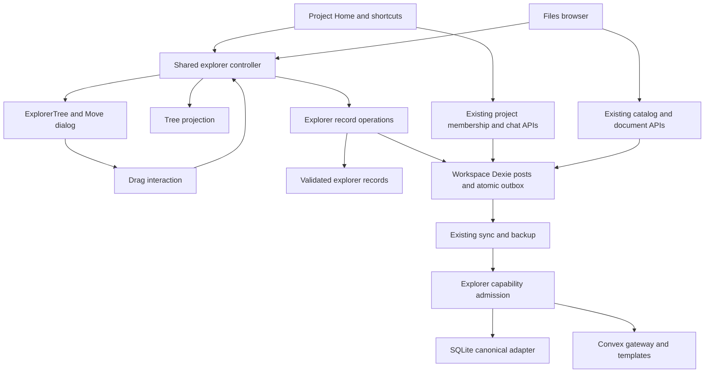

# Design

## Overview

Implement a shared explorer on Nuxt UI `UTree` for project contents and Files navigation. Add two small internal post record types for folders and scoped item placements; existing content, membership, ownership, storage, and sync remain authoritative. Projects hosts the mixed-content tree, while Files reuses its current list/preview/upload shell with a folder navigator and breadcrumbs.

This plan is based on the checked-in source, not the older standalone `SidebarProjectTree.vue`. Relevant owners are `app/components/sidebar/SidebarProjectsPage.vue`, `SidebarProjectsSection.vue`, `app/components/files/WorkspaceFilesPane.vue`, `app/db/project-workspace.ts`, `workspace-files.ts`, `shared/posts/visibility.ts`, and the host/provider sync capability boundaries. New paths below are proposed; existing paths are integration targets.

## Architecture



| Component | Responsibility | Requirements |
| --- | --- | --- |
| C1 Explorer record contract | Validate folder/placement identity and payloads in `shared/explorer/records.ts`. | R1, R7, R8, R9 |
| C2 Explorer record operations | Read/write organization in `app/db/explorer.ts` with existing transaction, scope, and revision contracts. | R1, R5, R6, R7, R8, R9, R12 |
| C3 Tree projection | Derive a reachable display hierarchy from records and eligible content in `shared/explorer/tree.ts`. | R1, R7, R8, R10, R12 |
| C4 Explorer controller | Own scope-local navigation, selection, edit/undo state, and commands in `app/composables/explorer/useExplorer.ts`. | R4, R5, R10, R11, R12 |
| C5 Explorer presentation | Render `app/components/explorer/ExplorerTree.vue` and `ExplorerMoveDialog.vue` with Nuxt UI semantics. | R1, R4, R5, R10, R11, R12 |
| C6 Drag interaction | Translate pointer dragging into validated controller move/upload intents in `app/composables/explorer/useExplorerDrag.ts`. | R3, R5, R11, R12 |
| C7 Project integration | Supply eligible project contents/actions and host the shared tree in the active project components. | R2, R4, R6, R7, R10 |
| C8 Files integration | Supply catalog contents/actions and host folder navigation in `WorkspaceFilesPane.vue`. | R3, R4, R6, R7, R10, R11 |
| C9 Explorer capability admission | Enforce schema/version and workspace access at host and canonical provider boundaries. | R8, R9 |
| C10 Qualification | Preserve repeatable evidence and document feature/provider contracts using existing test/docs infrastructure. | R1–R13 |

Keep C7/C8 in their existing owners initially. Extract a surface-specific helper only when necessary to keep those owners readable; do not add an adapter registry, new service, or generic CRUD framework.

## Components and Interfaces

### C1: Typed domain boundary

Use Zod for persisted payloads and validation, matching `shared/projects/workspace.ts`. Use snake_case for serialized fields. The following TypeScript describes the intended contract, not a new public SDK API:

```ts
type ExplorerScope =
    | { kind: 'files' }
    | { kind: 'project'; project_id: string };

type ExplorerItemRef =
    | { kind: 'chat'; item_id: string } // canonical chat family root
    | { kind: 'document'; item_id: string }
    | { kind: 'file'; item_id: string }; // catalog post ID, never a blob hash

type ExplorerFolder = {
    version: 1;
    scope: ExplorerScope;
    parent_id: string | null;
    name: string;
};
type ExplorerPlacement = {
    version: 1;
    scope: ExplorerScope;
    parent_id: string | null;
    item: ExplorerItemRef;
};
type ExplorerRowRef =
    | { kind: 'folder'; id: string }
    | { kind: 'item'; item: ExplorerItemRef };
type ExpectedRecord = Pick<Post, 'id' | 'clock' | 'hlc' | 'content' | 'title' | 'deleted'> | null;
type ExplorerChangeError = Error & {
    code: 'invalid-name' | 'invalid-target' | 'conflict' | 'permission-denied'
        | 'scope-changed' | 'unsupported-version' | 'storage-failed';
};
```

The schema forbids chat placements in Files. `parent_id` points only to a folder record in the same scope. Scope and placement item identity are immutable for an existing record. Folder names are separate from `Post.title`, which is reserved for the indexed scope key.

Validate new records strictly. For a record with unknown version or invalid payload, retain the raw row, refuse mutation, and expose an organization warning; do not turn parse failure into deletion. Read known-version records with the existing preserve-unknown-fields approach, and merge fields on save so a narrow edit cannot discard unrecognized data.

### C2: Persistence operations

Provide concrete `readExplorerRecords`, `createExplorerFolder`, `renameExplorerFolder`, `moveExplorerEntries`, and `removeExplorerFolder` helpers. Every write accepts a captured `WorkspaceOperationScope`, scope descriptor, and expected record snapshots for rows being changed. Move accepts row identities plus a destination folder ID or root; it never accepts an entire client-supplied replacement tree.

Operation sequence:

1. Capture the originating workspace/session and resolve input IDs. Prepare content hooks through their existing owner when a content operation is involved; do not execute arbitrary async hooks in a Dexie transaction.
2. Precompute deterministic IDs outside the transaction. Enter `scope.db.transaction('rw', getWriteTxTableNames(..., { includeTombstones: true }), ...)` with posts plus projects/threads needed for membership checks.
3. Recheck scope/access, expected changed rows, scope owner, current membership, and destination ancestry from fresh rows under the transaction. Validate all selected entries before writing any.
4. Remove descendants whose selected ancestor already moves. Update each selected folder's parent or each item's placement record; advance clocks through existing helpers. Write row changes and capture/outbox effects atomically.
5. Publish existing generic post notifications only after commit. A notification failure is reported without pretending an already committed operation failed. The live query supplies the committed tree.

Resolve a missing/deleted destination differently by caller: explicit moves refuse; create/upload integration retains an already saved item at root and reports fallback. Never replay an operation in a new active workspace.

Organization-only operations do not call catalog rename/Trash hooks or alter `file_hashes`. Content rename/trash/remove still route through existing catalog/document/project helpers and extension policies. Do not introduce a new public folder-action registry or silently expand existing plugin payload unions.

### C3: Display projection

Join scoped organization records to eligible content from existing membership/catalog readers. No placement creates membership, makes trashed content visible, or changes permissions. Content with no placement appears at root. Duplicate content references collapse by typed item identity; duplicate names do not collapse. Branch children remain a conversation-family presentation detail, not folder children eligible for independent moves.

Build parent maps iteratively in O(folders + placements + supplied items), avoiding recursion limits. For a missing, deleted, or wrong-scope folder parent, project the affected node at scope root. For each directed cycle, ignore the parent edge of the lexicographically smallest folder ID in that cycle, making the entire component reachable; expose a “Folder location needs attention” indicator on the affected node. All clients use identical ID ordering. Unknown-version organization rows produce a warning and root fallback for readable content, never speculative writes.

This projection handles out-of-order sync pages and concurrent offline moves. It does not claim canonical multi-row atomicity across devices: local batches are atomic, remote records may arrive separately, and existing LWW resolves each row. A user repairs a recovered node with an ordinary explicit move against fresh records. Validate explicit moves against the projected ancestry and persist a legal parent so recovery is not perpetuated.

### C4–C5: Shared interaction and rendering

`useExplorer` consumes the scope and eligible content rows supplied by the surface. It returns visible rows, breadcrumbs, expanded IDs, selected typed IDs, focused ID, pending operation, and direct commands. Surface callbacks activate/rename content through existing owners. Folder commands always use C2.

`ExplorerTree.vue` wraps `UTree`, supplies an explicit stable `get-key`, controlled expansion/selection, and slots for existing item icons/actions/status. It uses flattened virtualized rendering for large trees. Keep expand-chevron activation separate from item activation; content activation must not happen on a disclosure click or selection modifier. Empty folders remain real expandable/drop-target entries. Use the supported row `as`/slot controls to avoid nesting action buttons or rename inputs inside a button. Use semantic tokens, `v-theme`, and `useThemeOverrides()` where the surrounding components do.

`ExplorerMoveDialog.vue` renders the same tree restricted to eligible folders plus a root destination; invalid descendants are disabled. It is also the complete keyboard/touch movement path. Row menus remain available without hover. Visible tree navigation follows Reka's semantics; rename fields suspend tree shortcuts. Files list selection uses the same typed controller state and operations, with list/table semantics appropriate to that view.

Store expansion, active folder, sort, and project view preference with the existing VueUse `useLocalStorage` pattern used by `app/composables/sidebar/useActiveSidebarPage.ts`, under a versioned key namespaced by account/workspace/scope. Existing project expansion is memory-only; this adds persistence explicitly rather than assuming it already exists. Do not sync these UI preferences or store content in them. Validate restored IDs, prune missing entries, and retain usable in-memory navigation if preference storage is unavailable. Selection and the single last move/rename undo receipt remain memory-only. Undo retains before/after snapshots, rechecks all inverse revisions/membership/destinations, and is cleared on scope/account changes; undo is not a second mutation path.

### C6: Drag implementation decision and qualification gate

Nuxt UI supplies tree presentation, selection, and virtualization; its [official drag example](https://ui.nuxt.com/docs/components/tree#with-drag-and-drop) is a Sortable.js integration, not the full folder-management behavior required here. Do not copy its index-based list mutation into persistent data operations.

Use `@atlaskit/pragmatic-drag-and-drop` as the proposed drag interaction dependency, with its [auto-scroll package](https://atlassian.design/components/pragmatic-drag-and-drop/optional-packages/auto-scroll) for viewport-edge scrolling. The [core package supports Vue through framework-independent TypeScript APIs](https://atlassian.design/components/pragmatic-drag-and-drop/core-package/). These dependencies are justified by cross-row targets, external file drops, cleanup, and auto-scroll. Add no React packages, sortable model, hitbox/reorder package, or alternate styling layer. Resolve and pin compatible versions during implementation rather than guessing versions in this plan.

Before persistence/UI integration, qualify a small local browser spike against installed `UTree`: empty/collapsed/root targets, selected folder with selected descendants, nested scrolling, virtualized row mount/unmount, focus after drop, and external file payloads. The spike must demonstrate all these behaviors and produce a trace; otherwise revise this one interaction choice before proceeding. Do not maintain two drag engines or hide failed behavior behind a timeout increase.

Drag data contains only typed IDs and an originating scope token. Treat DOM/dataTransfer payloads as untrusted; validate against fresh controller/domain state at drop. Drops are onto a folder or root, not between alphabetically sorted rows. Show destination outline plus text/icon, selected count, and explicit invalid-target feedback. Hover expansion is 600 ms; cancel its timer when leaving/unmounting. Render pending state until the local transaction commits; avoid a second optimistic tree that must be reconciled. External plain files delegate to C8's existing intake path, capturing destination before asynchronous work.

### C7: Project integration

Add Explorer/Recent activity selection to the existing Project Home content area, keeping brief and new chat/document controls, Knowledge, Memory, and Settings. Reuse project list readers, chat-family grouping, `normalizeProjectData`, canonical ownership resolution, source associations, and workspace-profile visibility. Do not infer project membership from organization records.

Replace the flat child rendering inside expanded Home shortcuts with the same shared tree, preserving their existing lazy-loading boundary and project actions. Do not mount every project's full tree when the sidebar loads. The old standalone `SidebarProjectTree.vue` may be removed only after confirming no runtime/import consumer; do not edit it as the sole implementation.

New project documents continue to use existing Knowledge binding and source modes. Folder selection determines placement only. If the existing create/association helper supports joining a transaction, compose placement into that transaction; otherwise create/associate first, then place and visibly report root fallback if placement fails. Never report total failure and invite duplicate creation when content already committed.

Project detach/delete paths retire the corresponding metadata in their existing owning transaction when feasible. Regardless of delayed cleanup, C3 immediately hides ineligible placements. Re-adding a previously detached item starts at project root: the explicit association path clears an old placement, including a retained tombstone, using a fresh clock. Existing explicit cross-project chat moves retain branch-family semantics and start the family at destination root.

### C8: Files integration

Retain `WorkspaceFilesPane.vue` preview/download/upload/Trash, policy hooks, existing errors, and `useWorkspaceFileActions`. Add a folder navigator, breadcrumb bar, New folder, Move to…, selection controls, and direct child folders in the list. Directory navigation is independent of type/project filters; folders remain navigable when a filter hides their content. Root lists unfiled entries. Search searches the whole Files scope or project scope, clearly labels the scope, and returns paths even when a matching descendant is outside the current folder.

Keep file/document search in the existing command-palette coordinator with its 120 ms debounce and bounded results; add a small local folder-name search over the already loaded folder map. This does not justify a second search engine or searching blob bytes. Derive paths from C3 rather than persisting materialized paths. Content revisions continue to invalidate their existing indexes; folder revisions invalidate computed paths/reveal without reindexing document text.

Handle the existing `recordId` prop by resolving current placement, expanding ancestors, scrolling/focusing, and then following current preview/open behavior. Missing/ineligible targets show an unavailable result. Trash stays a flat recovery view with original location labels; restoring an item retains its placement if valid, otherwise displays root. Removing a folder while items are trashed also reparents those hidden placements, so later restoration has a defined destination.

Uploads capture a destination once. A new upload is cataloged by the existing helper, then placed if still authorized; deduplicated catalog entries keep their prior location and offer Reveal. If the destination disappears, keep the committed record at root with feedback. If access changes, stop subsequent placement. Reject directory drops explicitly rather than importing an arbitrary subset silently. On small screens, put folder navigation behind a button/drawer and retain breadcrumbs and Move to… in the main pane.

### C9: Cloud admission and old-client boundary

Add the narrow optional `explorerCapability: 'v1'` request field and `capabilities.explorer: 'v1'` provider advertisement, following the existing separate `fileKindCapability` and `workspaceItemCapability` patterns. Do not overload or bump existing workspace-item `v1` semantics. The new capability is required because older readers do not recognize the proposed internal post types and must not expose them as ordinary content.

Update host sync types/schemas, gateway provider requests, push/pull/snapshot routes, session capability response, and backup export/restore callers. Add shape/identity validation and an explicit update-required error using the current 426 convention. Detection recognizes both new post types even when content is malformed; incoming puts and stored canonical rows must both be checked, including deletes or attempts to change `post_type` to bypass the guard. Pull/watch/snapshot check before returning the affected page or committing its cursor. A bare tombstone must be classified from its reserved ID prefix or retained canonical type; gating must not depend on a deleted payload still being present.

Implement equivalent checks in `or3-provider-sqlite/src/runtime/server/sync/sqlite-sync-gateway-adapter.ts`, and `or3-provider-convex/templates/convex/sync.ts` plus its helper, `src/runtime/server/sync/convex-sync-gateway-adapter.ts`, and `src/runtime/app/sync/convex-sync-provider.ts`. Native SQLite and Convex must validate within the same canonical transaction as mutation/version allocation, not just at the host gateway. Preserve `can()`, broker tokens, existing LWW, `op_id`, contiguous versions, tombstones, and snapshot ordering. D1 does not gain explorer support as part of this work; reject explorer mutations rather than advertising an unqualified transactional capability.

Canonical validation checks payload shape/size, reserved identity, matching indexed scope key, immutable scope/item identity, forbidden file ownership fields, and workspace permissions. It does not invent a second global tree authority or require every referenced parent/content row to have arrived in the same batch. Missing relationships use C3's deterministic projection; local user operations still validate eligibility and cycle prevention. Providers advertise capability only when installed backend/template support is verified; a new Convex package with an old deployed template must not advertise readiness. Follow the existing backend contract/version check rather than trusting package version alone.

## Data Models

### Existing `posts` records, no new synchronized table

| Record | `postType` locally / `post_type` on wire | `id` | `title` | `content` |
| --- | --- | --- | --- | --- |
| Folder | `or3:explorer-folder` | `explorer-folder-<uuid>` | Serialized scope key | Versioned `ExplorerFolder` JSON |
| Placement | `or3:explorer-placement` | `explorer-placement-<sha256>` | Serialized scope key | Versioned `ExplorerPlacement` JSON |

Use `JSON.stringify(['files'])` or `JSON.stringify(['project', projectId])` as the stable scope key. Hash `JSON.stringify([scopeKey, item.kind, item.item_id])` with the existing SHA-256 utility family for a deterministic placement ID, computed before transactions. Include IDs/prefix rules in provider contract fixtures. A placement is created only on first organization; an absent row means root. Moving a previously placed item to root writes `parent_id: null`, keeping its conflict history instead of removing the row. Resurrecting an explicitly retired placement must compare its tombstone and advance revision through normal helpers.

Every organization row has ordinary Post timestamps, clock/HLC, and tombstone fields. It has empty `file_hashes`, no file ownership/reference edge, and no workspace-item Trash metadata. Limit serialized organization content to 8 KiB; these records contain identifiers/names only. Add both types to `shared/posts/visibility.ts` and reuse the internal-post guard in ordinary editors, search, chat tools, exports, and plugin read/write paths. Workspace backup includes the raw posts; normal content export does not treat them as documents.

Use the existing `[postType+title]` index for exactly scoped folder/placement reads and `id` for mutations. Do not add a Dexie version or backend SQL/Convex table/index for this design. Read each active scope's organization once per live query; use in-memory parent maps for the 5,500-row qualification target. Do not load every project's contents, scan blobs, or create a materialized path cache. If measured limits fail, collect the failing query/render boundary before introducing an index or another storage model.

Folder removal promotes direct child folders and all placements, including hidden/trashed placements, in one local transaction and tombstones the folder. It does not recursively enumerate or mutate content. Local concurrent edits conflict through expected snapshots; remote child edits arriving after deletion remain reachable through C3's root recovery. Folder names allow duplicates deliberately, eliminating destructive merge/overwrite semantics and distributed uniqueness machinery.

## Error Handling

Follow existing typed `Error` objects with `code` (as in `workspace-files.ts`), not a new result framework. Map codes to application-owned text through `reportError`; do not display raw backend exceptions.

| Failure | Outcome and recovery |
| --- | --- |
| Invalid/empty name or target | Keep editor/selection; show inline validation; no write. |
| Stale source/destination revision | Abort the whole local move/removal; refresh observed state; require a fresh user retry. |
| Local quota/IndexedDB abort | Roll back records and outbox together; remove pending state; retain input; use existing storage guidance. |
| Workspace/account/role changes | Abort new writes, clear scoped interaction state, dispose listeners; never replay in the new workspace. |
| Upload succeeds but placement fails | Keep saved content, report root/current location, offer Reveal/Move; do not upload again automatically. |
| Unknown record version or malformed graph | Preserve raw row; refuse edits to unreadable row; show warning and deterministic reachable projection. |
| Remote concurrent movement | Accept existing per-record LWW; redraw winning location; no silent compensating writes. |
| Cloud capability/version rejection | Keep durable local work and expose existing sync failure; explain provider/client update requirement. |
| Missing item or revoked membership | Hide placement and report unavailable on explicit activation; metadata never grants access. |
| Post-commit notification failure | Keep committed UI state and report the notification failure without rolling back successful content. |

## Testing Strategy

Testing is E2E-first and follows `AGENTS.md`: enumerate failures and write any necessary isolated tests **before** implementing their production behavior. No post-hoc unit tests mirroring implementation. Read the `test-audit` skill when authoring tests. Tests must exercise real operation/provider boundaries; do not copy production algorithms into tests.

- **Browser journeys (R1–R7, R10–R12):** extend `tests/e2e/persistent-projects.spec.ts` and `storage-layer.spec.ts` with folder creation, nested moves, selected ancestors/descendants, empty/collapsed destinations, rename/cancel, guarded undo, safe folder removal, project/reference independence, duplicate upload, reload, search/reveal, and retained plugin actions. Exercise actual pointer movement in Chromium and a WebKit run for native drag constraints; keyboard/touch paths cover the same operations.
- **Focused isolation where browsers cannot expose the boundary (R5–R9):** before implementation, extend existing database integration and sync/schema/provider suites with transaction abort, revision conflict, opposite offline folder moves, dangling parents, malformed/new-version records, capability bypass via incoming/stored rows, bare tombstones, and role revocation. Pure graph fixtures may be narrow tests if needed, using fixed expected trees rather than an alternate graph implementation.
- **Real cloud convergence (R8–R9):** two isolated browser contexts/devices against disposable Basic Auth + SQLite + filesystem storage; offline concurrent moves, reconnect, independent records, deletion race, new-device snapshot, stale client refusal, and export/restore into a separate disposable workspace. Repeat provider contract/convergence checks with disposable Convex templates and both gateway/direct transports. Do not use the user's real workspace or paid model calls.
- **Accessibility/responsive (R4, R5, R11):** keyboard tree navigation and rename focus, screen-reader semantics/live announcements, 320/768/1440 widths, light/dark themes, reduced motion, and touch Move to…. Check existing profile restrictions and plugin cleanup on unmount.
- **Performance (R12):** extend the workspace-scale harness with deterministic 5,000-item/500-folder/20-depth fixtures; record host/browser/build, warm-up, p95 across 30 interactions, mounted rows, and network requests. Enforce the stated 200 ms/<150-row bounds; compare base and candidate on the same machine if a gate fails. Virtualization must preserve keyboard focus and drag targets. No speculative optimization before this fixture identifies a failure.
- **Evidence (R13):** attach screenshots, retained traces for successful qualification as well as failures, and a JSON receipt through Playwright `testInfo.outputPath/attach`; include source SHAs for host/providers, seed, scopes, before/after IDs/parents, unchanged content hashes, cloud convergence and backup results, viewport/browser, and timing samples. Retain failed-run evidence separately.

Verification commands to use after coherent batches, not after every edit:

```sh
# or3-chat: focused tests first, then the connected/high-risk lanes once
bun run test:e2e:projects
bun run test:e2e:storage
bun run test:integration
bun run test:plugin-compatibility
bun run type-check
bun run check:docs
bun run check:docs:examples
bun run build
bun run test:e2e:sync:cloud
bun run test:e2e:file-backup:cloud
bun run test:e2e:workspace-scale
```

Add a named `test:e2e:explorer` runner only to bind the new cloud/browser/receipt scenarios that existing runners do not execute; it must invoke canonical suites rather than duplicate them. Its final exact command/profile belongs in the implementation receipt. For affected provider packages run their `bun run test`, `bun run type-check:standalone`, and `bun run build`; SQLite also has `type-check:host-contract`/`test:host-integration`, and Convex has `test:release`/`test:sync-hardening`. Qualify changed contracts/templates through those existing lanes. Build/typecheck with the fixed Basic Auth + SQLite + filesystem profile and managed registration policy for cloud qualification; also verify the host static build remains usable. New dependencies require build/typecheck/affected tests. No release gate or production lifecycle smoke is required for this planning-only change.

## Design Decisions

1. **Internal posts over new tables or nested project JSON.** Existing project settings/sources already use indexed internal posts. Two concrete post kinds avoid a provider table migration and keep independent moves as independent LWW records. A whole tree in `projects.data` would couple unrelated edits; content parent metadata cannot represent independent per-project placement. No physical schema migration is needed.
2. **Shared operations/controller, distinct surface shells.** Projects needs mixed-content tree activation; Files needs preview, filters, and a details list. Sharing the whole shell would grow conditionals and duplicate established owners. Share only behavior that is identical.
3. **Independent scoped references.** Files is a library; project membership and context already have canonical APIs. Folder moves must not become a second ownership API. Cross-scope dragging is excluded until its copy/reference/ownership meaning is separately specified.
4. **Folders first plus explicit sorts, no drag ordering.** Finder/VS Code organization does not require manually ordered siblings. Omitting position ranks removes an unnecessary distributed ordering contract; drag always means move into a container.
5. **Safe folder removal and limited undo.** Promote direct children, retain blobs/content, and confirm the exact action. Current-session move/rename undo provides useful recovery without durable command logs or recursive delete protocols.
6. **Read-time graph recovery over server-side tree transactions.** Offline devices can independently form cycles even with locally valid moves. Deterministic projection provides reachability while preserving sync invariants; canonical providers enforce shape/access, not a competing tree authority. No repair background job is introduced.
7. **New narrow capability over weakening existing guards.** Unknown internal types are unsafe for older readers, including direct Convex clients. Follow existing capability patterns; qualify both providers/templates before exposing Cloud mutations. Existing flat behavior needs no legacy tree implementation or bulk conversion.
8. **Small drag dependency over adopting an entire file-manager library.** Framework-independent drag adapters and auto-scroll address concrete required interactions, while Nuxt UI remains responsible for appearance/accessibility. The browser spike is an implementation gate, not a promise that all libraries compose without testing.

## Risks & Mitigations

1. **Virtualization and dragging conflict with focus/DOM lifetime.** Run the C6 spike first, register targets per mounted row, key by identity, clean up on unmount, and retain WebKit/keyboard evidence before integrating persistence.
2. **Offline edits produce cycles or a parent disappears mid-operation.** Fresh transactional checks for local commands plus deterministic non-writing recovery for synced graphs; prove opposite offline moves, deleted-parent restoration, and snapshot order independence.
3. **Provider package and deployed Convex templates disagree.** Require advertised backend contract support, cover direct and gateway paths, and fail closed for organization mutations. Provider releases precede host adoption when separately authorized; do not publish during implementation verification.
4. **Organization accidentally changes ownership, AI context, or file retention.** Keep placements as metadata with no file edges; route membership/content actions through existing helpers; compare owners, source modes, hashes, and reference counts in receipts.
5. **Large existing UI owners cause duplicate logic or scope leakage.** Share the controller/operations, integrate into active owners only, retain generation/account guards, and verify profile restrictions, stale operations, and disposal in the two real surfaces.
